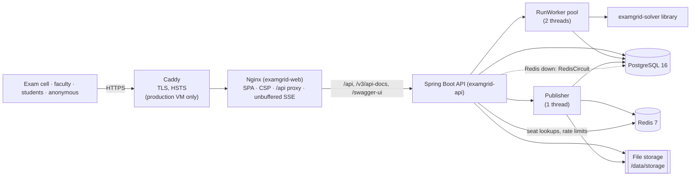
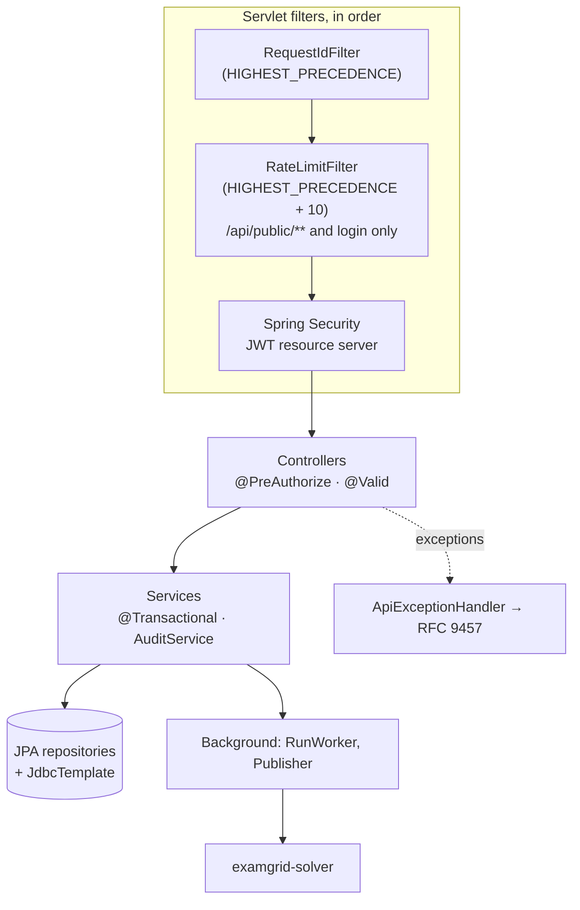
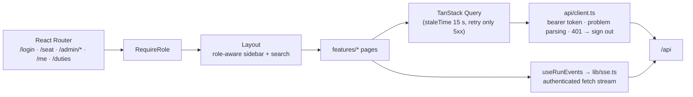
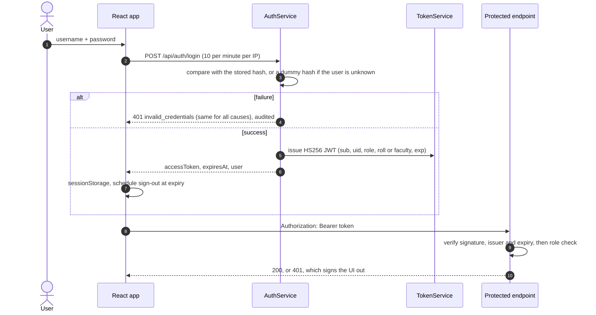

# ExamGrid project bible

> **The single source of truth for ExamGrid.** This handbook is written so that an engineer,
> or an AI assistant with no prior context, can understand the whole project and continue it
> without missing anything. Every statement describes the repository as it is. Anything not
> implemented is marked **pending**. Every number was measured, and its source is named.
>
> Last verified against commit `c38a7a4` on `main` (2026-11-07). When the code changes, update
> this file in the same pull request.

## Contents

1. [Executive summary](#1-executive-summary)
2. [Vision](#2-vision)
3. [Current status](#3-current-status)
4. [Complete feature list](#4-complete-feature-list)
5. [Architecture](#5-architecture)
6. [Tech stack](#6-tech-stack)
7. [Backend deep dive](#7-backend-deep-dive)
8. [Frontend deep dive](#8-frontend-deep-dive)
9. [Database](#9-database)
10. [Algorithms](#10-algorithms)
11. [API documentation](#11-api-documentation)
12. [Security](#12-security)
13. [Performance](#13-performance)
14. [Testing](#14-testing)
15. [Deployment](#15-deployment)
16. [Repository structure](#16-repository-structure)
17. [Development history](#17-development-history)
18. [Engineering decisions](#18-engineering-decisions)
19. [Known issues](#19-known-issues)
20. [Future enhancements](#20-future-enhancements)
21. [Interview preparation](#21-interview-preparation)
22. [Resume summary](#22-resume-summary)
23. [Developer onboarding](#23-developer-onboarding)
24. [Lessons learned](#24-lessons-learned)
25. [Future AI context](#25-future-ai-context)

---

## 1. Executive summary

### What is ExamGrid?

ExamGrid plans a university's examination season end to end and publishes it safely. From a
list of which students take which courses, it decides:

- **when** every exam happens: a clash-free timetable;
- **where** every student sits: rooms, plus seats in each room's grid, so that no two
  neighbours write the same paper;
- **who** supervises each room: a fair invigilation roster in which nobody watches their own
  subject.

It then publishes the plan behind a two-person approval: PDF hall tickets, seating charts,
the timetable and the invigilation roster. On result day it serves a "find my seat" page
that stays fast under heavy load.

It is a full-stack application:
- a framework-free Java 21 scheduling engine (`solver/`);
- a Spring Boot 4 REST API (`backend/`);
- a React 19 + TypeScript web app (`frontend/`);
- PostgreSQL as the source of truth and Redis as a cache;
- Docker images built and published by GitHub Actions.

### What problem does it solve?

Twice a year, a university's exam cell turns enrolments into those three plans. Most exam
cells do it by hand in spreadsheets: it takes days, nothing checks the result, and mistakes
(a clash, a double-booked room, two neighbours with the same paper) surface on exam morning.
On result day, thousands of students look up their seat within minutes.

### Why was it built?

As a flagship portfolio project, demonstrating production-quality engineering on a problem
that needs real algorithms, not just CRUD:
- NP-hard timetabling, network flow and constraint satisfaction;
- careful concurrency (job queues, approvals, atomic publication);
- security (no IDOR, a two-person rule, an audit trail);
- a measured performance story (load tests, a cache with a fallback).

The project was specified in [`docs/spec/PROJECT_SPEC.md`](docs/spec/PROJECT_SPEC.md) and
built in ten milestones ([`docs/ROADMAP.md`](docs/ROADMAP.md)).

### Who are the users?

| User | Role in ExamGrid | What they do |
|---|---|---|
| Exam-cell staff | `EXAM_CELL` | Import data, configure slots, rooms and rules, run the solver, review and approve plans, publish, repair disruptions, manage users, read the audit log |
| Students | `STUDENT` | See their own exams, rooms and seats; download their own hall ticket |
| Faculty | `FACULTY` | See their own invigilation duties |
| Anyone | anonymous | Look up a roll number on the public seat finder (no names shown) |

### Why is this problem important?

- A clash or a missing seat directly harms a student's exam.
- Fairness matters: two papers on one day, or back-to-back papers, measurably burden
  students.
- Staff time matters: manual planning takes days, twice a year.
- Result day is a traffic spike: a slow or failing seat lookup creates queues and panic at
  the exam hall.

### What differentiates ExamGrid from existing solutions?

These are described qualitatively; no competitor was benchmarked.

| Typical approach | Gap | ExamGrid |
|---|---|---|
| Spreadsheets | No validation; manual and slow | Every plan passes an independent validator of all hard constraints |
| General timetabling tools | Built for weekly class schedules; do not model seat grids, same-paper adjacency or invigilation | Models exam halls as seat grids with blocked seats, enforces "no neighbour shares a paper", assigns invigilators |
| Tools that fail when over-constrained | The exam cell must guess what to relax | Certified infeasibility reports that name courses and roll numbers |
| Publishing by one person | A mistaken plan goes straight to students | Two different approvers; approval refused if the data changed after the solve |
| Re-planning after a disruption | Moves everyone | Re-seats only the students of the lost room, as a new run that is approved again |

---

## 2. Vision

ExamGrid aims to be the system an exam cell trusts to plan, publish and repair an exam
season, so that the people involved spend their time on judgement, not arithmetic.

What future versions could become (none of this is implemented; see
[section 20](#20-future-enhancements)):

- **Institution-integrated.** Single sign-on through the university's identity provider
  (OIDC), with enrolments synced from the student information system instead of uploaded.
- **Multi-instance and multi-tenant.** Several API instances sharing one run queue, with
  progress fanned out through Redis pub/sub. Later, several institutions on one deployment.
- **Richer planning.** Building and department preferences in room allocation,
  accessibility seating, staff preference weighting, and what-if comparisons across
  calendars.
- **Communication.** Notifications to students and faculty when a plan is published or
  repaired. Pending: ExamGrid sends no email or push notifications today.
- **Analytics.** Season-over-season comparisons of fairness metrics. Pending: today there is
  per-run metrics and a side-by-side comparison of up to five runs.

---

## 3. Current status

### Completed

- **v1.0 feature set, milestones M1–M10 shipped** ([roadmap](docs/ROADMAP.md),
  [changelog](CHANGELOG.md)):
  - solver;
  - backend API;
  - web app;
  - Docker images;
  - CI/CD to GHCR;
  - deployment configurations (single VM with Caddy; Render blueprint);
  - load tests;
  - benchmarks.
- **Documentation complete:**
  - README;
  - architecture, data model, algorithms, technology, API, security, testing, benchmarks,
    load test and deployment guides;
  - nine ADRs;
  - CONTRIBUTING, SECURITY.md, CHANGELOG, CODEOWNERS, issue and PR templates;
  - Makefile;
  - annotated screenshots, demo GIF and video, banner and social preview.
- **CI is green.** The last run on `main` (commit `c38a7a4`) passed all four jobs: Java
  tests, frontend checks, and both Docker images.

### Partially complete

| Item | State |
|---|---|
| Frontend test coverage | 31 tests, 50.0 % line coverage. Key journeys are covered; simple data-entry screens are not |
| Tests on more than one API instance | Not exercised. Live progress is broadcast in-process, so it is single-instance today |
| End-to-end tests | A Playwright script (`tools/screenshots/capture.cjs`) drives the whole workflow and fails on page errors, but it is not part of CI |

### Left to do (pending)

| Item | Blocked on |
|---|---|
| **Live deployment** | No public deployment exists. Needs the owner's Render account (or a VM) |
| **GHCR image visibility** | CI pushes the images, but whether they are public was not verified. The owner sets this in GitHub's package settings |
| **v1.0.0 git tag and GitHub release** | Not created. Pushing tags from the development environment returned HTTP 403, so the owner must create the release in the GitHub UI. The `CHANGELOG.md` link to `releases/tag/v1.0.0` is broken until then |
| **Private vulnerability reporting** | Must be enabled in repository settings; SECURITY.md relies on it |
| **Repository metadata** | Description, topics and the social preview upload are set in GitHub settings by the owner. Suggested text is in [section 22](#22-resume-summary) |
| **Open Dependabot PRs** | #18–#21 (grouped Maven, npm, Actions and base-image updates). Not merged; see the Dependabot policy in [section 23](#23-developer-onboarding) |

### Currently blocked

Nothing in the code is blocked. Every pending item above needs the repository owner's
accounts or settings.

### Assumptions

- **One institution per deployment, one API instance.** The design keeps the API stateless
  apart from in-process run progress, but only a single instance has been run.
- **Scale.** The target is a university of thousands to tens of thousands of students. The
  largest measured instance is 6,500 students with 65,390 enrolments.
- **A slot is a date plus a session** (`MORNING`, `AFTERNOON` or `EVENING`), and exams within
  one slot happen at the same time.
- **Adjacency** means left, right, front and back; diagonals are optional per run.
- **Roll numbers** match `[0-9]{2}[A-Z]{2,4}[0-9]{3}` by default (e.g. `23CE001`).
  `EXAMGRID_ROLL_PATTERN` overrides this.
- **Demo data is synthetic.** The demo university is generated with a fixed seed and uses
  fake names. No real student data is in the repository.

---

## 4. Complete feature list

Every feature below is implemented. API paths omit the `/api` prefix where noted as `…`.
Tables are those in [section 9](#9-database).

### 4.1 Authentication and accounts

| | |
|---|---|
| **Purpose** | Sign in with a username and password; manage exam-cell, student and faculty accounts |
| **User benefit** | One login per person, with a role that decides what they can see |
| **Backend** | `AuthService` checks credentials with a timing equaliser and audits success and failure. `TokenService` issues HS256 JWTs. `UserService` handles CRUD with lockout guards. `BootstrapAdmin` creates the first exam-cell account from environment variables |
| **Frontend** | `LoginPage`, `AuthProvider` (session in `sessionStorage`), `RequireRole` route guard, `UsersPage`. A 401 anywhere signs the user out |
| **APIs** | `POST /api/auth/login`, `GET /api/auth/me`, `POST /api/auth/password`, `GET/POST /api/users`, `GET/PATCH /api/users/{id}` |
| **Tables** | `app_user`, `audit_log` |

### 4.2 Master data (catalog)

| | |
|---|---|
| **Purpose** | Courses (hard flag, allowed sessions), students, rooms (seat grids with blocked seats, priority, active flag), faculty (papers taught, unavailable slots) |
| **User benefit** | Everything the solver needs, editable in the browser |
| **Backend** | `CatalogService` validates and normalises codes, which cannot be renamed once created. Room capacity is derived from the grid minus blocked seats. Controllers per entity |
| **Frontend** | `CoursesPage` + `CourseForm`, `StudentsPage`, `RoomsPage` + `RoomForm` + `SeatGridEditor` (click to block seats), `FacultyPage`, `DashboardPage` (counts and readiness checklist) |
| **APIs** | `…/courses`, `…/students`, `…/rooms`, `…/faculty` (list, get, create, update, delete), `GET …/courses/{id}/students`, `GET …/catalog/summary` |
| **Tables** | `course`, `student`, `enrolment`, `room`, `faculty`, `faculty_course`, `faculty_unavailability` |

### 4.3 Schedule setup (slots and rules)

| | |
|---|---|
| **Purpose** | Define exam slots; pin papers to slots (locks); group papers that must share a slot |
| **User benefit** | Real-world rules ("this paper on Monday morning", "common papers together") are honoured |
| **Backend** | `CatalogService`, with the slot generator skipping chosen weekdays and dates. Locks respect each course's allowed sessions. A course can be in only one group |
| **Frontend** | `SlotsPage` (generate a date range), `RulesPage` (locks and groups) |
| **APIs** | `GET/POST …/slots`, `POST …/slots/generate`, `DELETE …/slots/{id}`, `GET …/locks`, `PUT/DELETE …/locks/{courseCode}`, `GET/POST …/same-slot-groups`, `PUT/DELETE …/same-slot-groups/{id}` |
| **Tables** | `exam_slot`, `course_lock`, `same_slot_group`, `same_slot_group_member` |

### 4.4 Imports

| | |
|---|---|
| **Purpose** | Bulk-load courses, students, enrolments, rooms and faculty from CSV or `.xlsx` |
| **User benefit** | Use existing spreadsheets. Nothing is written until the file is entirely valid, and every upload is kept for the record |
| **Backend** | `ImportService` runs the pipeline: archive the original with SHA-256 → parse (`TabularFileReader`) → validate every row (`ImportHandler` per kind) → report, or commit all-or-nothing under a Postgres advisory lock. `REPLACE` mode makes an enrolment file the complete list. Templates are downloadable |
| **Frontend** | `ImportsPage` wizard (choose kind → file → "Check file" dry run → "Import N rows"), `ImportReportView` (row, column, severity, message; change counts), import history |
| **APIs** | `POST …/imports/{kind}?dryRun=&mode=`, `GET …/imports`, `GET …/imports/{id}`, `GET …/imports/{id}/file`, `GET …/imports/templates/{kind}` |
| **Tables** | `import_batch` (and the target tables); file storage `imports/…` |

### 4.5 Scheduling runs

| | |
|---|---|
| **Purpose** | Solve the season in the background, show live progress, keep every run for review and comparison |
| **User benefit** | A complete plan in seconds; tune parameters and compare outcomes |
| **Backend** | `ScheduleRunService` creates (202), cancels and deletes runs, refusing to start with incomplete data (`not_ready`) or too many active runs (`too_many_runs`). `RunWorker` (fixed pool) claims runs atomically. `InstanceLoader` takes a repeatable-read snapshot and fingerprint. The solver runs, `PlanWriter` batch-writes the plan, and `RunProgressBroadcaster` streams SSE. Runs are recovered after a restart |
| **Frontend** | `RunsPage` (list, select runs to compare), `NewRunForm`, `RunDetailPage` (live progress, metrics, approval, tabs), `TimetableGrid`, `SeatingView`, `InvigilationView`, `ComparePage`, `useRunEvents` |
| **APIs** | `GET/POST …/schedule-runs`, `GET/DELETE …/schedule-runs/{id}`, `POST …/{id}/cancel`, `GET …/{id}/events` (SSE), `…/{id}/timetable`, `…/{id}/rooms?slot=`, `…/{id}/invigilation`, `…/{id}/students/{roll}`, `GET …/schedule-runs/compare` |
| **Tables** | `schedule_run`, `exam_assignment`, `seat_assignment`, `invigilation` |

### 4.6 Infeasibility reports

| | |
|---|---|
| **Purpose** | When no clash-free timetable exists, explain why |
| **User benefit** | The exam cell knows exactly what to relax: add a slot, unlock a paper, split a group |
| **Backend** | `InfeasibilityAnalyzer` (solver). Issues carry a `proof` flag, courses and sample roll numbers. The run ends as `INFEASIBLE` with the report stored |
| **Frontend** | `InfeasibilityPanel` in `RunDetailPage` |
| **APIs** | `GET …/schedule-runs/{id}` (`infeasibility` field) |
| **Tables** | `schedule_run.infeasibility` (JSON) |

### 4.7 Approval and publishing

| | |
|---|---|
| **Purpose** | Two different exam-cell members approve; publication generates documents and the seat index, then switches the live plan |
| **User benefit** | No single person can publish a mistaken plan, and a plan built on outdated data cannot be approved |
| **Backend** | `PublicationService` locks the run row, checks the data fingerprint, records approvals, and starts publishing at the required count (`EXAMGRID_REQUIRED_APPROVALS`, default 2). `Publisher` is a single-thread job: PDFs via `PdfRenderer` into storage, the Redis seat index via `SeatIndex`, then one transaction marking the old run `SUPERSEDED` and the new one `PUBLISHED`, then the pointer switch. On failure the run returns to `DONE` with its approvals kept. Unfinished publications are recovered on start-up |
| **Frontend** | Approval card in `RunDetailPage` (approve with comment, withdraw, retry), `DocumentsView` |
| **APIs** | `POST …/{id}/approvals`, `DELETE …/{id}/approvals/me`, `POST …/{id}/publish` (retry), `GET …/{id}/documents`, `GET …/{id}/documents/{docId}` |
| **Tables** | `approval`, `published_document`, `schedule_run`; Redis keys; file storage `runs/…` |

### 4.8 Disruption repair ("room lost")

| | |
|---|---|
| **Purpose** | A room becomes unusable for one session or for all of them; re-seat only its students |
| **User benefit** | A minimal change on exam morning: "30 students moved, 0 others affected" (measured on the demo data) |
| **Backend** | `DisruptionService` freezes the parent's timetable, runs `DisruptionReseater` (solver), and stores the result as a new `DONE` run with `parent_run_id` and a `disruption` summary. It refuses if the catalog changed |
| **Frontend** | "Room lost…" modal in `RunDetailPage`; a "derived from run #N" link |
| **APIs** | `POST …/schedule-runs/{id}/disruptions` |
| **Tables** | `schedule_run` (`parent_run_id`, `disruption`), plan tables |

### 4.9 Result day: portals and public seat finder

| | |
|---|---|
| **Purpose** | Students and faculty see their own published data; anyone can look up a roll number |
| **User benefit** | Fast answers under load, with no login needed for the seat |
| **Backend** | `PublicController` (`/api/public/seat` and `/status`, per-IP rate limit, no names). `PortalController` (identity only from the JWT). `SeatIndex` serves Redis first, then Postgres, via `RedisCircuit` |
| **Frontend** | `SeatFinderPage` (`/seat`), `MyExamsPage` (`/me`, hall-ticket download), `MyDutiesPage` (`/duties`), `ExamList` |
| **APIs** | `GET /api/public/seat?roll=`, `GET /api/public/status`, `GET /api/students/me/exams`, `GET /api/students/me/hall-ticket`, `GET /api/faculty/me/duties` |
| **Tables** | `seat_assignment`, `published_document`, `schedule_run`; Redis |

### 4.10 Search

| | |
|---|---|
| **Purpose** | Find students, courses, faculty and rooms from one box |
| **User benefit** | Quick navigation for the exam cell |
| **Backend** | `SearchController` (trigram indexes, `pg_trgm`) |
| **Frontend** | `GlobalSearch` in the top bar (debounced) |
| **APIs** | `GET /api/search?q=` |
| **Tables** | `student`, `course`, `faculty`, `room` (GIN trigram indexes) |

### 4.11 Audit log

| | |
|---|---|
| **Purpose** | An append-only record of logins, failed logins, imports, runs, approvals, publications and edits |
| **User benefit** | Accountability: who did what, when, with which request id |
| **Backend** | `AuditService.record` writes in the caller's transaction (mandatory); `recordIndependently` uses its own transaction, used for failed logins and background jobs |
| **Frontend** | `AuditPage` |
| **APIs** | `GET /api/audit` |
| **Tables** | `audit_log` |

### 4.12 Operations features

- Health probes: `/actuator/health/liveness` and `/actuator/health/readiness` (readiness
  includes the database, not Redis).
- `/actuator/metrics` (requires `EXAM_CELL`).
- A request id on every request and log line. JSON (ECS) logs in the `prod` profile.
- Graceful shutdown. Restart recovery for runs and publications.
- A demo-data seeder (`EXAMGRID_DEMO_ENABLED=true`, empty database only).
- OpenAPI at `/v3/api-docs` and Swagger UI at `/swagger-ui.html`.

---

## 5. Architecture

ExamGrid is a **modular monolith**:
- one Spring Boot API with feature packages;
- a framework-free solver library;
- a React single-page app served by Nginx on the same origin;
- Postgres as the only source of truth and Redis as a disposable cache.

Rendered diagrams with more detail live in [`docs/architecture.md`](docs/architecture.md).

### 5.1 System and containers



| Container | Image | Responsibility |
|---|---|---|
| `web` | `ghcr.io/n3h4a/examgrid-web` (Nginx 1.27) | Serves the built SPA with a strict CSP and long-lived caching of hashed assets; proxies the API; SSE without buffering; `/healthz` |
| `api` | `ghcr.io/n3h4a/examgrid-api` (JRE 21 Alpine, non-root) | All business logic, background runs and publication |
| `postgres` | `postgres:16-alpine` | Source of truth |
| `redis` | `redis:7-alpine`: no persistence; capped at 256 MB with LRU eviction in the demo and production Compose files | Seat index and rate-limit counters |
| `caddy` | `caddy:2.8-alpine` (production VM only) | TLS with automatic certificates, HSTS, real client IP |

### 5.2 Backend architecture

Package by feature: each feature package owns its entities, repositories, services,
controllers and DTOs. Cross-cutting concerns live in filters and one exception handler.



- **JPA** handles aggregates edited one at a time: users, runs and catalog rows.
- **JdbcTemplate** handles bulk paths: import upserts, writing plans (JDBC batches), plan read
  models, and snapshot loading for the solver.
- **Two security filter chains.** Order 1 serves the API docs with a CSP that allows Swagger's
  assets. Order 2 is the API itself: stateless, JWT, deny by default.
- **Threads.** HTTP requests run on virtual threads (`spring.threads.virtual.enabled: true`).
  Solving is CPU-bound, so `RunWorker` uses a fixed pool of platform threads
  (`EXAMGRID_SCHEDULING_WORKER_THREADS`, default 2). `Publisher` uses one platform thread.

### 5.3 Frontend architecture



There is no global store. Server state lives in TanStack Query, and mutations invalidate the
queries they affect. Session state lives in `AuthProvider` (React context plus
`sessionStorage`).

### 5.4 Database architecture

- Master data is mutable. Everything a run produces hangs off `schedule_run` and is
  immutable once written.
- Catalog rows referenced by a plan are protected with `ON DELETE RESTRICT`. Plans cascade
  with their run.
- Invariants are database constraints: unique seats, one published run (a partial unique
  index), distinct approvers, and role consistency for accounts.
- Flyway owns the schema (`V1`–`V3`). Hibernate only validates it.

Full detail: [section 9](#9-database).

### 5.5 Scheduling engine

A pure Java library with no Spring and no I/O (apart from the CLI's CSV reader):

```
ProblemInstance → ExamGroups (union-find) → ConflictGraph → DSatur (+ TabuCol repair | InfeasibilityReport)
  → SimulatedAnnealing | TabuSearch → per slot: RoomAllocator (min-cost max-flow) ⇄ SeatingSolver
  → InvigilationAssigner (min-heap) → SolutionValidator → Solution
DisruptionReseater: minimal-change repair of an existing Solution
```

It reports progress through `ProgressListener` (phases with percentage shares) and stops
cooperatively through `CancellationToken`. Details: [section 10](#10-algorithms).

### 5.6 Authentication flow



### 5.7 Request lifecycle

1. The browser calls `https://host/api/...`. Caddy terminates TLS and sets the real client IP.
2. Nginx proxies `/api/*` and adds `X-Request-Id` if it is absent.
3. `RequestIdFilter` validates or creates the id, puts it in the logging MDC, and echoes it in
   the response.
4. `RateLimitFilter` applies only to `/api/public/**` and `POST /api/auth/login`.
5. Spring Security verifies the JWT and maps the `role` claim to `ROLE_*`. Failures become
   problem documents (`ProblemSecurityHandlers`).
6. The controller runs: `@PreAuthorize`, then `@Valid` on the request DTO.
7. The service runs in a transaction. The audit entry is written in the same transaction.
8. The response is sent. Any exception becomes an RFC 9457 problem with a `code` and
   `requestId` (`ApiExceptionHandler`).

Long-running work returns `202 Accepted` with a `Location` header. Progress then arrives over
SSE (`GET /api/schedule-runs/{id}/events`).

### 5.8 Folder organisation

See [section 16](#16-repository-structure) for every folder, and
[sections 7](#7-backend-deep-dive)–[8](#8-frontend-deep-dive) for every source file.

### 5.9 Service interactions

| Interaction | How |
|---|---|
| Start a run | `ScheduleRunController` → `ScheduleRunService.create` (insert `QUEUED`, audit) → after commit, `RunWorker.submit` |
| Execute a run | `RunWorker.execute`: conditional claim `QUEUED → RUNNING` → `InstanceLoader.load` (repeatable-read snapshot) → `ExamGridSolver.solve` with a progress listener → `RunProgressBroadcaster.publish` → `PlanWriter.write` and `DONE` in one transaction, or a single update to `INFEASIBLE` (with the report) or `FAILED` |
| Approve | `PublishingController` → `PublicationService.approve` (`SELECT … FOR UPDATE`, fingerprint check, insert approval) → at the threshold, `markPublishing` → after commit, `Publisher.submit` |
| Publish | `Publisher.publish`: `PlanReader.load` → `PdfRenderer` → `FileStorage.put` and `published_document` rows → `SeatIndex.load` → one transaction (`SUPERSEDED` / `PUBLISHED`) → `SeatIndex.activate` (pointer) → `SeatIndex.retire` the previous run's keys after 1 hour |
| Seat lookup | `PublicController` → `SeatIndex.publishedRun` (Redis pointer, else Postgres) → `SeatIndex.lookup` (Redis key, else `PlanReader.seatsOf`, then refill) |
| Disruption | `PublishingController` → `DisruptionService.disrupt` → `DisruptionReseater` → new run row and `PlanWriter.write` |
| Restart | `RunWorker.recover` (`RUNNING` → `FAILED` with a message; `QUEUED` resubmitted) and `Publisher.recover` (resubmits `PUBLISHING`), both on `ApplicationReadyEvent` |

---

## 6. Tech stack

Exact versions are pinned in `pom.xml`, `backend/pom.xml`, `frontend/package.json` and the
Dockerfiles. The long-form rationale is in [`docs/technology.md`](docs/technology.md).

| Technology | Version | Why chosen | Alternatives | Trade-offs | Future replacement |
|---|---|---|---|---|---|
| **Java** | 21 (`maven.compiler.release`) | Records for immutable models; fast enough for millions of optimiser moves per second; one language for solver and API | Kotlin, Go, Python | More verbose than Kotlin; a JVM footprint | Kotlin is possible module by module; keep the solver on the JVM |
| **Spring Boot** | 4.1.2 | Security (JWT resource server), validation, Flyway, Actuator, problem details and Testcontainers support, maintained together | Quarkus, Micronaut | Slower start-up and more memory than a micro-framework | Quarkus if cold starts mattered (serverless) |
| **Maven** | 3.9 (multi-module) | Standard, reproducible, good IDE support; modules `solver`, `benchmarks`, `backend` | Gradle | More verbose build files | Gradle if build logic grows |
| **PostgreSQL** | 16 | Constraints, partial indexes, advisory and row locks, JSONB, `pg_trgm` | MySQL, a document store | Vertical scaling | Read replicas for reporting; it stays the source of truth |
| **Flyway** | via Spring Boot BOM | Versioned SQL migrations in the repository, run at start-up | Liquibase | SQL only (deliberate) | None needed |
| **Hibernate / JPA** | via Spring Boot 4.1 | Convenient aggregates; schema validation | jOOQ, plain JDBC everywhere | ORM overhead; mixed with JDBC for bulk work | jOOQ for type-safe SQL if queries grow |
| **Redis** | 7 | O(1) seat lookups; atomic Lua rate limiting | Caching in the app, Memcached | One more service; mitigated by `RedisCircuit` | Valkey (drop-in) |
| **JWT (Nimbus via Spring Security)** | HS256 | Stateless; identity in signed claims (no IDOR) | Server sessions with cookies, RS256 | No early revocation; a shared secret | OIDC with the institution's identity provider (RS256 or JWKS) |
| **OpenPDF** | 3.0.5 | Pure Java PDF generation | Headless-browser HTML-to-PDF, iText (AGPL) | Layout code is verbose | HTML-to-PDF if richer layouts are needed |
| **Apache POI** | 5.5.1 | Reads `.xlsx` exports | fastexcel | Heavy library | fastexcel for very large sheets |
| **Commons CSV** | 1.14.1 | Robust CSV parsing in the backend | OpenCSV | none significant | — |
| **springdoc-openapi** | 3.2.0 | OpenAPI 3.1 and Swagger UI from code | Hand-written specs | Annotations in controllers | — |
| **React** | 19.3 | Interactive admin console (live progress, seat-grid editor) | Vue, Svelte, server-rendered templates | Client-side rendering | — |
| **TypeScript** | 5.9 (strict) | Typed API contract (`api/types.ts`) | JavaScript | A build step | Generate types from OpenAPI in future |
| **Vite** | 7.3 | Fast dev server, small bundle (about 140 kB gzipped JS) | webpack, Next.js | — | — |
| **TanStack Query** | 5.106 | Server-state caching and invalidation, no global store | Redux Toolkit Query, SWR | — | — |
| **React Router** | 7.18 | Role-aware routes | TanStack Router | — | — |
| **Tailwind CSS** | 4.3 | Consistent design scale next to the markup | CSS modules | Long class lists | — |
| **lucide-react** | 0.577 | Icons | Heroicons | — | — |
| **Vitest + Testing Library** | 3.2 | Vite-native tests of user-visible behaviour | Jest | — | — |
| **JUnit 6, AssertJ, Mockito** | via Spring Boot BOM | JVM unit tests | — | — | — |
| **jqwik** | 1.10.2 | Property-based tests with shrinking | junit-quickcheck | Slower than example tests | — |
| **Testcontainers** | 2 (via BOM) | Real Postgres and Redis in integration tests | H2 or embedded databases | Needs Docker | — |
| **JMH** | 1.37 | Correct micro-benchmarks | Hand timing | Short runs on a shared VM give wide error bars | — |
| **JaCoCo** | 0.8.13 | Coverage; unit and integration reports merged | — | — | — |
| **Docker** | multi-stage | Reproducible images; the same images in CI, locally and in production | Buildpacks | Two images to maintain | — |
| **Nginx** | 1.27 | SPA serving, headers, proxy, SSE settings | Serving the SPA from Spring | Another container | Caddy alone could replace it |
| **Caddy** | 2.8 | Automatic HTTPS on a VM | Traefik, Nginx with certbot | — | A cloud load balancer |
| **GitHub Actions + GHCR** | — | CI next to the code; images in the same account | GitLab CI, CircleCI | Vendor lock-in to GitHub | — |
| **Dependabot** | — | Grouped monthly minor and patch updates | Renovate | — | Renovate for finer control |
| **k6** | used v0.57 | Scriptable load tests with thresholds | Gatling, JMeter | Ran on the same VM as the system under test | — |
| **Playwright** | 1.63 (tools) | Screenshots and the walkthrough recording from the real UI | Puppeteer | — | Could become CI end-to-end tests |
| **Render** | blueprint | Free-tier demo hosting | Fly.io, Railway | Free services sleep; ephemeral disk | Any container host |

---

## 7. Backend deep dive

Module `backend/` (artifact `examgrid-backend`), package root `com.examgrid.backend`. The
entry point is `ExamGridApplication`. Below, every class is listed by package, with what it
does and how it interacts with others. **Scheduled and background tasks** are collected in
[7.16](#716-scheduled-startup-and-background-tasks).

### 7.1 `auth`

| Class | Responsibility |
|---|---|
| `AuthController` | `POST /api/auth/login` (`LoginRequest`: username ≤ 64, password ≤ 128 characters) → `TokenResponse`; `GET /api/auth/me`; `POST /api/auth/password` (delegates to `UserService.changeOwnPassword`) |
| `AuthService` | `login(username, password)`. Looks up the user case-insensitively and compares against the stored hash, or a precomputed dummy hash if the user is unknown (timing equaliser). Fails with `401 invalid_credentials` for an unknown user, a wrong password or a disabled account alike. Audits `auth.login` and `auth.login_failed` with `recordIndependently`, so failures are kept despite the rollback. Updates `last_login_at`. Issues a token through `TokenService` |

### 7.2 `user`

| Class | Responsibility |
|---|---|
| `AppUser` | JPA entity for `app_user`: username, password hash, display name, role, optional student roll or faculty code, enabled flag, timestamps |
| `AppUserRepository` | `findByUsernameIgnoreCase`, `existsByUsernameIgnoreCase`, `countByRoleAndEnabledTrue`; specification search |
| `UserService` | `search(role, q, page)`, `get`, `create` (portal accounts must link a roll or faculty code), `update` (display name, role, links, enabled, password reset), `changeOwnPassword`, `view`. Guards: you cannot disable or demote yourself, and the last active exam-cell account must remain |
| `UserController` | `GET/POST /api/users`, `GET/PATCH /api/users/{id}` (`EXAM_CELL`) |
| `UserDtos` | `UserView`, `CreateUserRequest` (username 3–64 characters from `[A-Za-z0-9._@-]`, password 8–128), `UpdateUserRequest`, `ChangePasswordRequest` |
| `BootstrapAdmin` | `ApplicationRunner`, `@Order(1)`. Creates the first `EXAM_CELL` account from `EXAMGRID_BOOTSTRAP_ADMIN_USERNAME` / `_PASSWORD`, but only when the `app_user` table is empty, so the variables can stay set. It runs before the demo seeder, whose accounts would otherwise count as existing users |

### 7.3 `security`

| Class | Responsibility |
|---|---|
| `SecurityConfig` | Two filter chains. Docs chain (`@Order(1)`) for `/swagger-ui/**` and `/v3/api-docs/**`, with its own CSP. API chain (`@Order(2)`): stateless, CSRF off (no cookies), CORS from properties, CSP `default-src 'none'`, `no-referrer`. Rules: ASYNC/ERROR dispatches permitted, OPTIONS permitted, public endpoints (`/api/auth/login`, `/api/public/**`, `/actuator/health/**`, `/actuator/info`), `/actuator/**` → `EXAM_CELL`, everything else authenticated. Configures the OAuth2 resource server with the `TokenService` decoder and maps the `role` claim to an authority. Beans: `JwtDecoder`, delegating `PasswordEncoder` (bcrypt by default), `CorsConfigurationSource` |
| `TokenService` | Issues and verifies HS256 tokens (Nimbus). Claims: `iss`, `sub`, `uid`, `role`, `roll` or `faculty`, `iat`, `exp` (TTL from `EXAMGRID_TOKEN_TTL`, default 8 h, truncated to seconds) |
| `SecurityProperties` | `examgrid.security.*`: `jwtSecret` (the app refuses to start unless it is at least 32 characters), `issuer`, `tokenTtl`, `corsOrigins` |
| `CurrentUser` | Reads the authenticated caller (id, username, role, roll or faculty) from the verified JWT; `actorName()` for audit entries |
| `Role` | `EXAM_CELL`, `FACULTY`, `STUDENT` |
| `ProblemSecurityHandlers` | 401 (`unauthenticated`) and 403 (`forbidden`) from the filter chain as problem documents |

### 7.4 `audit`

| Class | Responsibility |
|---|---|
| `AuditLog` | Entity for `audit_log`: occurred-at, actor, action, entity type and id, JSON `details`, request id |
| `AuditLogRepository` | Specification search |
| `AuditService` | `record(action, entityType, entityId, details)` with `Propagation.MANDATORY`, so it must run inside the caller's transaction. `recordIndependently(actor, …)` with `REQUIRES_NEW` for failed logins and background jobs. Picks up the actor from `CurrentUser` and the request id from the MDC |
| `AuditController` | `GET /api/audit?actor=&action=&entityType=&entityId=&page=&size=`, newest first (`EXAM_CELL`) |

### 7.5 `catalog`

| Class | Responsibility |
|---|---|
| `Course`, `Student`, `Enrolment`, `Room`, `Faculty`, `ExamSlot`, `CourseLock`, `SameSlotGroup` | JPA entities. `Room` derives `capacity = rows × columns − blocked`. `Course.allowedSessions` is stored by `SessionSetConverter`. `ExamSlot` exposes its key (`2026-12-01-MORNING`) |
| `*Repository` | Lookups by natural key (`findByCode`, `findByRoll`, `findByDateAndSession`, `findByKey`), ordered lists (rooms by priority, slots by date and session), `EnrolmentRepository.findByCourseCode` / `findByStudentRoll` / `countByCourseId`, `SameSlotGroupRepository.existsByNameIgnoreCase` |
| `CatalogService` | Create, update and delete for every entity. `normaliseCode` upper-cases and checks codes; codes are immutable (`code_immutable`). `validateLayout` checks blocked-seat labels and that at least one seat is usable. Slot generator: date range × sessions, skipping chosen weekdays and dates, capped (`too_many_slots`). Locks are checked against allowed sessions. Groups need 2+ courses, and each course may be in one group only. Deleting a course removes its enrolments but is refused if a saved run references it (`ON DELETE RESTRICT` → `409 conflict`). Every change is audited. Also computes `CatalogSummary` for the dashboard |
| `CatalogDtos` | Views and requests: `CourseView/Request`, `StudentView/Detail/Request`, `RoomView/Request` (rows and columns 1–100, priority 0–10,000), `FacultyView/Request` (teaches, unavailable slots), `SlotView/Request`, `GenerateSlotsRequest`, `LockView/Request`, `GroupView/Request`, `CatalogSummary`. Codes must match `CODE_PATTERN` (1–32 letters, digits, `.`, `_`, `-`) |
| `CourseController`, `StudentController`, `RoomController`, `FacultyController` | CRUD endpoints (`EXAM_CELL`); `GET /api/courses/{id}/students`. Courses and students are listed with `q`, `department`, `page` and `size`; faculty with `q`, `page` and `size`; rooms are returned in full, ordered by priority |
| `ScheduleSetupController` | Slots, slot generation, locks, same-slot groups, `GET /api/catalog/summary` |
| `SessionSetConverter` | JPA converter: `Set<Session>` ↔ `"AFTERNOON,EVENING"` (empty means any session) |
| `SlotKeys` | Parses and validates slot keys like `2026-12-01-MORNING` |

### 7.6 `imports`

| Class | Responsibility |
|---|---|
| `ImportController` | `POST /api/imports/{kind}` (multipart; `dryRun` defaults to true; `mode` is `MERGE` or `REPLACE`), `GET /api/imports`, `GET /api/imports/{id}`, `GET /api/imports/{id}/file` (the original bytes), `GET /api/imports/templates/{kind}` |
| `ImportService` | `importFile`: sanitise the name, compute SHA-256, store the original at `imports/<yyyy>/<mm>/<sha16>-<name>`, parse, validate through the matching handler, and either report (dry run or any error) or commit in one transaction after `pg_advisory_xact_lock(hashtext('examgrid-import'))`. Records an `import_batch` row and an audit entry either way. `template(kind)` returns a CSV template |
| `ImportHandler` | Interface: validate rows into issues plus a change preview, then apply |
| `handlers/*ImportHandler` | One per kind: `Course` (upsert by code; hard flag; sessions), `Student` (upsert by roll), `Enrolment` (creates students as needed; `REPLACE` removes enrolments missing from the file), `Room` (validates layouts; upsert by code), `Faculty` (`teaches` and `unavailable` lists). All write with `JdbcTemplate` batch upserts (`insert … on conflict`) |
| `TabularFileReader` | Reads CSV (comma or semicolon, UTF-8 with or without BOM) or the first `.xlsx` sheet into header-keyed rows; limits 200,000 rows and 50 columns; refuses OLE2 `.xls`; skips blank lines but keeps original row numbers; cells read with `DataFormatter` (formulas are not evaluated) |
| `ImportSupport` | Field parsers shared by handlers (codes, booleans, sessions, lists, roll pattern), each reporting issues |
| `ImportKind` | `COURSES`, `STUDENTS`, `ENROLMENTS`, `ROOMS`, `FACULTY`: required and optional columns, plus a template example |
| `ImportMode` | `MERGE`, `REPLACE` |
| `ImportIssue`, `ImportReport` | Row, column, severity and message; totals, issues (truncated beyond a limit), change counts |
| `ImportBatch`, `ImportBatchRepository` | Entity and newest-first paging |
| `ImportProperties` | `examgrid.imports.roll-pattern` (default `[0-9]{2}[A-Z]{2,4}[0-9]{3}`) |

### 7.7 `storage`

| Class | Responsibility |
|---|---|
| `FileStorage` | Interface: `put`, `open`, `exists`, `delete` by key |
| `LocalFileStorage` | Files under `examgrid.storage.root` (`./data/storage` by default, `/data/storage` in the image). Validates keys and resolves them strictly inside the root (no traversal) |

### 7.8 `scheduling`

| Class | Responsibility |
|---|---|
| `ScheduleRun`, `ScheduleRunRepository` | Entity for `schedule_run` (status, params JSON, input summary, metrics, infeasibility, disruption, parent, timestamps, progress). Transitions: `markPublishing`, `markPublished`, `markSuperseded`, `completeImmediately` (for disruption runs). Repository: paging, `findAllByStatusIn`, `findFirstByStatus`, `countByStatusIn` |
| `RunStatus` | `QUEUED, RUNNING, DONE, INFEASIBLE, FAILED, CANCELLED, PUBLISHING, PUBLISHED, SUPERSEDED`; `ACTIVE`, `TERMINAL`, `hasPlan()` |
| `RunParams` | Request body with validation: `maxIterations` 0–20,000,000 (default 1,000,000), `timeLimitSeconds` 1–600 (default 60), seed (default 42), weights (0–1000 each; `hardMinGapDays` 0–30; defaults 10/3/5/2), `studentsPerInvigilator` 1–500 (default 30), `minInvigilatorsPerRoom` 1–10 (default 1), `diagonalAdjacency`, `optimizer` (`ANNEALING` by default; `TABU`, `NONE`). `toSolverParams()` resolves the defaults |
| `ScheduleRunService` | `create` (checks data readiness → `422 not_ready`; caps active runs → `429 too_many_runs`; stores resolved params; audit; submits after commit), `cancel` (dequeues `QUEUED` with a conditional update or signals the running worker), `delete` (refused for active or published runs, or runs with children), `get`, `requirePlan`, `currentEvent` |
| `ScheduleRunController` | All run endpoints including SSE (`GET /{id}/events` returns an `SseEmitter` from the broadcaster) and `GET /compare?ids=` (up to five runs) |
| `RunWorker` | Fixed pool of platform threads. `submit` → `execute`: claim with `update … set status='RUNNING' where id=? and status='QUEUED'`; load the snapshot; run `ExamGridSolver` with a progress listener (every event goes to SSE; database progress writes are throttled by `progress-write-ms`) and a `CancellationToken`; write the plan and `DONE` in one transaction, or `INFEASIBLE` / `FAILED` / `CANCELLED`. `recover()` on `ApplicationReadyEvent`: `RUNNING` → `FAILED` ("Interrupted by a server restart; start the run again."), `QUEUED` resubmitted. `cancel(runId)` works only for runs executing on this instance. `destroy()` shuts the pool down gracefully |
| `RunProgressBroadcaster` | In-process SSE fan-out: subscribers per run, last event per run (replayed on subscribe), 30-minute emitter timeout, heartbeat comment every 15 s (`@Scheduled(fixedRate = 15_000)`) |
| `RunEvent` | `runId, status, phase, pct, score, message` |
| `InstanceLoader` | Anti-corruption layer: a read-only, `REPEATABLE_READ` snapshot of the catalog → solver `ProblemInstance` + `InputSummary` (counts + SHA-256 fingerprint of the input). `currentFingerprint()` is used by approval and disruption to detect changed data |
| `PlanWriter` | JDBC batch inserts into `exam_assignment`, `seat_assignment`, `invigilation`, resolving codes to ids once |
| `PlanQueries` | Read models: timetable, rooms of a slot (seat grids with rolls), invigilation (optionally per faculty), one student's plan, approvals |
| `RunMetrics` | Solver metrics, per-slot load (`SlotLoad`), warnings |
| `RunViews` | `RunSummary`, `RunDetail` (params, metrics, infeasibility, input summary, disruption, error, `dataChanged`, approvals), `Approval`, `TimetableEntry`, `SeatView`, `RoomPlan`, `InvigilationEntry`, `StudentExam`, `StudentPlan` |
| `SchedulingProperties` | `examgrid.scheduling.worker-threads` (2), `max-active-runs` (10), `progress-write-ms` (1,000 ms; minimum interval between progress writes to the database, while SSE events are not throttled) |

### 7.9 `publishing`

| Class | Responsibility |
|---|---|
| `PublicationService` | `approve(runId, comment)`: lock the run row (`for update`), require `DONE`, refuse if the fingerprint changed (`data_changed`) or the same user already approved (`already_approved`), insert the approval, audit, and at `requiredApprovals` mark `PUBLISHING` and submit after commit. `withdraw` (before publication), `retry` (a failed publication: `DONE` with enough approvals). Returns `ApprovalResult(approvals, required, publishing)` |
| `Publisher` | Single-thread publication job: `PlanReader.load` → render every PDF (hall ticket per student, seating chart per slot, timetable, invigilation roster) → `FileStorage` and `published_document` rows → `SeatIndex.load` → one transaction (previous `PUBLISHED` → `SUPERSEDED`; this run → `PUBLISHED`) → `SeatIndex.activate` → `retire(previous, 1 h)`. On error the run returns to `DONE` with `error_message` "Publishing failed…" and approvals intact; audited as `run.publish_failed`. `recover()` resubmits `PUBLISHING` runs on start-up |
| `PdfRenderer` | OpenPDF documents: hall ticket, seating charts (one page per room, seats tinted by paper), timetable, invigilation roster; institution name from properties |
| `PlanReader` | Bulk read of a run into `PlanSnapshot` (students with tickets, timetable, rooms per slot, roster); `seatsOf(runId, roll)` for the seat-lookup fallback |
| `PlanSnapshot` | `PlanSnapshot`, `SeatInfo`, `StudentTicket` |
| `SeatIndex` | Redis keys `examgrid:run:<id>:seat:<ROLL>` (JSON seats) and the pointer `examgrid:published-run`. `load`, `activate`, `retire` (SCAN, then EXPIRE), `publishedRun` (pointer, else Postgres, then restores the pointer), `lookup` (key, else Postgres, then refills). All Redis calls go through `RedisCircuit` |
| `DisruptionService` | `disrupt(parentId, {roomCode, slot?, label?})`: requires a plan, refuses if the data changed, rebuilds the parent's `Solution` from the tables (`plan_mismatch` if it no longer seats every enrolment), runs `DisruptionReseater`, and stores a new `DONE` run with `parent_run_id` and the disruption summary (`422 cannot_reseat`, `400 room_not_used` / `unknown_room`) |
| `PublishingController` | Approvals, withdraw, retry publish, documents list and download, disruptions (`EXAM_CELL`) |
| `PublishingProperties` | `examgrid.publishing.required-approvals` (2), `institution-name` |

### 7.10 `portal`

| Class | Responsibility |
|---|---|
| `PublicController` | `GET /api/public/seat?roll=` → `SeatLookup` (roll + exams; no names) from the published run via `SeatIndex`, or 404. `GET /api/public/status` → `PublicationStatus` (published, when, first and last exam, exam count). Unauthenticated and rate-limited |
| `PortalController` | `GET /api/students/me/exams` (`MyExams` with name and department), `GET /api/students/me/hall-ticket` (the stored PDF), `GET /api/faculty/me/duties`. Identity comes only from `CurrentUser`; 404 when nothing is published |

### 7.11 `search`

`SearchController` handles `GET /api/search?q=&limit=` (`EXAM_CELL`). It finds case-insensitive
substring matches (`ILIKE`, with wildcards escaped) across students, courses, faculty and rooms,
ranked by trigram similarity and backed by the GIN trigram indexes. Results are typed hits.

### 7.12 `ratelimit`

| Class | Responsibility |
|---|---|
| `RateLimitFilter` | Servlet filter (`HIGHEST_PRECEDENCE + 10`) for `/api/public/**` and `POST /api/auth/login` only. Per client IP (`request.getRemoteAddr()`, after `forward-headers-strategy: framework`). Sets `X-RateLimit-Limit` / `-Remaining`; on refusal, `429 rate_limited` with `Retry-After` |
| `RedisRateLimiter` | Fixed window: a Lua script does `INCR` and sets `EXPIRE` (window + 1 s) on the first hit, atomically. Fails open on Redis errors or while `RedisCircuit` is open |
| `RateLimitProperties` | `enabled`, `public-per-minute` (60), `login-per-minute` (10) |

### 7.13 `common`

| Class | Responsibility |
|---|---|
| `api/PageResponse` | Stable paging shape `{items, page, size, totalItems, totalPages}` |
| `config/ClockConfig` | An injectable `Clock` (testable time) |
| `config/OpenApiConfig` | OpenAPI metadata and bearer security scheme |
| `config/SchedulingConfig` | `@EnableScheduling` (SSE heartbeats) |
| `error/ApiException` | Business failure with status, `code` and message; factories `notFound`, `conflict`, `badRequest`, `forbidden` |
| `error/ApiExceptionHandler` | Maps `ApiException`, validation errors (`validation_failed` with per-field `errors`), unreadable JSON (`malformed_request`), `DataIntegrityViolationException` (`409 conflict`), optimistic locking (`409 concurrent_update`), `AccessDeniedException` (`403 forbidden`), other Spring errors (`request_error`, standard status) and anything else (`500 internal_error`) to problem documents |
| `error/Problems` | Builds `ProblemDetail` with type `https://examgrid.dev/problems/<code>`, `code` and `requestId` |
| `redis/RedisCircuit` | After a Redis failure, `allows()` is false for 10 s, then probes again; `recordSuccess` closes it. Logs once per opening |
| `web/RequestIdFilter` | Accepts a sane incoming `X-Request-Id` (`[A-Za-z0-9._-]{8,64}`) or generates one; MDC key `requestId`; echoes it in the response header |

### 7.14 `demo`

`DemoDataSeeder` is an `ApplicationRunner` with `@Order(2)`, so it runs after `BootstrapAdmin`.
When `examgrid.demo.enabled=true` and the database has no courses, it generates a synthetic
university with `SyntheticInstanceGenerator`:
- 120 courses and 1,500 students by default (`examgrid.demo.courses` / `.students`);
- 10 days × 2 sessions, starting on the first Monday at least three weeks ahead;
- seed 2026.

It inserts the data and creates the demo accounts `examcell2`, the first student (e.g.
`23ce001`) and the first faculty member, all with password `demo12345`
(`examgrid.demo.password`). It is audited as `demo.seeded`.

### 7.15 Configuration properties and environment variables

All values come from [`application.yml`](backend/src/main/resources/application.yml). The `dev`
profile adds a throwaway JWT secret, `admin` / `admin12345` and demo data. The `prod` profile
switches logs to ECS JSON.

| Variable | Default | Purpose |
|---|---|---|
| `EXAMGRID_DB_URL` or `EXAMGRID_DB_HOST` / `_PORT` / `_NAME` | `localhost:5432/examgrid` | Database location |
| `EXAMGRID_DB_USERNAME` / `EXAMGRID_DB_PASSWORD` | `examgrid` / `examgrid` | Database credentials |
| `EXAMGRID_DB_POOL_SIZE` | 10 | Hikari pool size |
| `EXAMGRID_REDIS_URL` | `redis://localhost:6379` | Redis (timeouts 500 ms) |
| `EXAMGRID_JWT_SECRET` | none (required, 32+ characters) | HS256 secret |
| `EXAMGRID_TOKEN_TTL` | `8h` | Token lifetime |
| `EXAMGRID_CORS_ORIGINS` | `http://localhost:5173` | Allowed origins for split-origin setups |
| `EXAMGRID_BOOTSTRAP_ADMIN_USERNAME` / `_PASSWORD` | none | First exam-cell account on an empty database |
| `EXAMGRID_STORAGE_ROOT` | `./data/storage` | File storage root |
| `EXAMGRID_ROLL_PATTERN` | `[0-9]{2}[A-Z]{2,4}[0-9]{3}` | Roll-number validation for imports |
| `EXAMGRID_REQUIRED_APPROVALS` | 2 | Approvals needed to publish |
| `EXAMGRID_INSTITUTION_NAME` | `ExamGrid Demo University` | Printed on PDFs |
| `EXAMGRID_RATE_LIMIT_ENABLED` / `_PUBLIC` / `_LOGIN` | `true` / 60 / 10 | Per-IP limits per minute |
| `EXAMGRID_DEMO_ENABLED` | `false` | Seed demo data into an empty database |
| `EXAMGRID_SCHEDULING_WORKER_THREADS` / `_MAX_ACTIVE_RUNS` | 2 / 10 | Solver concurrency and queue cap |
| `PORT` | 8080 | HTTP port |
| `SPRING_PROFILES_ACTIVE` | none (`prod` in the image) | `dev` locally |
| `SPRINGDOC_APIDOCS_ENABLED` / `SPRINGDOC_SWAGGERUI_ENABLED` | `true` | Hide the API docs on public deployments |

Other fixed settings: multipart limit 20 MB per file (21 MB per request), JPA batch size 500,
`open-in-view: false`, graceful shutdown, `include-stacktrace: never`, Actuator exposure
`health,info,metrics`, readiness group `readinessState,db`.

### 7.16 Scheduled, startup and background tasks

| Task | Trigger | What it does |
|---|---|---|
| `BootstrapAdmin.run` | Start-up, `@Order(1)` | Creates the first admin if there are no users at all |
| `DemoDataSeeder.run` | Start-up, `@Order(2)` | Seeds demo data if enabled and the database is empty |
| `RunWorker.recover` | `ApplicationReadyEvent` | Fails interrupted runs; resubmits queued runs |
| `Publisher.recover` | `ApplicationReadyEvent` | Resubmits `PUBLISHING` runs |
| `RunProgressBroadcaster.heartbeat` | `@Scheduled(fixedRate = 15_000)` | Sends an SSE comment to keep connections alive through proxies |
| `RunWorker` pool | `submit` after a run is committed | Executes solves |
| `Publisher` executor | `submit` after the approval threshold is committed | Publishes |

---

## 8. Frontend deep dive

Module `frontend/`: React 19, TypeScript 5.9 (strict), Vite 7, Tailwind CSS 4. Runtime
dependencies are deliberately few: `react`, `react-dom`, `react-router`,
`@tanstack/react-query`, `clsx` and `lucide-react`. There is **no form library and no global
state library**.

### 8.1 Folder organisation

```
frontend/
├── index.html, public/favicon.svg        app shell and logo mark
├── vite.config.ts                        dev proxy /api → :8080; Vitest (jsdom, v8 coverage)
├── eslint.config.js, tsconfig*.json      lint and strict type settings
├── nginx/                                default.conf.template (proxy, SSE, cache map), spa-headers.conf (CSP etc.)
├── Dockerfile                            node:22-alpine build → nginx:1.27-alpine
└── src/
    ├── main.tsx, App.tsx                 bootstrap and the route table
    ├── index.css                         Tailwind import and brand theme tokens
    ├── api/                              client.ts (fetch wrapper), endpoints.ts, types.ts (DTO mirror)
    ├── auth/                             AuthProvider.tsx, useAuth.ts, RequireRole.tsx
    ├── components/                       Layout.tsx (app shell), ui.tsx (design-system primitives)
    ├── features/<area>/                  one folder per screen or area
    ├── lib/                              format.ts, seats.ts, sse.ts, queryClient.ts, useSearchParam.ts
    └── test/                             setup.ts, render.tsx (helpers), fixtures/run-detail.json
```

### 8.2 Routing (`App.tsx`)

| Path | Guard | Page |
|---|---|---|
| `/` | — | Redirects to the role's home (`/admin`, `/me`, `/duties`) or to `/seat` |
| `/login` | — | `LoginPage` |
| `/seat` | public | `SeatFinderPage` |
| `/admin` | `EXAM_CELL` | `DashboardPage` |
| `/admin/imports`, `/courses`, `/students`, `/rooms`, `/faculty`, `/slots`, `/rules` | `EXAM_CELL` | Data and setup pages |
| `/admin/runs`, `/admin/runs/compare`, `/admin/runs/:id` | `EXAM_CELL` | `RunsPage`, `ComparePage`, `RunDetailPage` |
| `/admin/users`, `/admin/audit` | `EXAM_CELL` | `UsersPage`, `AuditPage` |
| `/me` | `STUDENT` | `MyExamsPage` |
| `/duties` | `FACULTY` | `MyDutiesPage` |
| `*` | — | Redirects to `/` |

`RequireRole` sends anonymous users to `/login` and users of another role to their own home.
The backend enforces the same rules independently.

### 8.3 Authentication

`AuthProvider` holds `{token, expiresAt, user}` in React context and `sessionStorage` under the
key `examgrid.session`:
- an expired session is ignored on load;
- a timer signs the user out at expiry;
- `configureClient` wires the token into every request and makes any 401 sign the user out.

`useAuth()` exposes `user`, `token`, `login` and `logout`, and `homeFor(role)` gives each role's
landing page.

### 8.4 API layer (`src/api`)

- **`client.ts`.** `api.get/post/put/patch/delete/upload` add the bearer token and
  `Accept: application/json`, and build query strings. Errors become `ApiError` (status, `code`,
  `detail`, field `errors`, `requestId`) parsed from problem documents. `download()` fetches
  authenticated files (PDFs, CSVs) and saves them through an object URL.
- **`endpoints.ts`.** Typed groups: `authApi`, `catalogApi`, `importApi`, `userApi`, `auditApi`,
  `publicApi`, `portalApi`, `runsApi`.
- **`types.ts`.** Hand-written mirrors of the backend DTOs (`User`, `Course`, `Room`,
  `RunDetail`, `RunEvent`, `ImportReport`, …).

### 8.5 State management

| State | Where |
|---|---|
| Server data | TanStack Query (`lib/queryClient.ts`: `staleTime` 15 s, no refetch on window focus, retries only for non-4xx errors, at most twice). Query keys such as `['run', id]`, `['runs']`, `['imports', page]`. Mutations invalidate affected keys; for example, a committed import invalidates catalog and dashboard queries |
| Session | `AuthProvider` context + `sessionStorage` |
| URL state | `useSearchParam` keeps search boxes in the query string, so searches survive reloads and links |
| Local UI state | `useState` in components (modals, tabs, form fields) |
| Live run progress | `useRunEvents(runId, enabled)` |

### 8.6 Hooks

| Hook | Purpose |
|---|---|
| `useAuth` | Session and actions |
| `useRunEvents` | Subscribes to `GET /api/schedule-runs/{id}/events` with `fetch` (`EventSource` cannot send an `Authorization` header), parses the stream with `SseParser`, reconnects with backoff (the server replays the latest event), stops at the terminal `status` event, then invalidates the run's queries |
| `useSearchParam` | One URL query parameter as React state |

### 8.7 Pages and components by feature

| Folder | Files | Notes |
|---|---|---|
| `login` | `LoginPage` | Shows API problems inline |
| `dashboard` | `DashboardPage` | Catalog counts, a "Ready to schedule?" checklist, the published timetable card |
| `imports` | `ImportsPage`, `ImportReportView`, `ImportStatusBadge` | Two-step wizard; replace mode styled as destructive; history with downloads of the original file |
| `courses` | `CoursesPage`, `CourseForm` | Search and department filter; hard flag; allowed sessions |
| `students` | `StudentsPage` | Search, enrolments |
| `rooms` | `RoomsPage`, `RoomForm`, `SeatGridEditor` | Click seats to block them. Shows the most candidates of one paper the room can hold (`lib/seats.ts maxSamePaper`, mirroring the solver's colour classes) |
| `faculty` | `FacultyPage` | Papers taught; unavailable slots |
| `slots` | `SlotsPage` | Generate slots over a date range, skipping weekdays and dates |
| `rules` | `RulesPage` | Locks and same-slot groups |
| `runs` | `RunsPage`, `NewRunForm`, `RunDetailPage` (with `TimetableTab`, `InfeasibilityPanel`, `MetricsPanel`, `ApprovalPanel`, `DisruptionForm`), `TimetableGrid`, `SeatingView`, `InvigilationView`, `DocumentsView`, `ComparePage`, `RunBits` (`RunStatusBadge`, `ProgressBar`), `palette.ts` (stable tints per course), `runFormat.ts` (phase labels, durations) | The heart of the app. `RunDetailPage` polls every 1.5 s while a run is `PUBLISHING` |
| `users` | `UsersPage` | Create accounts (role, plus roll or faculty code for portal users); enable or disable others. Role changes and password resets exist in the API (`PATCH /api/users/{id}`) but not in the UI yet |
| `audit` | `AuditPage` | Filters by actor and action |
| `search` | `GlobalSearch` | Debounced search box in the top bar; each hit links to its list page filtered by its code (`?q=`) |
| `portal` | `SeatFinderPage`, `MyExamsPage`, `MyDutiesPage`, `ExamList` | Public and personal views. The seat finder explains 404 (unknown roll) and 429 (rate limited) in plain words |

### 8.8 Forms

Controlled inputs with `useState`, submitted through TanStack Query mutations. Validation
messages come from the API (`validation_failed` with field errors) and are shown by
`ErrorBanner`. Client-side constraints (`min`, `max`, `required`) mirror the server limits.

### 8.9 Design system (`components/ui.tsx`, `index.css`)

- **Tokens.** Brand colours `--color-brand-50` to `-900` (navy, primary `#1f3a5f`). The font
  stack starts with Inter; it is used when installed locally (no web-font file is shipped),
  otherwise the system UI font.
- **Primitives:**
  - `Button` (primary, secondary, danger, ghost; loading state), `PageHeader`, `Card`,
    `StatTile`, `Badge` (six tones);
  - `Spinner`, `EmptyState`, `ErrorBanner` (problem detail, field errors, request id);
  - `Field`, `TextInput`, `SelectInput`, `Checkbox`, `Table`/`Th`/`Td`, `Pagination`;
  - `Modal` (Escape and backdrop to close; `role="dialog"`).
- **Shell.** `Layout` has a role-aware sidebar with sections (Overview, Data, Scheduling,
  Administration, or "Me" for portal users), a top bar with `GlobalSearch` for the exam cell,
  the signed-in user and sign-out, and a responsive mobile menu.
- **Seating tints.** `palette.ts` assigns up to eight Tailwind tints in order of first
  appearance, so the papers in one room never share a tint.
- **Formatting.** `lib/format.ts` uses `en-GB` (e.g. "Mon 7 Dec 2026 · Afternoon").

### 8.10 Production serving

The Nginx template (`frontend/nginx/default.conf.template`):
- listens on `${PORT}` and proxies to `${API_UPSTREAM}` (default `api:8080`);
- trusts `X-Forwarded-For` only from private networks and overwrites it upstream;
- forwards or creates `X-Request-Id`;
- serves `/api/schedule-runs/{id}/events` with buffering off;
- caches `/assets/` for a year as immutable and the HTML with `no-cache`;
- falls back to `index.html` for client routes;
- answers `/healthz`.

`spa-headers.conf` adds CSP, `nosniff`, `X-Frame-Options: DENY`, `no-referrer` and
`Permissions-Policy`.

---

## 9. Database

PostgreSQL 16, schema owned by Flyway. The narrative version is in
[`docs/database.md`](docs/database.md).

### 9.1 Migrations

| Migration | Contents |
|---|---|
| `V1__initial_schema.sql` | All tables, constraints and core indexes |
| `V2__search_indexes.sql` | `pg_trgm` extension and GIN trigram indexes on student roll and name, course code and name, faculty code and name |
| `V3__published_documents.sql` | `published_document` table; `seat_assignment (run_id, student_id)` index |

Applied migrations are never edited; changes go in a new `V<n>__description.sql`. Hibernate
runs with `ddl-auto: validate`.

### 9.2 ER diagram

```mermaid
erDiagram
    APP_USER ||--o{ APPROVAL : gives
    STUDENT ||--o{ ENROLMENT : takes
    COURSE ||--o{ ENROLMENT : has
    IMPORT_BATCH |o--o{ ENROLMENT : "loaded"
    FACULTY ||--o{ FACULTY_COURSE : teaches
    COURSE ||--o{ FACULTY_COURSE : "taught by"
    FACULTY ||--o{ FACULTY_UNAVAILABILITY : "unavailable in"
    EXAM_SLOT ||--o{ FACULTY_UNAVAILABILITY : ""
    COURSE ||--o| COURSE_LOCK : "pinned by"
    EXAM_SLOT ||--o{ COURSE_LOCK : ""
    SAME_SLOT_GROUP ||--|{ SAME_SLOT_GROUP_MEMBER : contains
    COURSE ||--o| SAME_SLOT_GROUP_MEMBER : "belongs to"
    SCHEDULE_RUN |o--o{ SCHEDULE_RUN : "repaired into"
    SCHEDULE_RUN ||--o{ EXAM_ASSIGNMENT : timetable
    SCHEDULE_RUN ||--o{ SEAT_ASSIGNMENT : seating
    SCHEDULE_RUN ||--o{ INVIGILATION : duties
    SCHEDULE_RUN ||--o{ APPROVAL : "approved by"
    SCHEDULE_RUN ||--o{ PUBLISHED_DOCUMENT : documents
    COURSE ||--o{ EXAM_ASSIGNMENT : ""
    EXAM_SLOT ||--o{ EXAM_ASSIGNMENT : ""
    STUDENT ||--o{ SEAT_ASSIGNMENT : ""
    ROOM ||--o{ SEAT_ASSIGNMENT : ""
    FACULTY ||--o{ INVIGILATION : ""
    ROOM ||--o{ INVIGILATION : ""
```



### 9.3 Tables and columns

All primary keys are `bigint generated always as identity` unless a composite key is stated.

| Table | Columns | Constraints and relationships |
|---|---|---|
| `app_user` | `username`, `password_hash`, `display_name`, `role`, `student_roll`, `faculty_code`, `enabled`, `created_at`, `last_login_at` | `username` unique; `role` in (`EXAM_CELL`, `FACULTY`, `STUDENT`); a student must have `student_roll`; faculty must have `faculty_code`; partial unique indexes on `student_roll` and `faculty_code` |
| `audit_log` | `occurred_at`, `actor`, `action`, `entity_type`, `entity_id`, `details` (jsonb), `request_id` | No foreign keys (outlives its subjects); indexes on `occurred_at desc` and `(entity_type, entity_id)` |
| `course` | `code`, `name`, `department`, `hard`, `allowed_sessions`, `created_at`, `updated_at` | `code` unique |
| `student` | `roll`, `name`, `department`, `email`, `created_at` | `roll` unique |
| `import_batch` | `kind`, `original_filename`, `content_type`, `size_bytes`, `sha256` (char 64), `storage_key`, `dry_run`, `status`, `total_rows`, `accepted_rows`, `error_count`, `warning_count`, `report` (jsonb), `created_by`, `created_at` | `kind` and `status` checked |
| `enrolment` | `student_id`, `course_id`, `import_batch_id` | FKs cascade from student and course; `set null` from batch; unique `(student_id, course_id)`; index `course_id` |
| `exam_slot` | `slot_date`, `session` | `session` in (`MORNING`, `AFTERNOON`, `EVENING`); unique `(slot_date, session)` |
| `room` | `code`, `building`, `seat_rows`, `seat_columns`, `blocked_seats` (jsonb), `capacity`, `priority`, `active` | `code` unique; grid 1–100 × 1–100; `capacity > 0` |
| `faculty` | `code`, `name`, `email`, `department` | `code` unique |
| `faculty_course` | `faculty_id`, `course_id` | Composite PK; cascades |
| `faculty_unavailability` | `faculty_id`, `slot_id` | Composite PK; cascades |
| `course_lock` | `course_id` (PK), `slot_id`, `locked_by`, `locked_at` | One lock per course; cascades |
| `same_slot_group` | `name` | `name` unique |
| `same_slot_group_member` | `group_id`, `course_id` | Composite PK; `course_id` unique (one group per course) |
| `schedule_run` | `label`, `status`, `params`, `metrics`, `score`, `infeasibility`, `error_message`, `progress_pct`, `parent_run_id`, `disruption`, `input_summary`, `created_by`, `created_at`, `started_at`, `finished_at`, `published_at` (JSON columns are jsonb) | `status` in the nine states; `parent_run_id` FK `restrict`; index `status`; **partial unique index `schedule_run_one_published ((true)) where status = 'PUBLISHED'`** |
| `exam_assignment` | `run_id`, `course_id`, `slot_id` | PK `(run_id, course_id)`; run cascade; course and slot `restrict` |
| `seat_assignment` | `run_id`, `student_id`, `course_id`, `slot_id`, `room_id`, `seat_row`, `seat_col`, `seat_label` | Unique `(run_id, slot_id, room_id, seat_row, seat_col)`; unique `(run_id, student_id, course_id)`; indexes `(run_id, slot_id, room_id)` and `(run_id, student_id)` |
| `invigilation` | `run_id`, `faculty_id`, `room_id`, `slot_id` | Unique `(run_id, faculty_id, slot_id)` |
| `approval` | `run_id`, `user_id`, `approved_at`, `comment` (≤ 500) | PK `(run_id, user_id)` |
| `published_document` | `run_id`, `kind` (`HALL_TICKET`, `SEATING`, `TIMETABLE`, `INVIGILATION`), `ref`, `storage_key`, `size_bytes`, `created_at` | Unique `(run_id, kind, ref)`; run cascade |

### 9.4 Indexing strategy

Indexes serve real queries:
- natural-key uniques for import upserts and look-ups;
- `enrolment(course_id)` for course candidates;
- `seat_assignment(run_id, slot_id, room_id)` for seating charts;
- `seat_assignment(run_id, student_id)` for portals, hall tickets and the seat-finder
  fallback;
- `schedule_run(status)` for the live plan, the queue and recovery;
- `audit_log` time and entity indexes;
- GIN trigram indexes for search.

### 9.5 Normalisation

The schema is in third normal form for master data and plans. Deliberate denormalisations:
- `room.capacity` (derived from the grid, stored for fast sums);
- `seat_assignment.seat_label` (derived from row and column, stored for display and PDFs);
- JSON documents for run parameters, metrics, reports and import reports. These are
  read and written whole and never queried by field.

### 9.6 Redis and file storage

- **Redis keys:**
  - `examgrid:published-run`: the live run id;
  - `examgrid:run:<id>:seat:<ROLL>`: JSON seats; expire one hour after the run is replaced;
  - `examgrid:rl:<bucket>:<ip>:<window>`: rate-limit counters.
- **File storage keys:** `imports/<yyyy>/<mm>/<sha256-prefix>-<name>` and
  `runs/<run-id>/<document>.pdf`.

### 9.7 Future schema improvements (pending)

- **Encrypted file storage.** Object storage (S3-compatible) behind the existing `FileStorage`
  interface, for multi-instance deployments.
- **Partitioning.** Partition or archive `seat_assignment` and `audit_log` by season once many
  seasons accumulate.
- **Room preferences.** A table for building and department preferences, as flow costs.
- **Accessibility.** Flags on students and seats, for example ground-floor or extra-time
  rooms.

---

## 10. Algorithms

The narrative explainer with a worked example is [`docs/algorithms.md`](docs/algorithms.md).
The decision records are ADRs [0002](docs/adr/0002-colouring-strategy.md),
[0003](docs/adr/0003-penalty-model-and-optimisers.md) and
[0004](docs/adr/0004-rooms-seating-invigilation.md).

| # | Algorithm (class) | Purpose | Complexity | Why chosen | Alternatives and trade-offs |
|---|---|---|---|---|---|
| 1 | **Union-find** (`util/UnionFind`, `graph/ExamGroups`), with path halving and union by size | Merge same-slot groups into one exam node | Near-constant per operation (inverse Ackermann) | The constraint can never be violated afterwards | Enforcing "same slot" in every algorithm: more code, more risk |
| 2 | **Weighted conflict graph** (`graph/ConflictGraph`) | Nodes are exams; edges join exams that share students, weighted by shared students (and shared students on hard papers) | O(Σ kᵢ²) over students with kᵢ papers each | The weights feed the fairness score directly | — |
| 3 | **DSatur** (Brélaz 1979; `coloring/DSaturColoring`), generalised to per-node slot domains (sessions, locks) and slot seat capacity | A clash-free initial timetable | O((n + m) log n + n·K) with a `TreeSet` priority queue | Strong greedy colouring; exact on bipartite graphs, cycles and wheels (unit-tested); fast enough for interactive runs | Welsh–Powell (worse on clustered graphs); Recursive Largest First (often fewer colours, slower, and not needed because the optimiser only needs a feasible start); exact ILP or CP-SAT (exponential worst case, adds a native dependency) |
| 4 | **TabuCol** (Hertz & de Werra 1987; `coloring/TabuColRepair`), objective `1000 × clashes + overflow seats` | Repair when DSatur runs out of slots | Bounded iterations | Greedy failure is not proof of infeasibility | Giving up immediately (misses solvable tight instances) |
| 5 | **Infeasibility analysis** (`coloring/InfeasibilityAnalyzer`, `util/BipartiteMatching` with Kuhn's algorithm, `graph/CliqueFinder`) | Prove or explain impossibility. Structural checks: same-slot group conflicts, empty domains, lock clashes, papers larger than every room or than its same-paper capacity, total seats. Then Hall's condition per student and on the largest greedy clique | Kuhn's algorithm O(V·E); per student O(k² · K) | Tells the exam cell what to relax; each issue has a `proof` flag | A generic "no solution" (unhelpful) |
| 6 | **Pairwise penalty model** (`optimize/PenaltyModel`) | Score = Σ over edges of shared students × `pair[slot u][slot v]` + shared hard-paper students × `hard[slot u][slot v]`, with K × K matrices for same day (×10), overnight back-to-back (×3) and hard papers fewer than N days apart (×5, N = 2) | Move delta O(deg v) | Counting per pair of papers makes the score a sum over edges, so it updates incrementally | Counting *students* (the spec's wording): not edge-decomposable |
| 7 | **Simulated annealing** (`optimize/SimulatedAnnealing`, default) | Improve fairness without breaking hard constraints. Moves: move (50 %), swap (25 %), Kempe chain (25 %) | O(deg) per move; O(chain · deg) per Kempe chain | Kempe chains stay clash-free by construction and escape plateaus. T0 is calibrated so 80 % of worsening moves are accepted; geometric cooling (0.995) is sized so the cheapest worsening move ends at 0.1 % acceptance; the best solution is restored; the RNG is seeded | Tabu search (faster on easy instances, worse when slots are scarce); genetic algorithms (crossover breaks hard constraints); late acceptance or great deluge (viable, not implemented) |
| 8 | **Tabu search** (`optimize/TabuSearch`) | Alternative optimiser: best non-tabu move from 40 sampled nodes, tenure 7–11, aspiration | Budget in evaluated moves | Same budget semantics as annealing for a fair comparison | — |
| 9 | **Min-cost max-flow** (`rooms/MinCostMaxFlow`, SPFA successive shortest paths; `rooms/RoomAllocator`) | Per slot: source → paper (candidates) → room (mixing cap) → sink (seats, cost = room priority rank) | Small networks (papers in one slot + rooms) | Max flow = all candidates iff everyone fits; rooms fill in priority order; the mixing cap stops one paper filling a room it could not be seated in. If seating rejects a room, that paper's cap there is tightened and the flow re-solved (terminates) | Bipartite matching (wrong model: many students per room); greedy first-fit (no guarantee, no mixing control); ILP (heavier than needed) |
| 10 | **Seating**: colour-class packing + **forward-checking CSP** (`seating/SeatingSolver`) | Seats per room with no same-paper neighbours (orthogonal, optionally diagonal); blocked seats stay empty | Budgeted: 100,000 packing steps, 200,000 CSP steps | Packing papers into 2 (checkerboard) or 4 independent seat classes is valid by construction; the CSP handles papers that must split across classes | Backtracking from the start (wasteful); random fill and repair (no guarantee) |
| 11 | **Min-heap invigilation** (`invigilation/InvigilationAssigner`) | Assign invigilators fairly: available, one room at a time, never one's own paper; invigilators per room = max(minimum, ⌈candidates / studentsPerInvigilator⌉) | O(D log F) | Loads differ by at most one without constraints (property-tested); deterministic tie-breaking | Round-robin (ignores rules); min-cost assignment (more complex, unnecessary) |
| 12 | **Incremental re-seating** (`incremental/DisruptionReseater`) | A lost room: freeze the timetable and other seats; fill spare seats in open rooms (a paper no neighbour sits and no invigilator teaches), then reserve rooms through the allocator; top up invigilators | Limited to the affected slots and the displaced students | A minimal change on exam morning; reports "N students moved, 0 others affected" | A full re-solve (moves everyone) |
| 13 | **Independent validation** (`pipeline/SolutionValidator`) | Re-checks every hard constraint from raw input, sharing no code with the algorithms | Linear in the plan size | It caught a real bug in disruption repair (a student seated under their own teacher) | — |

The pipeline is orchestrated by `pipeline/ExamGridSolver` and `TimetableStage`. Per-slot
seating is handled by `SlotSeating`. The outputs are `Solution` (`ExamAssignment`,
`SeatAssignment`, `InvigilationAssignment`) and `SolutionMetrics`.

`TimetableMetrics` recomputes the score from raw enrolments, independently of the graph; a
property test asserts that both always agree. Progress phases (`progress/Phase`) carry
percentage shares. `CancellationToken` is checked inside loops, and `SolverCancelledException`
ends a cancelled run.

Synthetic data (`io/SyntheticInstanceGenerator`) models departments × 4 year cohorts with core
courses per cohort, one elective per student, and roughly 8 % backlog papers. It is used by
tests, benchmarks and the demo.

---

## 11. API documentation

The full contract is [`docs/api/openapi.json`](docs/api/openapi.json): OpenAPI 3.1,
**69 operations** across 49 paths, exported from the running service. It is also served live
at `/v3/api-docs`, with Swagger UI at `/swagger-ui.html`. Request and response examples
captured from the running stack, and the full error catalogue, are in
[`docs/api/README.md`](docs/api/README.md).

### 11.1 Conventions

| Topic | Rule |
|---|---|
| Base path | `/api` on the same origin as the web app |
| Authentication | `POST /api/auth/login` → `{accessToken, tokenType: "Bearer", expiresAt, user}`; send `Authorization: Bearer <token>` |
| Roles | `EXAM_CELL` for everything administrative; `STUDENT` for `/api/students/me/**`; `FACULTY` for `/api/faculty/me/**`; anonymous for login, `/api/public/**` and health |
| Errors | RFC 9457 `application/problem+json` with `type` (`https://examgrid.dev/problems/<code>`), `title`, `status`, `detail`, `instance`, a stable `code`, `requestId` and, for validation errors, `errors: [{field, message}]` |
| Request ids | `X-Request-Id` is accepted (if it matches `[A-Za-z0-9._-]{8,64}`) or generated, and is echoed on every response |
| Paging | `page` (from 0) and `size`; response `{items, page, size, totalItems, totalPages}` |
| Long work | `POST /api/schedule-runs` → `202 Accepted` + `Location`; progress over SSE at `GET /api/schedule-runs/{id}/events` with `progress` events and one final `status` event; the latest event is replayed to new subscribers; a heartbeat every 15 s |
| Imports | Multipart `file`; `dryRun=true` by default; `mode=MERGE` (default) or `REPLACE` (enrolments only) |
| Rate limits | `/api/public/**` 60 and login 10 per minute per client IP; headers `X-RateLimit-Limit` and `-Remaining`; `429` with `Retry-After` |
| Content | JSON in and out; PDFs and CSVs as attachments with `Content-Disposition` |

### 11.2 Request validation

| Body | Rules |
|---|---|
| `LoginRequest` | `username` required, ≤ 64; `password` required, ≤ 128 |
| `ChangePasswordRequest` | `currentPassword` required; `newPassword` 8–128 |
| `CreateUserRequest` | `username` 3–64 from `[A-Za-z0-9._@-]`; `displayName` ≤ 120; `password` 8–128; `role` required; `studentRoll` / `facultyCode` ≤ 32 (required for the matching role) |
| `UpdateUserRequest` | All optional: `displayName` 1–120, `role`, links, `enabled`, `password` 8–128 |
| `CourseRequest` | `code` 1–32 characters from letters, digits, `.`, `_`, `-`; `name` ≤ 200; `department` ≤ 64; `hard`; `allowedSessions` |
| `StudentRequest` | `roll` (code pattern); `name` ≤ 120; `department` ≤ 64; `email` valid, ≤ 254; `courses` |
| `RoomRequest` | `code`; `building` ≤ 120; `rows` and `columns` 1–100 (required); `blockedSeats` (labels like `A1`); `priority` 0–10,000; `active` |
| `FacultyRequest` | `code`; `name` ≤ 120; `email`; `department`; `teaches` (course codes); `unavailableSlots` (slot keys) |
| `SlotRequest` / `GenerateSlotsRequest` | `date` + `session`; or `startDate`, `endDate`, `sessions` (non-empty), `skipWeekdays`, `skipDates` |
| `LockRequest` / `GroupRequest` | `slotKey`; `name` ≤ 120 and at least two `courses` |
| `RunParams` | See [7.8](#78-scheduling) (all optional, with defaults) |
| `ApprovalRequest` | `comment` ≤ 500 |
| `DisruptionBody` | `roomCode` required, ≤ 32; `slot` (a key, or empty for every slot); `label` ≤ 120 |

### 11.3 Every endpoint

Generated from the OpenAPI document. `*` marks a required query parameter.

#### Authentication

Access: login: anonymous (rate-limited); others: any signed-in user

| Method | Path | Purpose | Query | Body | Success |
|---|---|---|---|---|---|
| `POST` | `/api/auth/login` | Exchange username and password for a bearer token |  | LoginRequest | 200 TokenResponse |
| `GET` | `/api/auth/me` | The authenticated user |  |  | 200 UserView |
| `POST` | `/api/auth/password` | Change your own password |  | ChangePasswordRequest | 200 |

#### Public

Access: anonymous (rate-limited)

| Method | Path | Purpose | Query | Body | Success |
|---|---|---|---|---|---|
| `GET` | `/api/public/seat` | Find my seat: exams, rooms and seats for a roll number | roll* |  | 200 SeatLookup |
| `GET` | `/api/public/status` | Whether a timetable is published, and its date range |  |  | 200 PublicationStatus |

#### Portals

Access: STUDENT (`/students/me`) or FACULTY (`/faculty/me`)

| Method | Path | Purpose | Query | Body | Success |
|---|---|---|---|---|---|
| `GET` | `/api/faculty/me/duties` | My invigilation duties in the published timetable |  |  | 200 InvigilationEntry[] |
| `GET` | `/api/students/me/exams` | My exams, rooms and seats in the published timetable |  |  | 200 MyExams |
| `GET` | `/api/students/me/hall-ticket` | Download my hall ticket (PDF) |  |  | 200 string |

#### Imports

Access: EXAM_CELL

| Method | Path | Purpose | Query | Body | Success |
|---|---|---|---|---|---|
| `GET` | `/api/imports` | — | page, size |  | 200 PageResponseBatchSummary |
| `GET` | `/api/imports/templates/{kind}` | CSV template with the expected columns and example rows |  |  | 200 string |
| `GET` | `/api/imports/{id}` | — |  |  | 200 BatchDetail |
| `GET` | `/api/imports/{id}/file` | Download the exact file that was uploaded |  |  | 200 string |
| `POST` | `/api/imports/{kind}` | Upload a CSV or XLSX file. dryRun=true (default) only validates; mode=REPLACE makes an enrolment file the complete list | dryRun, mode | multipart file | 200 BatchDetail |

#### Courses

Access: EXAM_CELL

| Method | Path | Purpose | Query | Body | Success |
|---|---|---|---|---|---|
| `GET` | `/api/courses` | List or search courses (code or name), optionally by department | q, department, page, size |  | 200 PageResponseCourseView |
| `POST` | `/api/courses` | — |  | CourseRequest | 200 CourseView |
| `GET` | `/api/courses/{id}` | — |  |  | 200 CourseView |
| `PUT` | `/api/courses/{id}` | — |  | CourseRequest | 200 CourseView |
| `DELETE` | `/api/courses/{id}` | Delete a course and its enrolments (refused if a saved run uses it) |  |  | 200 |
| `GET` | `/api/courses/{id}/students` | Candidates enrolled in a course | page, size |  | 200 PageResponseStudentView |

#### Students

Access: EXAM_CELL

| Method | Path | Purpose | Query | Body | Success |
|---|---|---|---|---|---|
| `GET` | `/api/students` | — | q, department, page, size |  | 200 PageResponseStudentView |
| `POST` | `/api/students` | — |  | StudentRequest | 200 StudentDetail |
| `GET` | `/api/students/{id}` | — |  |  | 200 StudentDetail |
| `PUT` | `/api/students/{id}` | — |  | StudentRequest | 200 StudentDetail |
| `DELETE` | `/api/students/{id}` | — |  |  | 200 |

#### Rooms

Access: EXAM_CELL

| Method | Path | Purpose | Query | Body | Success |
|---|---|---|---|---|---|
| `GET` | `/api/rooms` | — |  |  | 200 RoomView[] |
| `POST` | `/api/rooms` | — |  | RoomRequest | 200 RoomView |
| `GET` | `/api/rooms/{id}` | — |  |  | 200 RoomView |
| `PUT` | `/api/rooms/{id}` | — |  | RoomRequest | 200 RoomView |
| `DELETE` | `/api/rooms/{id}` | — |  |  | 200 |

#### Faculty

Access: EXAM_CELL

| Method | Path | Purpose | Query | Body | Success |
|---|---|---|---|---|---|
| `GET` | `/api/faculty` | — | q, page, size |  | 200 PageResponseFacultyView |
| `POST` | `/api/faculty` | — |  | FacultyRequest | 200 FacultyView |
| `GET` | `/api/faculty/{id}` | — |  |  | 200 FacultyView |
| `PUT` | `/api/faculty/{id}` | — |  | FacultyRequest | 200 FacultyView |
| `DELETE` | `/api/faculty/{id}` | — |  |  | 200 |

#### Schedule setup

Access: EXAM_CELL

| Method | Path | Purpose | Query | Body | Success |
|---|---|---|---|---|---|
| `GET` | `/api/catalog/summary` | Counts of every kind of master data, for the dashboard |  |  | 200 CatalogSummary |
| `GET` | `/api/locks` | — |  |  | 200 LockView[] |
| `PUT` | `/api/locks/{courseCode}` | Pin a course's exam to a slot |  | LockRequest | 200 LockView |
| `DELETE` | `/api/locks/{courseCode}` | — |  |  | 200 |
| `GET` | `/api/same-slot-groups` | — |  |  | 200 GroupView[] |
| `POST` | `/api/same-slot-groups` | — |  | GroupRequest | 200 GroupView |
| `PUT` | `/api/same-slot-groups/{id}` | — |  | GroupRequest | 200 GroupView |
| `DELETE` | `/api/same-slot-groups/{id}` | — |  |  | 200 |
| `GET` | `/api/slots` | — |  |  | 200 SlotView[] |
| `POST` | `/api/slots` | — |  | SlotRequest | 200 SlotView |
| `POST` | `/api/slots/generate` | Create all slots in a date range, skipping weekdays and holidays |  | GenerateSlotsRequest | 200 SlotView[] |
| `DELETE` | `/api/slots/{id}` | — |  |  | 200 |

#### Schedule runs

Access: EXAM_CELL

| Method | Path | Purpose | Query | Body | Success |
|---|---|---|---|---|---|
| `GET` | `/api/schedule-runs` | — | page, size |  | 200 PageResponseRunSummary |
| `POST` | `/api/schedule-runs` | Start a solve. Returns 202 at once; follow progress on /events |  | RunParams | 200 RunSummary |
| `GET` | `/api/schedule-runs/compare` | Side-by-side parameters and metrics of up to five runs | ids* |  | 200 RunDetail[] |
| `GET` | `/api/schedule-runs/{id}` | Run detail: parameters, metrics, infeasibility report, approvals |  |  | 200 RunDetail |
| `DELETE` | `/api/schedule-runs/{id}` | — |  |  | 200 |
| `POST` | `/api/schedule-runs/{id}/cancel` | — |  |  | 200 RunSummary |
| `GET` | `/api/schedule-runs/{id}/events` | Server-Sent Events: 'progress' events while solving, then one 'status' event |  |  | 200 SseEmitter |
| `GET` | `/api/schedule-runs/{id}/invigilation` | — | faculty |  | 200 InvigilationEntry[] |
| `GET` | `/api/schedule-runs/{id}/rooms` | Seating charts of every room used in a slot | slot* |  | 200 RoomPlan[] |
| `GET` | `/api/schedule-runs/{id}/students/{roll}` | One student's exams and seats in this run |  |  | 200 StudentPlan |
| `GET` | `/api/schedule-runs/{id}/timetable` | Every exam with its slot, candidates and rooms |  |  | 200 TimetableEntry[] |

#### Publishing

Access: EXAM_CELL

| Method | Path | Purpose | Query | Body | Success |
|---|---|---|---|---|---|
| `POST` | `/api/schedule-runs/{id}/approvals` | Approve a finished plan; the second distinct approval starts publishing |  | ApprovalRequest | 200 ApprovalResult |
| `DELETE` | `/api/schedule-runs/{id}/approvals/me` | Withdraw your approval before the plan is published |  |  | 200 ApprovalResult |
| `POST` | `/api/schedule-runs/{id}/disruptions` | Re-seat the students of a lost room into a new derived run |  | DisruptionBody | 200 RunSummary |
| `GET` | `/api/schedule-runs/{id}/documents` | — | kind |  | 200 DocumentView[] |
| `GET` | `/api/schedule-runs/{id}/documents/{docId}` | — |  |  | 200 string |
| `POST` | `/api/schedule-runs/{id}/publish` | Retry a publication that failed |  |  | 200 ApprovalResult |

#### Search

Access: EXAM_CELL

| Method | Path | Purpose | Query | Body | Success |
|---|---|---|---|---|---|
| `GET` | `/api/search` | Search students, courses, faculty and rooms | q*, limit |  | 200 SearchResult |

#### Users

Access: EXAM_CELL

| Method | Path | Purpose | Query | Body | Success |
|---|---|---|---|---|---|
| `GET` | `/api/users` | List or search users | role, q, page, size |  | 200 PageResponseUserView |
| `POST` | `/api/users` | Create a user |  | CreateUserRequest | 200 UserView |
| `GET` | `/api/users/{id}` | — |  |  | 200 UserView |
| `PATCH` | `/api/users/{id}` | Update name, role, enabled flag or reset the password |  | UpdateUserRequest | 200 UserView |

#### Audit log

Access: EXAM_CELL

| Method | Path | Purpose | Query | Body | Success |
|---|---|---|---|---|---|
| `GET` | `/api/audit` | Search the audit log, newest first | actor, action, entityType, entityId, page, size |  | 200 PageResponseAuditEntry |

### 11.4 Examples

```bash
TOKEN=$(curl -s -X POST localhost:8088/api/auth/login -H 'Content-Type: application/json' \
  -d '{"username":"admin","password":"admin12345"}' | jq -r .accessToken)

curl -s localhost:8088/api/catalog/summary -H "Authorization: Bearer $TOKEN"
curl -s -X POST "localhost:8088/api/imports/enrolments?dryRun=true" -H "Authorization: Bearer $TOKEN" -F "file=@samples/enrolments.csv"
curl -s -i -X POST localhost:8088/api/schedule-runs -H "Authorization: Bearer $TOKEN" -H 'Content-Type: application/json' -d '{"label":"Draft 1"}'
curl -s -N localhost:8088/api/schedule-runs/1/events -H "Authorization: Bearer $TOKEN"
curl -s "localhost:8088/api/public/seat?roll=23CE001"
```

A real error response:

```json
{"type":"https://examgrid.dev/problems/already_approved","title":"Conflict","status":409,
 "detail":"You have already approved run 4. A different exam-cell member must give the next approval.",
 "instance":"/api/schedule-runs/4/approvals","code":"already_approved","requestId":"a7e7aadeaa7382083c2772083478a82a"}
```

### 11.5 Error codes

| Group | Codes |
|---|---|
| Generic | `validation_failed` (400), `malformed_request` (400), `request_error` (Spring's standard 4xx), `unauthenticated` (401), `invalid_credentials` (401), `forbidden` (403), `not_found` (404), `conflict` (409, database constraint), `concurrent_update` (409), `rate_limited` (429), `internal_error` (500) |
| Catalog | `code_immutable`, `duplicate_code`, `duplicate_roll`, `duplicate_slot`, `duplicate_name`, `invalid_seat`, `no_usable_seats`, `invalid_slot`, `unknown_slot`, `invalid_range`, `too_many_slots`, `session_not_allowed`, `unknown_course`, `group_too_small`, `course_in_other_group` |
| Imports | `empty_file`, `unsupported_format`, `malformed_csv`, `malformed_xlsx`, `too_many_rows`, `too_many_columns`, `unsupported_mode` (row problems are reported, not raised) |
| Runs | `not_ready` (422), `too_many_runs` (429), `not_active`, `not_cancellable`, `run_in_use`, `run_has_children`, `no_plan` |
| Publishing | `not_approvable`, `already_approved`, `data_changed`, `not_withdrawable`, `not_publishable`, `unknown_room`, `room_not_used`, `plan_mismatch`, `cannot_reseat` (422) |
| Users and portals | `username_taken`, `student_roll_required`, `faculty_code_required`, `cannot_disable_self`, `cannot_demote_self`, `last_admin`, `wrong_password`, `not_a_student`, `not_faculty` |

The status and meaning of each code are in
[`docs/api/README.md`](docs/api/README.md#error-codes).

---

## 12. Security

The full model, with a trust-boundary diagram and the threat table, is in
[`docs/security.md`](docs/security.md). The policy for reporting vulnerabilities is in
[`.github/SECURITY.md`](.github/SECURITY.md).

| Area | Implementation |
|---|---|
| **Authentication** | Username and password → HS256 JWT (8 h by default). The login response is the same for an unknown user, a wrong password and a disabled account, and unknown users are compared against a dummy hash so timing gives nothing away. Successes and failures are audited (failures in their own transaction) |
| **JWT** | Nimbus via the Spring Security resource server. Claims `iss`, `sub`, `uid`, `role`, `roll` or `faculty`, `iat`, `exp`. Signature, issuer and expiry are verified on every request. The secret comes only from the environment and must be at least 32 characters (start-up fails otherwise) |
| **Password hashing** | Spring Security's `DelegatingPasswordEncoder`, bcrypt by default; 8–128 characters |
| **Authorisation** | Deny by default; `@PreAuthorize("hasRole('EXAM_CELL')")` on every administrative controller; `/actuator/**` (except health and info) needs `EXAM_CELL`. Portal endpoints take no identifier: identity comes from the token only, so IDOR is impossible by construction (integration test `portalsServeOnlyTheCallersOwnData`) |
| **Two-person rule** | Approval needs distinct users (primary key `(run_id, user_id)`), counted under a row lock, and refused if the data changed after the solve |
| **Lockout guards** | You cannot disable or demote yourself; the last active exam-cell account must remain |
| **Validation** | Bean Validation on every request DTO; codes allow-listed (1–32 characters from letters, digits, `.`, `_`, `-`); roll numbers matched against a configurable pattern; problem responses list field errors |
| **Input sanitisation and injection** | Bind parameters everywhere (JPA, `JdbcTemplate`); dynamic SQL strings only combine constants with typed numeric ids; search escapes `LIKE` wildcards; React escapes output; strict CSP without inline scripts; PDFs built from typed data |
| **Rate limiting** | Redis fixed window per client IP: public 60 and login 10 per minute. Fails open if Redis is unavailable (a deliberate availability choice) |
| **File security** | 20 MB per upload; 200,000 rows and 50 columns; content-sniffed format; legacy `.xls` refused; formulas never evaluated; POI's zip-bomb guard; server-generated storage keys resolved inside the root (no path traversal); originals archived with SHA-256 |
| **Transport and headers** | Caddy TLS + HSTS on the VM. Nginx: CSP (`default-src 'self'; script-src 'self'; object-src 'none'; frame-ancestors 'none'; …`), `nosniff`, `X-Frame-Options: DENY`, `no-referrer`, `Permissions-Policy`. API: CSP `default-src 'none'`. One origin in production. Client IPs: Caddy replaces `X-Forwarded-For`, and Nginx trusts it only from private networks |
| **Secrets** | Environment only. The production Compose file requires them (`${VAR:?}`); `render.yaml` generates the JWT secret; `.env` files are git-ignored; containers run as non-root users |
| **Errors and logging** | No stack traces or SQL in responses; request ids in logs, responses and audit entries; JSON logs in `prod` |
| **Availability** | Bounded worker pool; cap on active runs; at most 20,000,000 moves and 600 s per run; Redis circuit breaker |

**OWASP Top 10 (2021).** Each risk is mapped to its controls in `docs/security.md`. A10 (SSRF)
does not apply: the API makes no outbound HTTP requests.

**Known security limitations:**
- No early token revocation (disabling an account blocks new logins only).
- No MFA or SSO.
- Rate limiting fails open while Redis is down.
- Files at rest are not encrypted by ExamGrid (use volume encryption).
- Swagger UI and `/v3/api-docs` are public unless disabled with `SPRINGDOC_*_ENABLED=false`.
- The demo credentials in `docker-compose.full.yml` are public by design and must never be
  used in production.

---

## 13. Performance

All numbers below are **measured**. Sources: [`docs/benchmarks/README.md`](docs/benchmarks/README.md)
(solver) and [`docs/benchmarks/load-test.md`](docs/benchmarks/load-test.md) (HTTP). Both ran on
a 4-vCPU cloud VM; the load generator shared the machine with the system under test.

### 13.1 Solver scaling (`ScalingReport`, median of 5 runs, 300,000-move budget, 24 slots)

| Courses | Students | Enrolments | Median solve (full plan) | DSatur score → final score |
|---:|---:|---:|---:|---|
| 48 | 650 | 3,295 | 25 ms | 13,512 → 0 |
| 96 | 1,300 | 6,581 | 38 ms | 22,988 → 0 |
| 192 | 2,600 | 13,160 | 59 ms | 51,380 → 0 |
| 480 | 6,500 | 65,390 | 181 ms | 325,560 → 1,938 |

JMH per stage at 500 courses: conflict graph 3.39 ms, DSatur 1.66 ms, full pipeline 202 ms.
These were short runs, so the error bars are wide. A re-run of `ScalingReport` on 2026-11-06 (after the documented measurement)
gave 24 / 39 / 56 / 206 ms with identical scores: the solver is deterministic, and the timings
vary run to run.

### 13.2 Result-day HTTP load (k6, through Nginx → API → Redis, demo data of 1,500 students)

| Scenario | Throughput | Failed | p95 | p99 |
|---|---:|---:|---:|---:|
| Ramp to 1,000 concurrent students, 0.5–1.5 s think time | 780 req/s | 0.00 % | 3.4 ms | 6.1 ms |
| 200 clients, no think time | 3,859 req/s | 0.00 % | 101 ms | 161 ms |
| Same, with Redis stopped (before the circuit breaker) | 25 req/s | 0.00 % | 8.15 s | — |
| Same, with Redis stopped (after the circuit breaker) | 1,115 req/s | 0.00 % | 564 ms | 988 ms |

The rate-limit test sent 100 rapid requests from one IP: 60 were allowed and 40 refused with
`429` and `Retry-After`.

### 13.3 Optimisations in place

- **Incremental scoring.** O(deg) per move, precomputed K × K penalty matrices.
- **Bulk JDBC.** Plans are written in batches; imports are batch upserts.
- **One-time document rendering.** PDFs are rendered once at publication and then served as
  files.
- **Precomputed seat index.** One Redis `GET` per lookup; the plan switches with one pointer
  change.
- **Cache fallback.** Postgres serves lookups when Redis is down; `RedisCircuit` stops each
  request from waiting on Redis timeouts (500 ms).
- **Indexes.** Every hot read path is indexed ([9.4](#94-indexing-strategy)).
- **Nginx.** Hashed assets cached immutably for a year; gzip and zstd in Caddy.
- **Threads.** Virtual threads for HTTP; a bounded platform pool for CPU-bound solving.

### 13.4 Scalability and known bottlenecks

- **The API is stateless except for SSE progress**, which is broadcast in-process. Several
  instances would need Redis pub/sub for progress, and `cancel` works only on the instance
  executing the run (`409 not_cancellable` elsewhere).
- **Solving is CPU-bound.** Concurrency is limited by `EXAMGRID_SCHEDULING_WORKER_THREADS`
  (default 2) per instance.
- **The Postgres fallback is the most likely ceiling with Redis down.** The Hikari pool has
  10 connections (`EXAMGRID_DB_POOL_SIZE`); this is an inference from the load test, not a
  measurement.
- **Publication renders one hall ticket per student on a single thread.** Its duration was
  not separately measured.
- **The fixed-window rate limiter** allows bursts at window edges, an accepted
  simplification.

### 13.5 Future improvements (pending)

- Redis pub/sub for progress across instances.
- Parallel PDF rendering during publication.
- Measured publication time.
- A dedicated load generator for load tests.
- A sliding-window or token-bucket limiter, if bursts matter.

---

## 14. Testing

The full report is in [`docs/testing.md`](docs/testing.md).

| Suite | Framework | Tests | Line coverage | Branch coverage |
|---|---|---:|---:|---:|
| Solver (unit + jqwik properties) | JUnit 6, jqwik, AssertJ | 112 | 92.7 % | 87.3 % |
| Backend unit | JUnit 6, Mockito | 19 | merged below | |
| Backend integration (`*IT`) | Spring Boot Test, Testcontainers (Postgres 16, Redis 7) | 53 | merged below | |
| Backend combined | JaCoCo merged report | 72 | 84.7 % | 67.2 % |
| Frontend | Vitest 3, Testing Library, jsdom | 31 | 50.0 % | 78.5 % |

### 14.1 Strategy

- **Algorithms get properties.** jqwik generates random universities and checks invariants:
  - DSatur uses at most Δ + 1 colours and is exact on bipartite graphs;
  - incremental scores equal full recounts;
  - optimisers never break hard constraints or end worse than DSatur;
  - every returned plan passes the validator;
  - about 78 % of random instances are solvable, so the properties exercise real plans.
- **The API is tested against real infrastructure.** Integration tests run the whole
  application on Testcontainers Postgres and Redis. Nothing is mocked except time
  (`Clock`). They cover Flyway, SQL, locks, Lua scripts and SSE.
- **The UI is tested at the user's level.** Pages render with the real router, query client
  and API client; only `fetch` is stubbed.
- **Mocking is minimal.** Mockito is used in backend unit tests where infrastructure is the
  subject, for example `SeatIndexOutageTest` with a failing `StringRedisTemplate`.

### 14.2 Test inventory

- **Solver:** `ColoringProperties`, `DSaturColoringTest`, `InfeasibilityAnalyzerTest`,
  `TabuColRepairTest`, `ConflictGraphTest`, `PenaltyModelTest`, `OptimizerTest`,
  `TimetableProperties`, `TimetableStageTest`, `MinCostMaxFlowTest`, `RoomAllocatorTest`,
  `SeatingSolverTest`, `InvigilationAssignerTest`, `DisruptionReseaterTest`,
  `ExamGridSolverTest`, `ExamGridSolverProperties`, `SeatPositionTest`, `CsvReaderTest`,
  `InstanceCsvLoaderTest`, `SyntheticInstanceGeneratorTest` and `SolverCliTest`, plus
  fixtures.
- **Backend unit:** `TokenServiceTest`, `RunParamsTest`, `SlotKeysTest`,
  `TabularFileReaderTest`, `PdfRendererTest`, `LocalFileStorageTest`, `RedisCircuitTest` and
  `SeatIndexOutageTest`.
- **Backend integration:** `AuthIT` (5), `UserIT` (5), `AuditIT` (1), `ErrorHandlingIT` (4),
  `SchemaIT` (3), `CatalogIT` (9), `ImportIT` (11), `SampleDataIT` (1, keeps `samples/`
  importable), `ScheduleRunIT` (6), `PublishingIT` (7) and `DisruptionIT` (1). Shared support:
  the `IntegrationTest` annotation, `TestcontainersConfig` (a Redis container unless
  `EXAMGRID_TEST_REDIS_URL` is set), `ApiClient`, `CatalogFixture` and `TestData`.
- **Frontend:**
  - API and logic: `client.test.ts`, `sse.test.ts`, `seats.test.ts`, `useRunEvents.test.tsx`;
  - auth and access: `RequireRole.test.tsx`, `LoginPage.test.tsx`;
  - imports and rooms: `ImportsPage.test.tsx`, `ImportReportView.test.tsx`,
    `SeatGridEditor.test.tsx`;
  - runs: `NewRunForm.test.tsx`, `RunDetailPage.test.tsx`, `TimetableGrid.test.tsx`,
    `SeatingView.test.tsx`;
  - portals: `SeatFinderPage.test.tsx`, `MyExamsPage.test.tsx`.

### 14.3 End-to-end testing

There is **no end-to-end suite in CI**. `tools/screenshots/capture.cjs` (Playwright) runs the
whole workflow against a fresh demo stack:
1. a faulty import;
2. a live solve;
3. review;
4. two approvals and publication;
5. a disruption;
6. a comparison;
7. the student portal and the seat finder.

It exits non-zero on any page error. It was run several times during development, but it is
not automated.

### 14.4 How to run

```bash
make test         # everything CI runs
make test-java    # mvn -B verify (needs Docker); coverage in */target/site/jacoco*/, backend merged at backend/target/site/jacoco-merged/
make test-web     # lint, typecheck, vitest with coverage, build
```

### 14.5 Known testing gaps

- Frontend data-entry screens (courses, students, faculty, slots, rules, users, audit,
  dashboard) have no tests of their own.
- No automated end-to-end tests in CI.
- No test runs several API instances.
- The demo seeder is at 17 % coverage; it is only exercised when enabled.
- Load tests are manual and ran on a shared machine.

---

## 15. Deployment

The full guide is [`docs/deployment.md`](docs/deployment.md).

### 15.1 Current deployment status

| Item | Status |
|---|---|
| Docker images | **Built and pushed by CI** on every push to `main`: `ghcr.io/n3h4a/examgrid-api` and `ghcr.io/n3h4a/examgrid-web`, tagged `latest` and `sha-<short>`. Whether they are public was **not verified** |
| Live public deployment | **None.** Pending the owner's Render account or a VM |
| Local full stack | Works: `make up` or `docker compose -f docker-compose.full.yml up --build` |

### 15.2 Deployment architecture

- **Option A, one VM** (`deploy/docker-compose.prod.yml`): Caddy (`:80`/`:443`, automatic TLS,
  HSTS), `web`, `api`, `postgres` (volume), `redis`. Only Caddy publishes ports. The
  environment comes from `deploy/.env` (template `deploy/.env.example`), with required
  secrets enforced by `${VAR:?}`. `deploy/backup.sh` runs `pg_dump` plus a tarball of storage,
  keeping 14 days. Upgrades: `docker compose pull && up -d`; Flyway migrates on start. Pin
  `EXAMGRID_VERSION=sha-<commit>` for repeatable deploys.
- **Option B, Render** (`render.yaml`): free Postgres `examgrid-db`, Key Value
  `examgrid-redis`, Docker web service `examgrid-api` (database variables from the database;
  generated JWT secret; admin password entered at set-up; demo enabled; one worker thread), and
  `examgrid-web` (`API_UPSTREAM` from the API service). Caveats: free services sleep, the free
  database expires after a period set by Render, and the disk is ephemeral (re-publish to
  regenerate PDFs).

### 15.3 Docker

- `backend/Dockerfile` (build context = repository root): `maven:3.9-eclipse-temurin-21`
  build, then layered jar extraction, then `eclipse-temurin:21-jre-alpine`. Non-root user,
  `/data` volume, `prod` profile, `JAVA_OPTS=-XX:MaxRAMPercentage=75 …`, healthcheck on
  readiness.
- `frontend/Dockerfile`: `node:22-alpine` build, then `nginx:1.27-alpine` with the template
  and headers snippet. `API_UPSTREAM=api:8080`, `PORT=80`, healthcheck `/healthz`.
- Compose files:
  - `docker-compose.yml`: Postgres and Redis for development, with ports 5432 and 6379;
  - `docker-compose.full.yml`: the full demo on `:8088` with demo data;
  - `deploy/docker-compose.prod.yml`: production.

### 15.4 CI/CD (`.github/workflows/ci.yml`)

Triggers: push to `main`, pull requests, and manual dispatch. Concurrent runs on the same ref
cancel each other.

| Job | Steps |
|---|---|
| `java` | Temurin 21 with Maven cache → `mvn -B -ntp verify` → coverage table in the step summary → upload test and coverage reports (14 days) |
| `frontend` | Node 22 → `npm ci` → lint → typecheck → `test:coverage` → coverage summary → build |
| `images` (matrix: api, web) | Needs both jobs above → buildx → GHCR login → metadata (`latest` on the default branch, `sha-…`) → build, and push only on pushes to `main`; GHA cache |

Dependabot (`.github/dependabot.yml`): monthly; grouped minor and patch updates for Maven,
npm, Docker base images and Actions; major versions ignored.

### 15.5 Environment variables

See [7.15](#715-configuration-properties-and-environment-variables). Production also uses
`DOMAIN`, `GHCR_OWNER` and `EXAMGRID_VERSION` (Compose), and `API_UPSTREAM` / `PORT` (web image).

### 15.6 Local setup

```bash
make up                       # full stack on http://localhost:8088 (admin / admin12345)
# or, for development with hot reload:
make infra && make api        # API on :8080 (dev profile, demo data, Swagger)
make web                      # UI on :5173
```

### 15.7 Future cloud improvements (pending)

- Managed Postgres with point-in-time recovery.
- Object storage for files.
- Several API instances behind a load balancer (needs Redis pub/sub for progress).
- Secrets from a secret manager.
- Image signing and SBOMs in CI.
- Infrastructure as code.

---

## 16. Repository structure

| Path | Why it exists | What belongs there |
|---|---|---|
| `solver/` | The engine as a framework-free library (ADR-0001) | Model, graph, colouring, optimisation, rooms, seating, invigilation, incremental repair, pipeline, progress, io, util, CLI, and their tests. **No Spring, no database** |
| `benchmarks/` | Performance measurement, kept out of the solver jar | JMH `SolverBenchmarks`, `ScalingReport` |
| `backend/` | The API | `src/main/java/com/examgrid/backend/<feature>`, `src/main/resources` (YAML, Flyway migrations), tests (`*Test` unit, `*IT` integration), `Dockerfile`, `README.md` |
| `frontend/` | The web app | `src/` (see [8.1](#81-folder-organisation)), `nginx/`, `Dockerfile`, `README.md` |
| `docs/` | All documentation | `README.md` (index), `architecture.md`, `database.md`, `algorithms.md`, `technology.md`, `security.md`, `testing.md`, `deployment.md`, `imports.md`, `ROADMAP.md`, `adr/`, `api/`, `benchmarks/`, `spec/`, `screenshots/`, `demo/`, `assets/` |
| `deploy/` | Production on a VM | `docker-compose.prod.yml`, `Caddyfile`, `.env.example`, `backup.sh` |
| `loadtest/` | k6 scripts | `seat-search.js`, `rate-limit.js`, `README.md` (`rolls.txt` is generated and ignored) |
| `samples/` | A small fictional dataset | `courses.csv` (24), `rooms.csv` (4), `enrolments.csv` (486 rows), `faculty.csv` (12), `README.md` |
| `tools/` | Regenerate visual assets from the product | `brand/` (banner and social preview from HTML), `screenshots/capture.cjs` |
| `.github/` | GitHub integration | `workflows/ci.yml`, `dependabot.yml`, `ISSUE_TEMPLATE/`, `pull_request_template.md`, `CODEOWNERS`, `SECURITY.md` |
| Root files | Entry points | `README.md`, `PROJECT_OVERVIEW.md` (this file), `CONTRIBUTING.md`, `CHANGELOG.md`, `LICENSE` (MIT, n3h4a), `Makefile`, `pom.xml` (parent), `docker-compose.yml`, `docker-compose.full.yml`, `render.yaml`, `.env.example`, `.editorconfig`, `.gitattributes`, `.gitignore`, `.dockerignore` |

---

## 17. Development history

All 22 commits are authored by n3h4a and dated 2026-11-06; the project was built milestone by
milestone, one commit per milestone. The order below is the real commit order.

| # | Commit | Milestone and content |
|---|---|---|
| 1 | `ff1c255` | **M1, solver core:** conflict graph, union-find groups, DSatur with domains and capacity, TabuCol repair, infeasibility analysis, CSV reader, synthetic generator, CLI |
| 2 | `aacee5d` | **M2, optimisation:** pairwise penalty model, incremental timetable, simulated annealing (move, swap, Kempe), tabu search, progress, cancellation |
| 3 | `d37da1e` | **M3, allocation:** min-cost max-flow rooms, seating packing + CSP, min-heap invigilation, disruption re-seating, validator, JMH benchmarks |
| 4 | `bb124f3` | **M4, backend foundation:** Spring Boot, Flyway schema, JWT, roles, audit log, problem details, request ids, OpenAPI |
| 5 | `51c6eb1` | **M5, data:** catalog CRUD, CSV/XLSX imports with dry run, trigram search |
| 6 | `4d0f136` | **M6, runs:** job table, worker pool, SSE, plan storage, comparison, cancellation, recovery |
| 7 | `a74e387` | **M7, publishing:** two-person approval, PDFs, Redis seat index, rate limiting, portals, disruptions |
| 8 | `7946163` | **M8, frontend I:** shell, auth, dashboard, import wizard, setup screens |
| 9 | `e03ae6f` | **M9, frontend II:** live runs, plan views, approvals, portals; Dockerfiles and full-stack Compose |
| 10 | `e351020` | **M10:** CI/CD, deployment configurations, k6 load tests, Redis circuit breaker, documentation, demo GIF and video |
| 11 | `9a92297` | Fix: the backend `storage` package was missing from the repository (see below) |
| 12 | `d89706c` | Dependabot grouping and major-version policy |
| 13–18 | `180a04d` … `a0007df` | Documentation: banner, annotated screenshots and capture script, README rewrite, architecture and data-model guides, algorithms and technology guides, API walkthrough, error catalogue, security mapping |
| 19–22 | `5d170b2` … `c38a7a4` | Spec reconciled with the implementation; Makefile; CONTRIBUTING, SECURITY, CHANGELOG, CODEOWNERS and templates; README completed |

### Problems encountered and how they were solved

| Problem | Cause | Resolution |
|---|---|---|
| Annealing finished at score 331 instead of 0 on a 168-course benchmark | End temperature calibrated on the *average* worsening move from the DSatur start, so the search never got cold | Calibrate on the *cheapest* worsening move (ADR-0003) |
| The validator rejected disruption repairs | Displaced students could be seated in a room supervised by the teacher of their own paper | Exclude papers taught by the room's invigilators when re-seating |
| A "cannot be seated" test was wrong | The CSP could actually solve that case | Replaced with a provably impossible 2×3 diagonal case |
| Room allocation as specified ("bipartite matching") was the wrong model | Many students share one room | Min-cost max-flow with a mixing cap and a feedback loop with seating |
| Ambiguous `CorsConfigurationSource` bean; Swagger blocked by the API's CSP | Spring Security configuration | `Customizer.withDefaults()`; a separate docs filter chain |
| JPQL with a null parameter inside `concat` was bound as `bytea` | Hibernate typing | Moved filtering to JPA Specifications |
| JWT `expiresAt` mismatch in tests | Nanosecond precision | Truncate to seconds |
| Hibernate validation of `char(64)` | Column type | `@JdbcTypeCode(SqlTypes.CHAR)`, without editing V1 |
| No admin created when demo data was enabled | The seeder ran before `BootstrapAdmin` and created users | `@Order(1)` / `@Order(2)` |
| CSV row numbers off after blank lines | Parser setting | `setIgnoreEmptyLines(false)`, skipping blank rows manually |
| Jackson 3 rejected nulls for primitive fields | `FAIL_ON_NULL_FOR_PRIMITIVES` | Wrapper types in DTOs; a field-specific `malformed_request` message |
| Race in a publishing integration test | The Redis switch happens after commit | `awaitRedis` polling in the test |
| A seating failure reported "No clash-free timetable exists" | Wrong message source | Join the issue messages instead |
| Server-level `add_header` lost in Nginx locations | Nginx inheritance rules | A shared headers snippet plus a cache-policy map |
| **Redis outage: p95 8.15 s** in the load test | Each request waited for several Redis timeouts | `RedisCircuit` (10 s cool-down), with timeouts lowered to 500 ms: p95 564 ms |
| **CI failed on the first push** | The `.gitignore` rule `storage/` also matched `backend/.../storage`, so `FileStorage` was never committed; local builds passed because the files existed on disk | Anchor the runtime-data rules to `/data/` and `/backend/data/`; verify from a fresh clone |
| A burst of Dependabot PRs, many of them breaking major upgrades | Default Dependabot settings | Monthly grouped minor and patch updates; major versions ignored |

### Changes in direction

- The spec's "score counts students" became "score counts pairs of papers", so the score is
  edge-decomposable.
- Redis went from "the result-day store" to "a cache with a fallback".
- Approval gained a stale-data guard.
- All of these are recorded in [`docs/spec/PROJECT_SPEC.md` §10](docs/spec/PROJECT_SPEC.md#10-where-the-implementation-refines-this-spec).

---

## 18. Engineering decisions

| Decision | Problem | Options considered | Chosen | Why | Trade-offs |
|---|---|---|---|---|---|
| Solver as a separate module (ADR-0001) | Algorithms must be testable and benchmarkable in isolation | Inside the backend; a separate service | Framework-free Maven module | Property tests, JMH, CLI; no Spring in hot loops | An adapter layer (`InstanceLoader`, `PlanWriter`) |
| Colouring strategy (ADR-0002) | NP-hard timetable with side constraints; explain failure | Welsh–Powell, RLF, ILP/CP-SAT, Timefold | DSatur + TabuCol + certified infeasibility | Strong, fast, explainable; feasibility is enough because the optimiser improves quality | Not optimal colour counts (not needed) |
| Penalty model and optimisers (ADR-0003) | Fairness needs millions of cheap evaluations | Student-level counts; genetic algorithms; hill climbing | Pairwise model, annealing (default) + tabu | O(deg) deltas; annealing best when slots are scarce | Pairwise counting differs from the spec's wording |
| Rooms, seats and invigilation (ADR-0004) | Capacity, adjacency, fairness | Matching, greedy, ILP; pure CSP; round-robin | Min-cost flow with caps; packing then CSP; min-heap | Correct model, guaranteed or explained results, simple | A loop between rooms and seating |
| Backend architecture (ADR-0005) | Clear seams, security, errors | Layered packages; sessions | Package by feature, stateless JWT, RFC 9457, runs solved on snapshots | Cohesion, horizontal scalability, stable error contract | No token revocation |
| Import pipeline (ADR-0006) | Safe bulk data entry | Row-by-row writes; staging tables | Dry run, all-or-nothing, advisory lock, archived originals, JDBC batches | No half-imports; auditable | Large files are validated in memory (limits apply) |
| Async runs (ADR-0007) | Solves take seconds or more | Synchronous HTTP; a message broker | Job table + bounded pool + SSE | Simple, durable, recoverable | Single-instance progress |
| Publishing and result day (ADR-0008) | Safety and scale | One approver; live queries | Two-person rule, precomputed documents, Redis seat index with Postgres fallback | Safe; O(1) lookups; correct without Redis | Publication work up front |
| Containers (ADR-0009) | Simple, secure delivery | One fat jar serving the SPA | Two images, one origin behind Nginx | No CORS, strict CSP, independent caching | Two images |
| HTTP threads | Many concurrent, mostly I/O-bound requests | Platform threads | Virtual threads for HTTP; platform pool for solving | Cheap concurrency; no CPU oversubscription | — |
| Redis circuit breaker | Outage latency (p95 8.15 s) | Shorter timeouts alone; a resilience library | Small `RedisCircuit` + 500 ms timeouts | Measured fix (p95 564 ms), no new dependency | Up to 10 s before Redis is used again after recovery |
| Rate limiting | Scraping and brute force | Token bucket; in-memory limits | Redis fixed window, fail-open | Atomic, shared, simple | Bursts at window edges; open while Redis is down |
| Token storage | Browser XSS and CSRF trade-off | HttpOnly cookie; `localStorage` | `sessionStorage` + bearer header | No CSRF surface; ends with the tab | Readable by injected script (mitigated by the CSP) |
| Disruption as a new run | Exam-morning repair must be reviewable | Edit in place | A derived `DONE` run that needs approval | Audit trail and the two-person rule preserved | One more approval step |
| Documentation numbers | Credibility | Estimates | Measure, or do not claim | Every number is reproducible | More effort |

---

## 19. Known issues

No bug reports are open. These are the known issues, by kind.

### Bugs and sharp edges

| Issue | Impact | Workaround or fix |
|---|---|---|
| `docker-compose.yml` (dev) and `docker-compose.full.yml` (demo) share the Compose project name `examgrid` and the `postgres` service and volume | Running `make infra` after `make up` reuses or recreates the same Postgres container and data; the dev and demo stacks are not isolated | Run one stack at a time (`make down` first). Fix: give the dev file its own `name:` or volume |
| The CHANGELOG links to the `v1.0.0` release, which does not exist yet | Broken link | The owner creates the release in GitHub |
| GitHub Actions warns that `actions/checkout@v4`, `setup-java@v4` and `upload-artifact@v4` target the deprecated Node 20 runtime | Warnings only; jobs pass | Accept Dependabot's grouped Actions update (PR #19) after review |
| The Users page cannot change roles or reset passwords | Admins must use the API (`PATCH /api/users/{id}`) | Add the UI controls |

### Limitations

- Live progress (SSE) and run cancellation are per API instance.
- No early JWT revocation, MFA or SSO.
- The rate limiter fails open during Redis outages.
- No notifications (email or push); students must check the portal.
- There is no manual editing of a computed plan beyond locks, rules and disruption repair.
- English-only UI; dates are formatted `en-GB`.
- PDF layouts are plain by design (bulk office printing).
- The free Render tier has an ephemeral disk and sleeping services.

### Technical debt

- `frontend/src/api/types.ts` is hand-maintained; it could be generated from OpenAPI.
- Frontend line coverage is 50 %.
- There is no CI end-to-end suite; the Playwright script is manual.
- Load tests ran on the same VM as the system under test.

### Performance concerns

- Single-threaded publication rendering of one PDF per student; not measured separately.
- Postgres-fallback throughput is bounded by the database pool.

### Security concerns

See the known limitations in [section 12](#12-security). Swagger is public by default.

### UX improvements

- Role and password management in the Users page.
- Notifications.
- A print view for room-door lists.
- Accessibility review.
- Bulk lock editing.
- Undo for deletes.

---

## 20. Future enhancements

None of these are implemented.

### High priority

1. Create the v1.0.0 GitHub release; deploy a public demo (Render); make the GHCR packages
   public.
2. Isolate the dev and demo Compose stacks (separate project name or volume).
3. Role change and password reset in the Users page.
4. Frontend tests for the remaining screens; a Playwright end-to-end job in CI.
5. Review and merge the grouped Dependabot updates (#18–#21), including the Node 24
   versions of the Actions.

### Medium priority

1. OIDC single sign-on with the institution's identity provider; optional MFA.
2. Early token revocation (a token version per user, or a short TTL with refresh tokens).
3. Redis pub/sub for progress, to run several API instances.
4. Generate the TypeScript API types from `openapi.json`.
5. Parallel PDF rendering and a measured publication time.
6. Object storage behind `FileStorage`.

### Low priority

1. Building and department preferences in room allocation (flow costs).
2. Accessibility seating (ground floor, extra time, separate rooms).
3. A sliding-window rate limiter.
4. Internationalisation.
5. Configurable PDF templates and branding.

### Dream features

- What-if planning: compare calendars (more days, fewer rooms) automatically.
- An exact optimiser for small instances (CP-SAT) to compare against the heuristics.
- A student-information-system integration that syncs enrolments.
- Multi-tenant SaaS for many institutions.
- Season-over-season fairness analytics.

### Long-term roadmap

| Version | Theme |
|---|---|
| 1.1 | Operational polish: the high-priority items above |
| 1.2 | Identity: OIDC, MFA, token revocation |
| 2.0 | Scale-out: multiple API instances, object storage, pub/sub progress |
| 3.0 | Platform: multi-tenancy, integrations, analytics |

The roadmap's [Beyond 1.0](docs/ROADMAP.md#beyond-10) section tracks the same items.

---

## 21. Interview preparation

### How to present ExamGrid (two minutes)

1. **Problem (20 s).** Universities plan exams by hand: when every exam happens, where every
   student sits with no neighbour on the same paper, and who invigilates. Then thousands of
   students look up their seat at once.
2. **Engine (40 s).**
   - A clash-free timetable is graph colouring: DSatur, with TabuCol repair, and a proof
     when no plan exists.
   - Fairness comes from simulated annealing over clash-free Kempe-chain moves, with O(deg)
     incremental scoring.
   - Rooms come from min-cost max-flow with a mixing cap; seats from checkerboard packing
     with a CSP fallback; invigilators from a min-heap.
   - An independent validator checks every plan.
   - 6,500 students in 181 ms.
3. **System (40 s).**
   - Spring Boot API: solves run on a bounded worker pool with SSE progress.
   - Two-person approval with a stale-data guard.
   - Publication precomputes PDFs and a Redis seat index; Postgres stays the source of truth.
   - A circuit breaker keeps lookups fast when Redis is down.
4. **Proof (20 s).**
   - 1,000 concurrent students at p95 3.4 ms with zero errors.
   - The load test found a real outage defect, and I fixed and re-measured it.
   - Property-based tests on random universities; Testcontainers integration tests;
     84.7 % backend and 92.7 % solver line coverage.

### Architecture walkthrough

Use the diagrams in [section 5](#5-architecture): browser → Caddy → Nginx → API filters → controller
→ service → Postgres; runs are a job table claimed atomically; publication is one transaction
plus a pointer switch.

### Likely questions and strong answers

| Question | Answer |
|---|---|
| Why not an ILP or CP-SAT solver? | It would give exact colourings but is exponential in the worst case and adds a native dependency. I need a feasible start quickly; quality comes from the optimiser. Comparing against CP-SAT on small instances is listed as future work |
| How do you know plans are correct? | An independent validator re-checks every hard constraint from raw data, sharing no code with the algorithms, and the pipeline refuses to return a failing plan. jqwik properties check it on thousands of random universities. It caught a real bug |
| Why simulated annealing over tabu search? | Measured: tabu converges faster on easy instances, but annealing was much better with scarce slots (2,390 against 5,934). Both are implemented and selectable |
| How is the score cheap enough for millions of moves? | Penalties count pairs of papers, so the score is a sum over graph edges, and a move only changes edges at the moved node: O(deg) |
| What happens if two admins approve at the same time? | The run row is locked with `SELECT … FOR UPDATE` while approvals are counted; the primary key `(run_id, user_id)` prevents double approval; a partial unique index allows only one `PUBLISHED` run |
| How do you prevent one student reading another's seats? | Portal endpoints take no identifier; identity comes from the signed JWT. There is an integration test for it |
| What if Redis dies on result day? | Lookups fall back to Postgres. My first load test showed p95 8.15 s because each request waited for timeouts; a 10-second circuit breaker brought it to 564 ms. Correctness never changed |
| How does the job queue survive restarts? | It is a table. Workers claim with a conditional `UPDATE`; on start-up, interrupted runs are marked failed with a reason and queued runs resubmitted; unfinished publications are resubmitted |
| Why SSE instead of WebSockets? | Progress is one-way, plain HTTP, and proxy-friendly. `EventSource` cannot send auth headers, so the client parses an authenticated `fetch` stream |
| How would you scale it? | The API is stateless apart from progress fan-out: add Redis pub/sub, run more instances, move files to object storage. Postgres scales vertically for one university |
| Biggest mistake? | A `.gitignore` rule meant for runtime files (`storage/`) also hid a source package, so CI failed while local builds passed. I now anchor ignore rules and verify from a fresh clone |

### Trade-offs worth mentioning

- Heuristics over exactness.
- Pairwise penalties over student counts.
- A modular monolith over microservices.
- A job table over a broker.
- Fail-open rate limiting.
- `sessionStorage` tokens with a strict CSP.
- No early token revocation.

### Lessons learned

See [section 24](#24-lessons-learned).

---

## 22. Resume summary

**Resume (one entry):**
> **ExamGrid**: exam timetabling, seating and invigilation platform (Java 21, Spring Boot,
> React/TypeScript, PostgreSQL, Redis, Docker).
> - Built a scheduling engine (DSatur graph colouring, simulated annealing with Kempe chains,
>   min-cost max-flow, seating CSP, min-heap) that plans 6,500 students and 65,390
>   enrolments in 181 ms, with certified infeasibility reports.
> - Designed the async solve pipeline (job table, worker pool, SSE progress), two-person
>   publishing, and a Redis seat index serving 1,000 concurrent users at p95 3.4 ms. Load
>   testing exposed an outage defect, and a circuit breaker cut the Redis-down p95 from
>   8.15 s to 564 ms.
> - 215 automated tests (property-based, Testcontainers, Vitest); CI/CD to GHCR; Docker,
>   Caddy and Render deployment configurations.

**LinkedIn:**
> I built ExamGrid, a full-stack system that plans a university's exam season. It schedules
> every exam without clashes, seats every student so no neighbour writes the same paper, and
> assigns invigilators fairly. Then it publishes the plan safely and serves result-day seat
> lookups at scale. Under the hood: graph colouring, simulated annealing, min-cost flow and
> constraint solving in Java, wrapped in a Spring Boot API with a two-person approval
> workflow, a Redis-backed seat finder, and a React app with live progress. Everything is
> measured: 181 ms for 6,500 students, and p95 3.4 ms for 1,000 concurrent lookups.

**GitHub "About":**
> Exam timetabling, seating and invigilation for universities: graph colouring, simulated
> annealing, min-cost flow and a seating CSP, behind a Spring Boot + React app built for
> result day.
> Topics: `scheduling`, `timetabling`, `graph-coloring`, `simulated-annealing`,
> `constraint-satisfaction`, `spring-boot`, `react`, `typescript`, `postgresql`, `redis`,
> `docker`, `java`.

**Portfolio:**
> ExamGrid turns a list of enrolments into a complete, validated exam plan in milliseconds:
> timetable, rooms, seats and invigilators. It publishes the plan through a two-person
> approval. The project combines algorithm design (NP-hard colouring with certified
> infeasibility, metaheuristics, network flow, CSP) with production engineering (async jobs,
> SSE, RFC 9457 errors, an audit trail, rate limiting, a cache with a measured fallback, CI/CD
> and containers). The README walks through the product with annotated screenshots and a
> demo video.

The test total is the sum of the four suites: 112 solver + 19 backend unit + 53 backend
integration + 31 frontend = 215.

---

## 23. Developer onboarding

### Day one

1. Install Docker, Java 21, Maven 3.9 and Node 22.
2. `git clone https://github.com/n3h4a/ExamGrid.git && cd ExamGrid`
3. `make up`, then open <http://localhost:8088> and sign in as `admin` / `admin12345`. Start a
   run, approve it as `admin` and as `examcell2` (`demo12345`), and look up `23CE001` at `/seat`.
4. Read, in order:
   - [README](README.md);
   - this file;
   - [architecture](docs/architecture.md);
   - [algorithms](docs/algorithms.md);
   - the [ADRs](docs/adr).
5. For hot-reload development: `make down`, then `make infra`, `make api` and `make web`. Use
   <http://localhost:5173>; Swagger UI is at <http://localhost:8080/swagger-ui.html>.

### Folder structure

See [section 16](#16-repository-structure) for the repository, [7](#7-backend-deep-dive) for
every backend package, and [8.1](#81-folder-organisation) for the frontend.

### Coding conventions

Also in [CONTRIBUTING.md](CONTRIBUTING.md).

- **Java.**
  - Package by feature in `backend`.
  - The solver stays free of Spring and I/O.
  - Records and immutable inputs; constructor injection; an injectable `Clock` for time.
  - JPA for aggregates, `JdbcTemplate` for bulk work.
  - Every business failure is an `ApiException` with a stable `code`.
  - Every state change is audited in the same transaction.
- **SQL.** New Flyway migration files only. Bind parameters. Constraints for invariants.
- **API.**
  - Validated request records.
  - RFC 9457 errors.
  - `@Operation` summaries.
  - Re-export `docs/api/openapi.json` (from `/v3/api-docs`) when the API changes.
- **TypeScript.**
  - Strict mode.
  - Server state in TanStack Query.
  - API types in `src/api/types.ts`.
  - UI primitives from `components/ui.tsx`.
  - Feature code under `features/<area>`.
- **Formatting.** `.editorconfig`: 4 spaces in Java, 2 elsewhere, LF line endings. ESLint
  must pass.
- **Docs.** Plain, short sentences. Only measured numbers. Update docs with the code.
  Regenerate screenshots (`make screenshots`) when the UI changes.

### Branch strategy and commits

- **Trunk-based.** `main` is the only long-lived branch and must always be green. External
  contributors use short-lived branches and pull requests (template and CODEOWNERS apply).
- **Commit messages** follow Conventional Commits: `feat(scope): …`, `fix: …`, `docs: …`,
  `ci: …`, `build: …`, `chore: …`.
- **Authorship.** Every commit is authored and committed as `n3h4a
  <nehakaramchandani2005@gmail.com>`, unsigned, with **no** co-author or tool attribution
  trailers. See [section 25](#25-future-ai-context).

### Testing

`make test` must pass before pushing. It covers Maven verify with Testcontainers, so Docker
must be running, plus the frontend lint, typecheck, tests and build. Add tests at the right
level for every behaviour change ([section 14](#14-testing)).

### Deployment

CI publishes images from `main`; deploy them with [section 15](#15-deployment). Never deploy the
demo credentials.

### Dependabot policy

Grouped minor and patch updates arrive monthly. Review the changelog, run `make test` (CI does
this on the PR), and merge only when green. Merging a bot PR adds `dependabot[bot]` to the
history. If the owner wants a single-author history, apply the version bumps manually in an
`n3h4a` commit and close the PR. Major upgrades are planned work, not bot PRs.

---

## 24. Lessons learned

### Architecture

- **Keeping the solver framework-free paid off immediately.** Property tests, JMH and the
  CLI were trivial, and the backend adapter (`InstanceLoader`, `PlanWriter`) stayed small.
- **A job table is enough** for rare, long jobs; a message broker would have added
  infrastructure without benefit.
- **Treat caches as caches.** Making Postgres the only source of truth made the Redis
  outage a latency problem, not a correctness problem.

### Engineering

- **Measure before claiming.** The load test exposed the 8-second Redis-outage path,
  which reading the code alone had not revealed.
- **An independent validator is worth its cost.** It caught a real constraint violation in
  disruption repair that the targeted tests missed.
- **Calibrate on the right quantity.** Cooling to the *average* move stalled annealing at
  331; calibrating on the *cheapest* move reached 0.
- **Verify from a fresh clone.** A too-broad `.gitignore` hid a source package from the
  repository while every local build passed.

### Trade-offs

Heuristics over exact optimisation, pairwise penalties, fail-open rate limiting, stateless
tokens without revocation, and one API instance. Each was chosen deliberately and is
documented with its cost.

### Mistakes and fixes

| Mistake | Fix |
|---|---|
| The spec's bipartite-matching model for rooms | Min-cost max-flow with mixing caps |
| Annealing end-temperature calibration | Calibrate on the cheapest worsening move |
| A missing invigilator check in re-seating | Exclude papers taught by the room's invigilators |
| Redis outage latency | `RedisCircuit` with 500 ms timeouts |
| The `.gitignore` rule that hid source files | Anchored rules; fresh-clone checks |
| Documentation drafts that claimed unimplemented details (`Last-Event-ID` reconnection, sealed types) | Every claim checked against the code before committing |

### What to do differently in version 2

- Generate the TypeScript client from OpenAPI from day one.
- Build the end-to-end Playwright suite into CI early, rather than as a documentation script.
- Design progress fan-out for several instances (Redis pub/sub) from the start.
- Give the dev and demo Compose stacks separate project names.
- Plan OIDC sign-in early if institutions are the target users.
- Use a dedicated machine for load testing.

---

## 25. Future AI context

**A complete handover for any future AI assistant.**

### Project goals

ExamGrid is the owner's (**n3h4a**) flagship portfolio project. It must read as
production-quality engineering to senior engineers and recruiters:
- real algorithms;
- clean architecture;
- accurate, measured documentation;
- polished GitHub presentation.

**Never add features** unless the owner asks. Prefer quality, correctness and documentation
accuracy over scope.

### Current status (as of `c38a7a4`, 2026-11-07)

- v1.0 is complete: milestones M1–M10, all docs, CI green.
- **Pending on the owner's side:**
  - create the v1.0.0 GitHub release (tag pushes from the development environment get 403);
  - deploy a public demo;
  - make the GHCR packages public;
  - enable private vulnerability reporting;
  - set the repository description, topics and social preview;
  - decide on the Dependabot PRs #18–#21.
- See [section 3](#3-current-status) and [section 20](#20-future-enhancements) for the next work.

### Rules that must never be broken

1. **Git identity.** Every commit's author and committer is `n3h4a
   <nehakaramchandani2005@gmail.com>`, unsigned. Set it per command with environment
   variables (`GIT_AUTHOR_NAME`, `GIT_AUTHOR_EMAIL`, `GIT_COMMITTER_NAME`,
   `GIT_COMMITTER_EMAIL`) and `git -c commit.gpgsign=false commit`. **Never change git
   config.**
2. **No attribution.** Never add `Co-Authored-By`, session links, "Generated with …" or any
   tool or AI attribution to commits, pull requests, code, docs or comments. The owner is the
   only credited contributor.
3. **Branch.** Push to `main` (the owner's instruction for this repository). Do not open pull
   requests unless asked.
4. **Accuracy.** Never invent functionality, metrics, performance numbers or deployment
   status. Measure, or say "pending". Check every documentation claim against the code.
5. **Tests.** Never skip, disable or weaken a test to get CI green.
6. **Schema.** Never edit an applied Flyway migration; add a new one.

### Architecture principles to preserve

- The solver module has no Spring and no I/O dependencies (the CLI's CSV I/O excepted).
- Hard constraints are never relaxed by the optimisers: every move is checked before it is
  scored.
- `SolutionValidator` stays independent of the algorithms, and no plan is returned unless it
  passes.
- Postgres is the source of truth. Redis holds derived data only and must never be required
  for correctness.
- Portal identity comes only from the JWT. Public endpoints never return names.
- Publishing needs the configured number of **distinct** approvals and is refused when the
  data fingerprint changed.
- Published plans are immutable; repairs create derived runs.
- Errors are RFC 9457 problems with stable `code` values (clients depend on them).
- Audit entries are written in the same transaction as the change.

### Repository conventions

- Conventional Commits.
- Package by feature.
- Docs live in `docs/` and are indexed in `docs/README.md`.
- ADRs are numbered in `docs/adr/`.
- The README links every major document.
- Screenshots and the banner are regenerated with `tools/` (`make screenshots`,
  `make brand`), never edited by hand.
- `CHANGELOG.md` follows Keep a Changelog.
- The Makefile is the command index (`make` lists targets).

### Preferred engineering practices

- Run `make test` before every push and confirm CI on GitHub afterwards.
- Verify changes from a fresh clone when files are added or moved.
- Keep docs in sync in the same commit as the code; re-export `openapi.json` when the API
  changes.
- Measure performance claims with the existing tools (`make bench`, `make loadtest`) and
  record the environment.
- Write short, plain sentences; avoid marketing language; mark anything not implemented as
  pending.

### Environment notes for AI sessions

These apply to the cloud sandbox used so far.

- Building the API Docker image inside the sandbox needs the sandbox's proxy CA. Use a
  temporary Dockerfile outside the repository; never commit sandbox-specific changes. CI
  builds the real Dockerfiles.
- Pushing tags is refused (403); pushing to `main` works.
- Docker Hub pulls can be rate-limited. For integration tests,
  `EXAMGRID_TEST_REDIS_URL=redis://localhost:6379` reuses a local Redis.
- k6 is not installed by default.

### Future direction

1. Operational polish (release, demo deployment, Compose isolation, Users page, frontend and
   end-to-end tests).
2. Identity (OIDC, MFA, revocation).
3. Scale-out (pub/sub progress, object storage).
4. Platform features (multi-tenancy, integrations, analytics).

Keep each step small, measured and documented.
