<p align="center">
  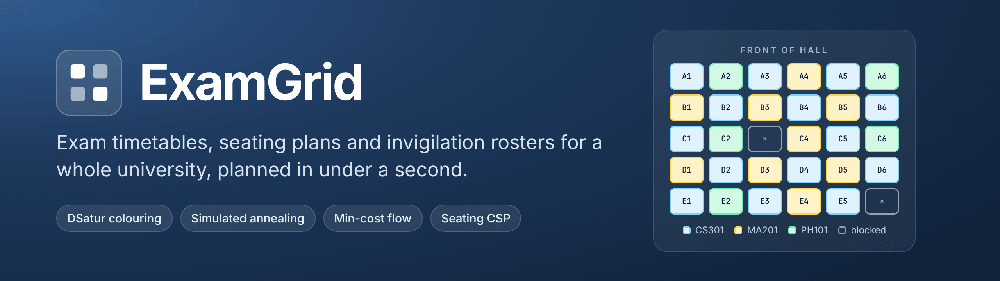
</p>

<p align="center">
  <a href="https://github.com/n3h4a/ExamGrid/actions/workflows/ci.yml"></a>
  
  
  
  
  
  <a href="LICENSE"></a>
</p>

<p align="center">
  <a href="#see-it-in-action"><b>Demo</b></a> ·
  <a href="docs/demo/examgrid-demo.mp4"><b>Video</b></a> ·
  <a href="#quick-start"><b>Run it in one command</b></a> ·
  <a href="docs/architecture.md"><b>Architecture</b></a> ·
  <a href="docs/api/README.md"><b>API</b></a> ·
  <a href="docs/README.md"><b>Documentation</b></a>
</p>

---

## Why ExamGrid exists

**The problem.** Twice a year, every university's exam cell turns a list of who takes which
course into three plans:

- a **timetable** in which no student sits two papers at once;
- a **seating plan** in which no student sits next to someone writing the same paper;
- an **invigilation roster** in which every room is supervised and no teacher watches their
  own subject.

Most exam cells still build these by hand in spreadsheets. It takes days, and mistakes
surface on exam morning, when a clash or a double-booked room is hardest to fix.

**Why it is hard.** The timetable alone is a graph-colouring problem, which is NP-hard. On
top of that come limited seats, locked papers, morning-only papers, papers that must share a
slot, fairness between students (no two exams on the same day, hard papers spread out), and
fairness between staff. Then, on result day, thousands of students look up their seat in the
same few minutes.

**Why the usual tools fall short.**
- Spreadsheets do not check anything.
- General-purpose timetabling tools are built for weekly class schedules. They model teaching
  periods, not exam halls with blocked seats, paper-by-paper seating rules and invigilation
  duties.
- When no clash-free plan exists, a tool that just "fails" leaves the exam cell guessing
  which constraint to relax.

**How ExamGrid solves it.**
- **Planning.** ExamGrid models the whole season as one optimisation pipeline: graph
  colouring for the timetable, simulated annealing for student fairness, min-cost flow for
  rooms, a constraint solver for seats and a heap for invigilation. It plans 6,500 students in
  181 ms, and when no plan exists it explains why, naming the courses and students involved.
- **Publishing.** It wraps the solver in the controls a real exam cell needs: validated
  imports, two-person approval, an audit trail, PDFs, a result-day seat finder that serves
  thousands of lookups a second, and one-click repair when a room is lost on the morning of
  an exam.

## See it in action

<p align="center">
  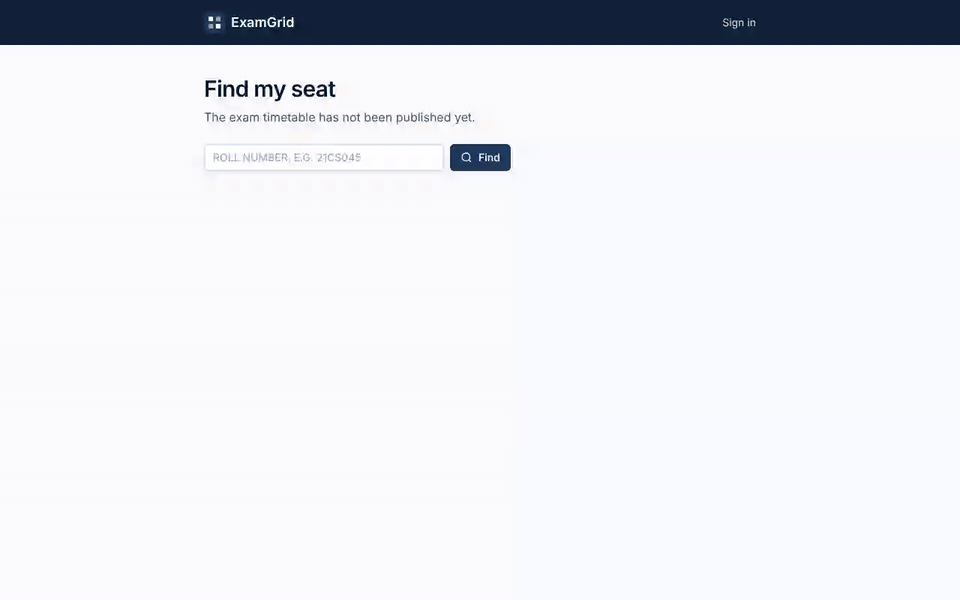
</p>

<p align="center"><sub>45 seconds, recorded from the real app: solve → review → two-person approval → publish → find my seat.
<a href="docs/demo/examgrid-demo.mp4">Full-resolution MP4</a>.</sub></p>

### A season, step by step

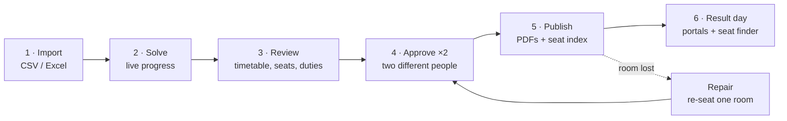

**1 · Import with a dry run.** Every file is checked before anything is written.

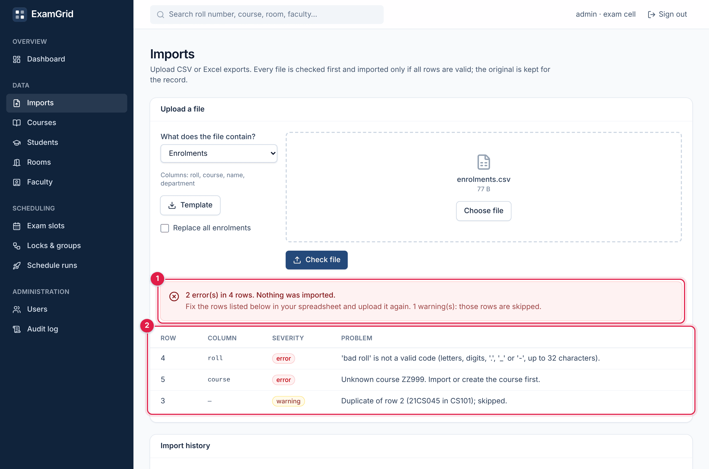

1. One bad row rejects the whole file, so the catalog is never half-imported.
2. Each problem names its row, column and reason. Duplicates are warnings and are skipped.

**2 · Solve, live.** A run returns at once and streams its progress to the browser.

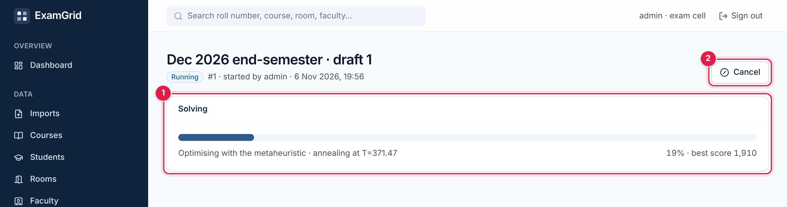

1. Server-Sent Events push the phase, progress and best score while the solver runs.
2. A run can be cancelled at any point.

**3 · Review the plan.** Every number a reviewer needs before signing off.

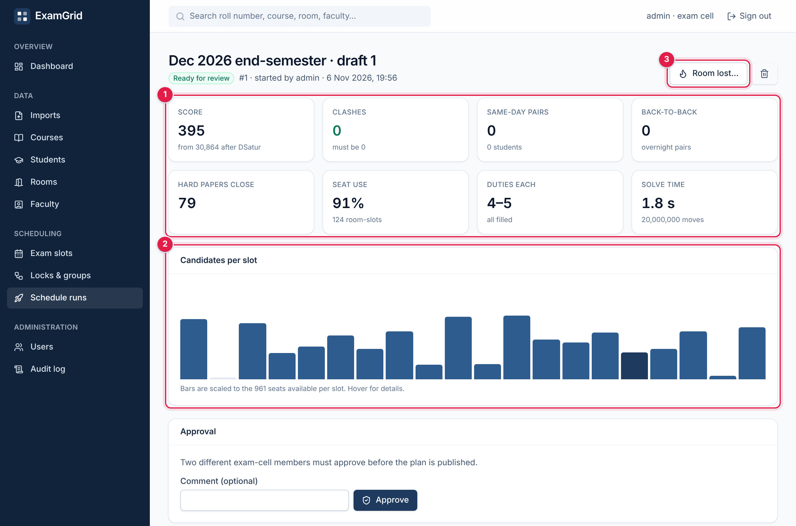

1. Hard constraints (clashes must be 0) next to soft ones. Here annealing took the score from
   30,864 after greedy colouring down to 395.
2. Candidates per slot against the 961 seats available.
3. "Room lost…" repairs the plan if a room becomes unavailable (see *Repair* below).

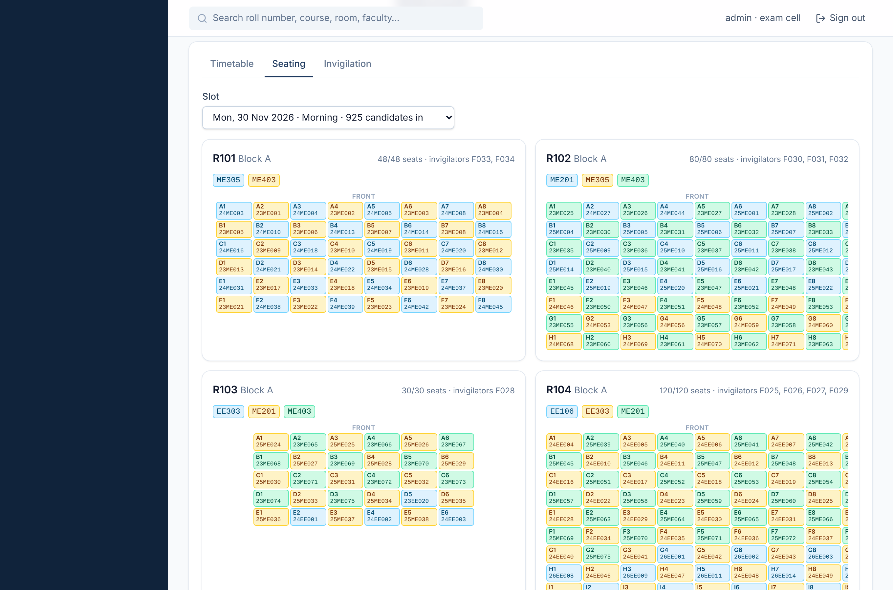

1. Pick any exam session.
2. Each room shows its occupancy and invigilators.
3. Papers alternate across the seat grid, so no two neighbours ever write the same paper.

**4 and 5 · Approve and publish.** Two different exam-cell members must approve. An approval
is refused if the data changed after the solve. Publication renders every PDF and loads the
seat index in one job, then switches the live plan atomically.

**Repair · When a room is lost.** "R103 is flooded on Tuesday afternoon."

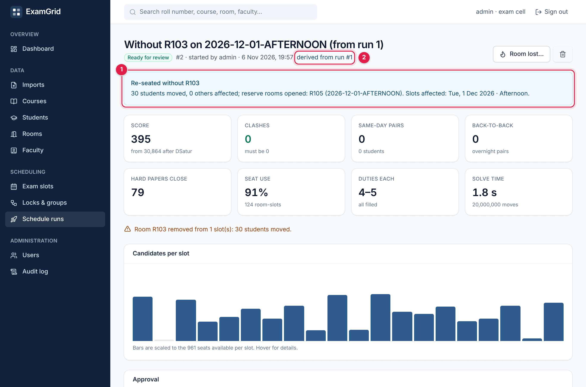

1. Only the 30 displaced students move, into a reserve room. Nobody else's seat changes.
2. The repair is a new run linked to the original, and it goes through approval again.

**6 · Result day.** Students look up their seat without signing in, or sign in for their hall ticket.

| Public seat finder | Student portal |
|---|---|
| 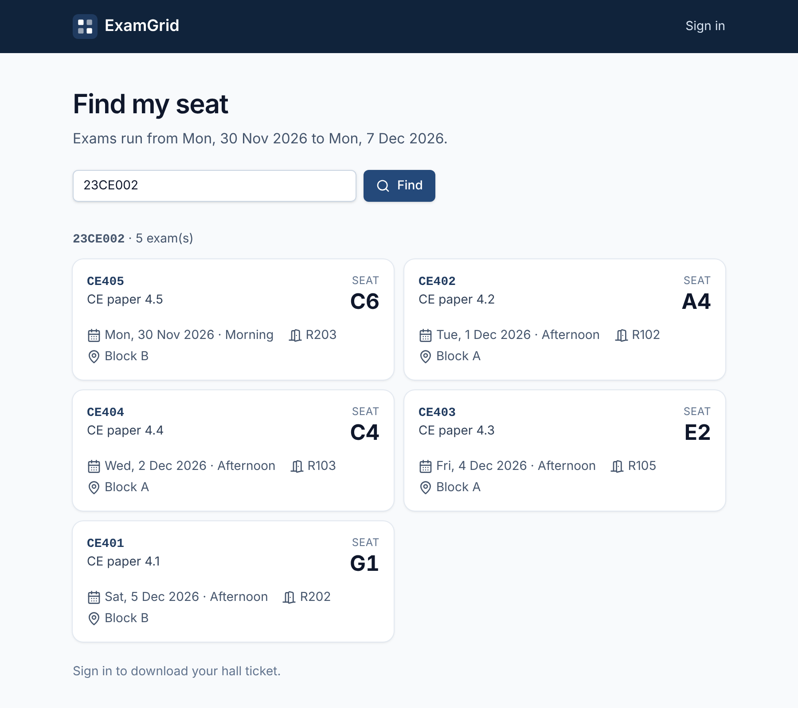 | 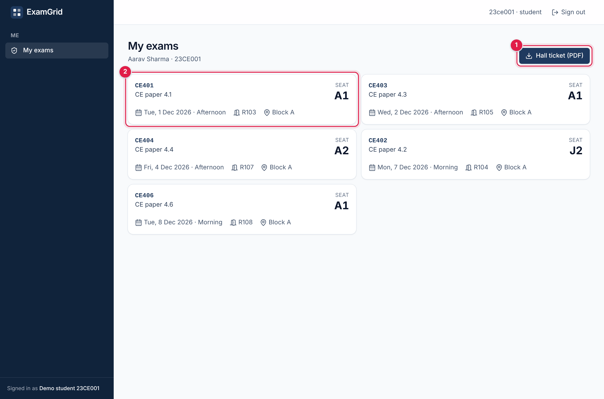 |
| ① No login, rate-limited per network. ② Room and seat only, never a name. | ① Hall ticket PDF for the signed-in student only. ② Every exam with date, room and seat. |

<details>
<summary><b>More screens</b>: dashboard, seat-grid editor, timetable, documents, run comparison</summary>

| | |
|---|---|
| **Dashboard**: readiness checklist and what is live | **Seat-grid editor**: draw a room, block broken seats |
| 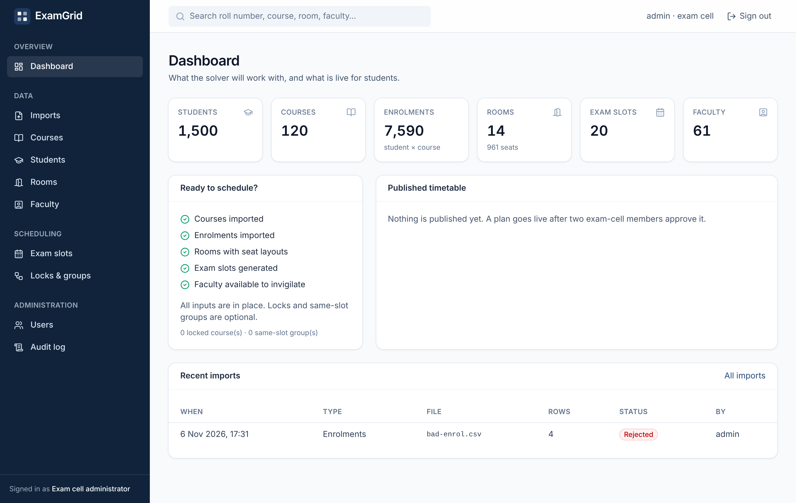 | 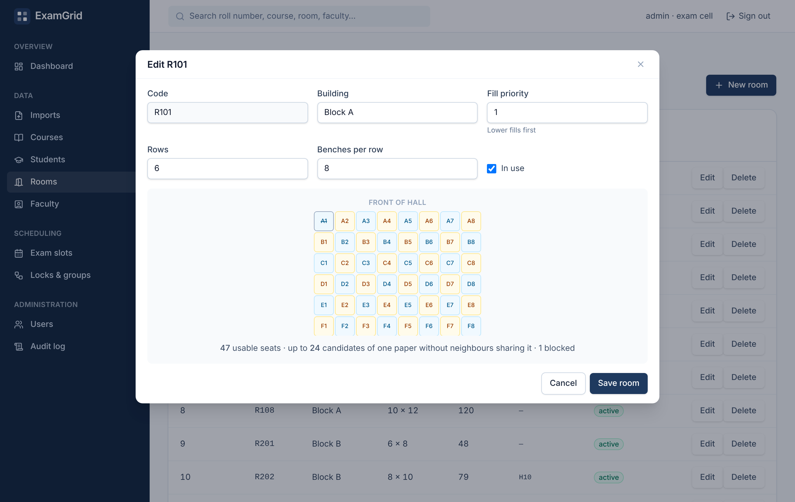 |
| **Timetable**: highlight a department across the season | **Documents**: every PDF from publication |
| 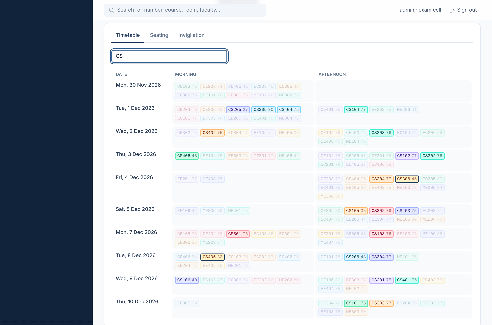 | 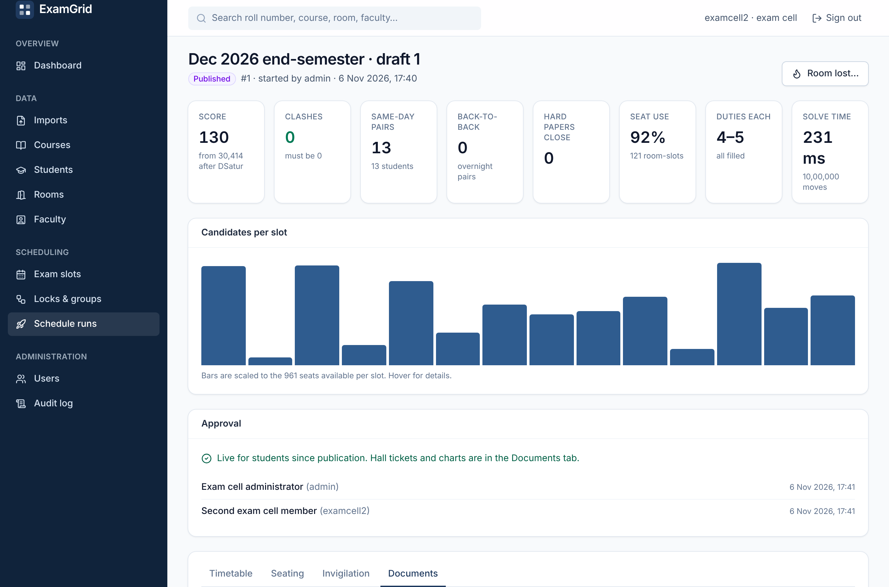 |
| **Compare runs**: best value per row highlighted | |
| 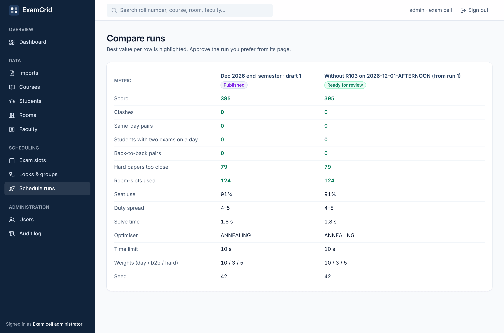 | |

</details>

## Features

| Area | What it does |
|---|---|
| **Scheduling engine** | Clash-free timetables with DSatur graph colouring and TabuCol repair. Respects morning- or afternoon-only papers, locked papers, papers that must share a slot, and seat capacity per slot. Optimises student fairness with simulated annealing or tabu search. Seeded, so the same inputs give the same plan. |
| **Infeasibility reports** | When no timetable exists, ExamGrid proves it (Hall's condition, clique bounds, lock clashes, empty domains, oversized papers) and names the courses and roll numbers involved. |
| **Seating** | Rooms with real seat grids and blocked seats. Min-cost flow chooses rooms. A constraint solver guarantees no neighbours share a paper, with diagonal neighbours optionally included. |
| **Invigilation** | A min-heap balances duty load, respects unavailability, never assigns a teacher to their own paper, and scales staff to room size. |
| **Data import** | CSV and Excel files for courses, rooms, students, enrolments and faculty. Dry run first, row-level errors, all-or-nothing commit, a replace mode for enrolments, downloadable templates, and archived originals with SHA-256. |
| **Runs** | Background solves with live progress, cancellation, restart recovery and side-by-side comparison of up to five runs. |
| **Publishing** | Two-person approval with a stale-data guard. PDF hall tickets, seating charts, timetable and invigilation roster. Atomic switch to the new plan. |
| **Result day** | A public seat finder backed by a Redis index, rate-limited per IP, with no names exposed. Student and faculty portals. Falls back to Postgres if Redis is down. |
| **Disruption repair** | Re-seat the students of a lost room (one session or all) into a new derived run, leaving everyone else in place. |
| **Security and audit** | Stateless JWT with three roles. Portal identity comes only from the token (no IDOR). Append-only audit log. RFC 9457 errors with request ids. CSP and security headers. |
| **Search** | Trigram search across students, courses, faculty and rooms. |

## Architecture

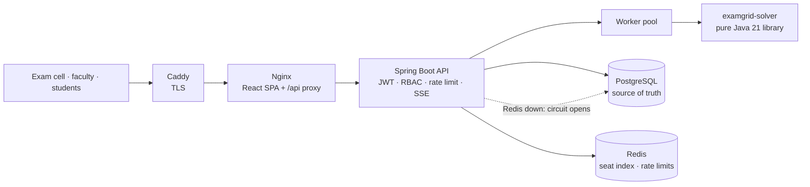

- **Modular monolith.** The solver is a framework-free Java library, also usable as a CLI
  and benchmarked on its own, inside a package-by-feature Spring Boot API. One deployable,
  clear seams.
- **Postgres is the only source of truth.** Redis holds derived data: the seat index and
  rate-limit counters. Losing Redis costs speed, never correctness.
- **Long work never blocks a request.** Solves run on a bounded worker pool. Clients follow
  them over Server-Sent Events, and a restart recovers queued work.

Read more:
- [architecture overview](docs/architecture.md): containers, backend layers, request
  lifecycle, authentication flow, frontend, pipeline, run lifecycle, publishing and deployment;
- [data model](docs/database.md): tables, constraints, indexing strategy and Redis keys;
- [nine architecture decision records](docs/adr).

## How the engine works

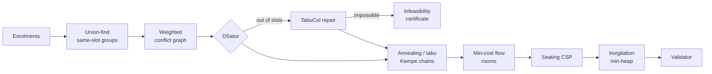

| Stage | Algorithm | Complexity | Why this one |
|---|---|---|---|
| Conflicts | Weighted conflict graph | O(Σ kᵢ²) over students with kᵢ papers each | Edge weight = shared students, which feeds the fairness score |
| Timetable | **DSatur** + **TabuCol** | O((n + m) log n + n·K) for K slots | Strong greedy colouring for sparse graphs; TabuCol recovers when greedy runs out of slots |
| Proof of impossibility | Hall's condition (Kuhn's matching), clique bounds | O(k² · K) per student | Tells the exam cell *what* to relax instead of just failing |
| Fairness | **Simulated annealing** or **tabu search** | O(deg) per move, O(chain · deg) per Kempe chain | Incremental deltas make millions of moves cheap; Kempe chains keep every candidate clash-free; temperature calibrated automatically |
| Rooms | **Min-cost max-flow** (SPFA) | per slot, on a graph of papers + rooms | Fills preferred rooms first and caps papers per room exactly |
| Seats | Colour-class packing + **forward-checking CSP** | budgeted backtracking (≤ 100k / 200k steps) | Packing papers into checkerboard classes is valid by construction; the CSP handles papers that must be split |
| Invigilation | **Min-heap** by load | O(D log F) for D duties, F faculty | Simple, fair and explainable |

Every plan passes an independent `SolutionValidator` before it is stored.
**[How ExamGrid plans an exam season](docs/algorithms.md)** walks through a worked example and
explains each algorithm's rationale, complexity and rejected alternatives.

## Engineering decisions

The key trade-offs are summarised below; [technology choices](docs/technology.md) covers each
one in depth.

| Decision | Why | Trade-off accepted |
|---|---|---|
| Solver as a pure library | Testable with property tests, benchmarkable with JMH, usable from a CLI | A thin adapter layer maps database rows to solver models |
| Spring Boot 4 on Java 21 | Mature security, validation, Flyway and Testcontainers support | Heavier start-up than a micro-framework |
| PostgreSQL | Transactions, row locks for approvals, advisory locks for imports, trigram search | Vertical scaling only, which is ample for one university |
| Redis as a cache only | O(1) seat lookups on result day; atomic Lua rate limiting | One more service, offset by a circuit breaker and a Postgres fallback |
| SSE, not WebSockets | One-way progress over plain HTTP that passes proxies | Needs an authenticated `fetch` stream rather than `EventSource` |
| Stateless JWT | No session store; any API instance can serve any request | Tokens cannot be revoked before they expire, so the lifetime is bounded (8 h by default, configurable) |
| React + TanStack Query | Server state, caching and invalidation without a global store | A client-rendered SPA (140 kB gzipped JS) rather than server-rendered pages |
| Nginx in front of the SPA | One origin (no CORS in production), strict CSP, unbuffered SSE | One more container to configure, offset by a single templated config |

## Performance

<p align="center">
  
</p>

| Result-day load test (k6 through Nginx → API → Redis) | Throughput | p95 | Errors |
|---|---:|---:|---:|
| 1,000 concurrent students with think time | 780 req/s | **3.4 ms** | 0 % |
| 200 clients, no think time | 3,859 req/s | 101 ms | 0 % |
| Same, with Redis stopped (Postgres fallback) | 1,115 req/s | 564 ms | 0 % |

All numbers were measured on one 4-vCPU VM shared with the load generator; see
[solver benchmarks](docs/benchmarks/README.md) and the [load test](docs/benchmarks/load-test.md).
The first Redis-outage measurement found a real defect: each request waited for Redis
timeouts, giving a p95 of 8 s. A circuit breaker fixed it, and the report keeps both numbers.

## Quality

| Suite | Tests | Line coverage |
|---|---:|---:|
| Solver: unit + jqwik property tests on random universities | 112 | 92.7 % |
| Backend: unit + integration against real Postgres and Redis (Testcontainers) | 19 + 53 | 84.7 % |
| Frontend: Vitest + Testing Library | 31 | 50.0 % |

The property tests check invariants on thousands of generated universities. For example,
every returned plan is clash-free, no room is over capacity, no neighbours share a paper, and
optimisation never breaks a hard constraint. CI runs everything on each push and publishes
Docker images. See the [testing report](docs/testing.md).

## Quick start

You only need Docker:

```bash
git clone https://github.com/n3h4a/ExamGrid.git && cd ExamGrid
docker compose -f docker-compose.full.yml up --build
```

Open <http://localhost:8088>. A demo university is already loaded: 1,500 students, 120
courses, 14 rooms and 61 faculty.

| Sign in as | Password | To try |
|---|---|---|
| `admin` | `admin12345` | Schedule runs → New run, then approve it |
| `examcell2` | `demo12345` | the second approval, which publishes the plan |
| `23ce001` | `demo12345` | the student portal and hall ticket |
| *(no login)* | | <http://localhost:8088/seat>, roll number `23CE001` |

<details>
<summary><b>Local development</b> (hot reload)</summary>

```bash
docker compose up -d                                         # Postgres + Redis only
mvn -pl solver -am install -DskipTests
SPRING_PROFILES_ACTIVE=dev mvn -pl backend spring-boot:run   # API on :8080 with demo data and Swagger UI
cd frontend && npm ci && npm run dev                         # UI on :5173, proxies /api
```

Run every check CI runs:

```bash
mvn -B verify                                                # needs Docker for Testcontainers
cd frontend && npm run lint && npm run typecheck && npm run test:coverage && npm run build
```

Use the solver on its own:

```bash
mvn -pl solver package
java -jar solver/target/examgrid-solver-1.0.0-SNAPSHOT.jar --synthetic 180:2400 --days 5 --optimizer tabu
```

</details>

## Deployment

On every push to `main`, [GitHub Actions](.github/workflows/ci.yml) tests everything,
reports coverage, and publishes the `examgrid-api` and `examgrid-web` images to GHCR. Two
deployment paths are ready:

- **One VM** with [`deploy/docker-compose.prod.yml`](deploy/docker-compose.prod.yml): Caddy
  with automatic HTTPS, Postgres, Redis and a backup script.
- **Render** with the [`render.yaml`](render.yaml) blueprint: managed Postgres and Key Value,
  free tier.

See the [deployment guide](docs/deployment.md) and the [security model](docs/security.md).

## Repository layout

| Path | Contents |
|---|---|
| [`solver/`](solver) | The scheduling engine: a framework-free Java 21 library and CLI |
| [`backend/`](backend) | Spring Boot REST API, organised by feature, with Flyway migrations |
| [`frontend/`](frontend) | React 19 + TypeScript app: admin console, portals and seat finder |
| [`benchmarks/`](benchmarks) | JMH micro-benchmarks and the scaling report |
| [`loadtest/`](loadtest) | k6 result-day and rate-limit scripts |
| [`deploy/`](deploy) | Production Compose file, Caddy config and backups |
| [`samples/`](samples) | A small fictional dataset for trying imports |
| [`tools/`](tools) | Scripts that regenerate the banner and every screenshot |
| [`docs/`](docs/README.md) | Architecture, ADRs, API, benchmarks, testing, security, deployment |

## Author

Designed and built by [n3h4a](https://github.com/n3h4a). Released under the [MIT licence](LICENSE).
