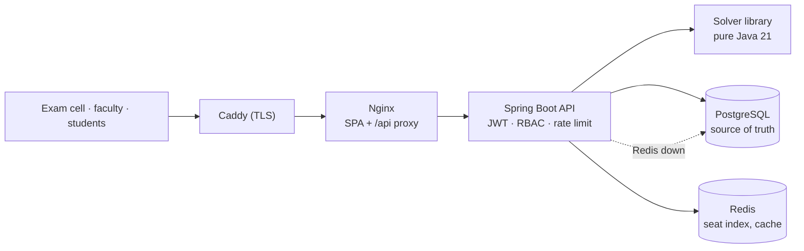

# ExamGrid

[](https://github.com/n3h4a/ExamGrid/actions/workflows/ci.yml)


[](LICENSE)

**Exam timetabling, seating and invigilation for universities.** You upload which students
take which course. ExamGrid works out **when** every exam happens, **where** every student
sits and **who** supervises each room. Two people approve the plan, and ExamGrid then
publishes hall tickets, seating charts and a "find my seat" page built to survive result day.


<sub>45-second walkthrough. Full-resolution video: [`docs/demo/examgrid-demo.mp4`](docs/demo/examgrid-demo.mp4)</sub>

## Highlights

- **Real algorithms, not a CRUD app.** The pipeline runs graph colouring (DSatur and TabuCol),
  simulated annealing and tabu search over Kempe chains, min-cost max-flow room allocation,
  a seating CSP and a min-heap invigilation roster. When no timetable exists, ExamGrid proves
  it with a **certified infeasibility report**.
- **Fast.** A complete plan for 6,500 students and 65,000 enrolments takes **181 ms**
  ([benchmarks](docs/benchmarks/README.md)).
- **Built for result day.** 1,000 concurrent students get their seats with **p95 3.4 ms and
  zero errors**. With Redis switched off, every answer is still correct
  ([load test](docs/benchmarks/load-test.md)).
- **Safe to operate.** Imports are dry-run first and all-or-nothing. Publishing needs two
  distinct approvers, and approval is refused if the data changed after the solve. A lost
  room is repaired by moving only the displaced students. Every change is audited.
- **Production-shaped.** Stateless JWT with RBAC and no IDOR, RFC 9457 errors, request
  correlation, rate limiting, CSP, Flyway, Testcontainers, CI to GHCR, and a Render blueprint
  or single-VM deployment with automatic TLS.

## Screens

| Live solve over Server-Sent Events | Review a plan |
|---|---|
|  |  |
| **Seating charts: no two neighbours share a paper** | **Timetable grid** |
|  |  |
| **"Room lost": only displaced students move** | **Compare runs** |
|  |  |
| **Import with a dry-run report** | **Seat-grid editor** |
|  |  |
| **Student portal** | **Public seat finder** |
|  |  |

## Quick start

You need Docker. This runs PostgreSQL, Redis, the API and the web app, with a synthetic demo
university already loaded:

```bash
git clone https://github.com/n3h4a/ExamGrid.git && cd ExamGrid
docker compose -f docker-compose.full.yml up --build
```

Open <http://localhost:8088>:

| Account | Password | Role |
|---|---|---|
| `admin` | `admin12345` | exam cell |
| `examcell2` | `demo12345` | exam cell (the second approver) |
| `23ce001` | `demo12345` | student |
| `/seat` page | none | anyone, by roll number |

Then go to **Schedule runs → New run**, watch it solve, approve it as `admin` and as
`examcell2`, and look up `23CE001` on the seat finder.

### Develop

```bash
docker compose up -d                                         # Postgres + Redis only
mvn -pl solver -am install -DskipTests
SPRING_PROFILES_ACTIVE=dev mvn -pl backend spring-boot:run   # :8080, demo data, Swagger UI
cd frontend && npm ci && npm run dev                         # :5173, proxies /api
```

### Use the solver on its own

```bash
mvn -pl solver package
java -jar solver/target/examgrid-solver-1.0.0-SNAPSHOT.jar --synthetic 180:2400
java -jar solver/target/examgrid-solver-1.0.0-SNAPSHOT.jar --synthetic 180:2400 --days 5 --optimizer tabu --out plan/
```

## Architecture



ExamGrid is a modular monolith. The solver is a framework-free library, also usable as a
CLI and benchmarked on its own, inside a package-by-feature Spring Boot API. Long solves run
on a bounded worker pool and stream progress over SSE. Postgres is the only source of
truth. Redis holds only derived data, so it can be lost at any time.

See the [architecture overview](docs/architecture.md) for the container, pipeline,
run-lifecycle, publishing and data-model diagrams. The decisions behind them are recorded
in [nine ADRs](docs/adr).

## How it works

1. **Import.** CSV or Excel files for courses, rooms (with seat grids), students,
   enrolments and faculty. Each file is validated as a dry run with row-level errors, then
   committed all-or-nothing. The original file is archived with its SHA-256
   ([formats](docs/imports.md)).
2. **Solve.** `POST /api/schedule-runs` returns `202` at once. A worker snapshots the
   catalog and runs the pipeline below while the browser follows live progress.
3. **Review.** Browse the timetable, room-by-room seating charts, invigilation duties and
   per-student schedules, and compare runs side by side.
4. **Approve and publish.** Two different exam-cell members approve. The publication job
   renders every PDF, loads `roll → seats` into Redis and switches the live plan atomically.
5. **Result day.** Students find their seat without logging in (names are never shown), or
   sign in to download their hall ticket. Faculty see their duties.
6. **Disruption.** "Room 204 is flooded." ExamGrid re-seats only the affected students into
   a new derived plan, which goes through the same approval.

## Algorithms

| Stage | Algorithm | Notes |
|---|---|---|
| Grouping | Union-find | Common papers that must share a slot become one node |
| Conflicts | Weighted conflict graph, O(Σ k²) over students | Edge weight = shared candidates |
| Timetable | **DSatur** with slot domains, locks and capacity, O((n + m) log n) | **TabuCol** repairs when greedy colouring runs out of slots |
| Infeasibility | Hall's condition via bipartite matching, clique bounds | Each issue names the courses and roll numbers involved |
| Quality | **Simulated annealing** (auto-calibrated temperature) or **tabu search** | Move, swap and Kempe-chain neighbourhoods; O(degree) incremental deltas |
| Rooms | **Min-cost max-flow** (SPFA) | Fills rooms in priority order and caps papers per room |
| Seats | Colour-class packing plus a **forward-checking CSP** fallback | No two neighbours ever sit the same paper |
| Invigilation | **Min-heap** by load | Fair duty spread; never invigilates one's own paper |
| Disruption | Incremental re-seat | "37 students moved, 0 others affected" |

Every plan is checked by an independent `SolutionValidator` before it is stored. Details:
[solver README](solver/README.md) and ADRs [0002](docs/adr/0002-colouring-strategy.md),
[0003](docs/adr/0003-penalty-model-and-optimisers.md),
[0004](docs/adr/0004-rooms-seating-invigilation.md).

## Performance


| Result-day load test (k6, through Nginx) | Throughput | p95 | Errors |
|---|---:|---:|---:|
| 1,000 concurrent students with think time | 780 req/s | 3.4 ms | 0 % |
| 200 clients, no think time | 3,859 req/s | 101 ms | 0 % |
| Same, with Redis stopped (Postgres fallback) | 1,115 req/s | 564 ms | 0 % |

All runs were on a single 4-vCPU VM shared with the load generator. Method and caveats:
[load test](docs/benchmarks/load-test.md) and [solver benchmarks](docs/benchmarks/README.md).

## Testing

| Suite | Tests | Line coverage |
|---|---:|---:|
| Solver: unit + jqwik property tests | 112 | 92.7 % |
| Backend: unit + Testcontainers integration (Postgres, Redis) | 19 + 53 | 84.7 % |
| Frontend: Vitest + Testing Library | 31 | 50.0 % |

The property tests generate random universities and check invariants. For example, every
returned plan is clash-free, no room is over capacity, no neighbours share a paper, and the
optimisers never break a hard constraint. See the [testing report](docs/testing.md).

## Deployment

CI ([`.github/workflows/ci.yml`](.github/workflows/ci.yml)) builds and tests everything,
reports coverage, and pushes `examgrid-api` and `examgrid-web` images to GHCR from `main`.
There are two ways to run it:

- **One VM**: `deploy/docker-compose.prod.yml` with Caddy (automatic HTTPS), plus a
  backup script.
- **Render**: `render.yaml` blueprint (managed Postgres and Key Value, free tier).

See the [deployment guide](docs/deployment.md) and [security model](docs/security.md).

## Documentation

| | |
|---|---|
| [Architecture](docs/architecture.md) | Containers, solver pipeline, run lifecycle, publishing sequence, data model |
| [API reference](docs/api/README.md) | Conventions, endpoint index, [OpenAPI 3.1 spec](docs/api/openapi.json) |
| [ADRs](docs/adr) | Nine architecture decision records |
| [Benchmarks](docs/benchmarks/README.md) · [Load test](docs/benchmarks/load-test.md) | Measured performance |
| [Testing report](docs/testing.md) | Suites, properties, coverage |
| [Imports](docs/imports.md) | File formats and validation rules |
| [Security](docs/security.md) | Threats and controls |
| [Deployment](docs/deployment.md) | VM, Render, configuration, operations |
| [Specification](docs/spec/PROJECT_SPEC.md) · [Roadmap](docs/ROADMAP.md) | What was built, milestone by milestone |

## Repository layout

| Path | What it is |
|---|---|
| [`solver/`](solver) | Framework-free Java 21 scheduling engine and CLI |
| [`backend/`](backend) | Spring Boot 4 REST API |
| [`frontend/`](frontend) | React 19 + TypeScript admin console, portals and seat finder |
| [`benchmarks/`](benchmarks) | JMH benchmarks and the scaling report |
| [`loadtest/`](loadtest) | k6 result-day and rate-limit scripts |
| [`deploy/`](deploy) | Production Compose, Caddy, backups |
| [`samples/`](samples) | Small fictional dataset for trying imports |

## License

[MIT](LICENSE) © n3h4a
