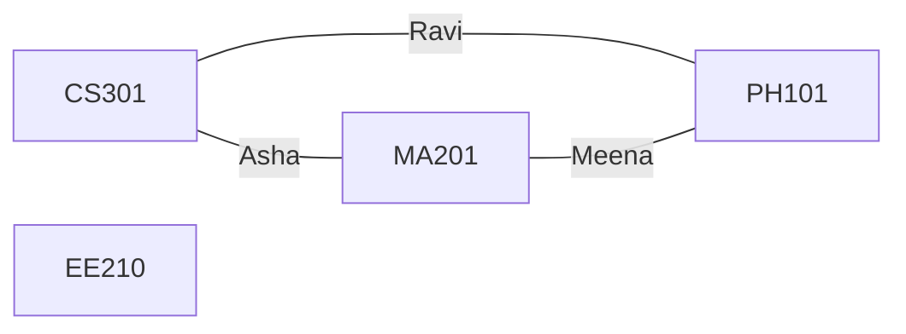
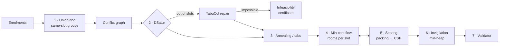

# How ExamGrid plans an exam season

This is the explainer for the engine in [`solver/`](../solver). It covers what each stage
computes, why that algorithm was chosen, what it costs, and what was traded away. The design
decisions, with measurements and the alternatives that were rejected, are recorded in ADRs
[0002](adr/0002-colouring-strategy.md), [0003](adr/0003-penalty-model-and-optimisers.md) and
[0004](adr/0004-rooms-seating-invigilation.md).

## The problem, precisely

Given students, the papers each one sits, a set of exam **slots** (date × session), rooms
with seat grids, and faculty, find:

| Decision | Hard constraints (must hold) | Soft goals (minimise) |
|---|---|---|
| a slot for every paper | no student sits two papers at once; locked papers stay put; morning-only papers stay in the morning; same-slot groups stay together; a slot's papers fit in the seats available | same-day pairs (×10), overnight back-to-back pairs (×3), hard papers fewer than *N* days apart (×5) |
| a room and seat for every student in every paper | room capacity; blocked seats stay empty; **no two neighbouring seats hold the same paper** | open as few rooms as possible, in priority order |
| invigilators for every room | available in that slot; in one room at a time; never supervising a paper they teach | balanced duty load |

The weights are run parameters. Every soft term is counted per pair of papers a student sits,
which is what makes the score cheap to update (see [Fairness](#3-fairness-simulated-annealing-and-tabu-search)).

## A worked example

```
Asha  → CS301, MA201        Meena → MA201, PH101
Ravi  → CS301, PH101        Kiran → EE210
```

Papers are nodes. Two papers that share a student are joined by an edge, weighted by how
many students they share:



A clash-free timetable is now a **graph colouring** in which slots are colours. The triangle
needs three different slots, while EE210 can go anywhere. Given only one day (two slots),
ExamGrid does not just fail. The CLI prints a proof:

```
No clash-free timetable exists:
 - 3 exams (CS301, MA201, PH101) all share students with each other, so they need 3 different slots, but only 2 are usable for them.
```

Given two days (four slots), it returns a plan:

```
2026-12-01 MORNING   CS301(2) EE210(1)
2026-12-01 AFTERNOON -
2026-12-02 MORNING   PH101(2)
2026-12-02 AFTERNOON MA201(2)
```

Meena still sits two papers on one day. Three mutually clashing papers on two days force at
least one such pair, so this plan is optimal for the fairness score.

## The pipeline



| Stage | Cost | Measured at about 500 courses |
|---|---|---|
| Conflict graph | O(Σ kᵢ²) for students with kᵢ papers | 3.4 ms (JMH) |
| DSatur | O((n + m) log n + n·K) | 1.7 ms (JMH) |
| Annealing | O(deg) per move; the move budget fixes the total | Most of the end-to-end time |
| Rooms + seats | Min-cost flow on (papers + rooms) per slot; budgeted search | Included below |
| Invigilation | O(D log F) | Included below |
| **Whole pipeline** | | **181 ms** for 480 courses, 6,500 students, 65,390 enrolments |

Full numbers: [benchmarks](benchmarks/README.md).

---

### 1. Same-slot groups: union-find

Common papers taken by several branches must sit together. Union-find merges each group
into a single node before the graph is built, so no later stage can separate them. With
path halving and union by size, each operation is near-constant (inverse Ackermann).

*Alternative:* adding a "must share a slot" constraint to every algorithm. Merging once is
simpler and makes the constraint impossible to violate.

### 2. A clash-free start: DSatur with TabuCol repair

**What it does.** DSatur colours the node with the fewest open slots next: its *saturation*,
generalised to per-paper domains such as morning-only papers and locks. Ties go to the
higher degree. It gives the node the lowest slot that is open, clash-free and still has
seats. A `TreeSet` priority queue keeps this at O((n + m) log n + n·K).

**Why.**
- DSatur is the standard strong greedy colouring.
- It is exact on bipartite graphs, cycles and wheels, which the unit tests check against
  known chromatic numbers.
- It is fast enough to run inside an interactive request.
- It only needs to be *feasible*: quality comes from stage 3.

**When it runs out of slots.** Greedy failure is not proof of impossibility, so **TabuCol**
(Galinier–Hao tabu search over K-colourings) tries to remove the remaining clashes within the
same K slots.

**When no timetable exists.** The infeasibility analyser runs cheap structural checks before
any search, then two certified proofs:
- **Hall's condition per student.** A student's papers must be matchable to distinct allowed
  slots. Kuhn's bipartite matching checks this in O(k² · K).
- **Hall's condition on the largest clique** found by a greedy heuristic. A clique of size
  *c* needs *c* slots.

Each issue carries a `proof` flag and names courses and sample roll numbers, so the exam cell
knows what to relax: add a slot, unlock a paper, split a group.

| Alternative | Why not |
|---|---|
| Welsh–Powell / largest-first | Simpler, but noticeably worse on the clustered graphs real enrolments produce |
| Recursive Largest First | Often uses fewer colours, but is slower, and the colour count does not matter here because the optimiser only needs a feasible start |
| Exact ILP / CP-SAT | Proves optimal colourings but is exponential in the worst case, and brings a native solver dependency for something the optimiser makes unnecessary |

### 3. Fairness: simulated annealing and tabu search

**What it optimises.** DSatur packs papers into the lowest slots, so many students get two
papers on one day. Because every soft term is counted per pair of papers a student sits, the
total is a sum over graph edges:

```
cost(u, v) = shared(u, v) · pair[slot u][slot v] + sharedHard(u, v) · hard[slot u][slot v]
```

`pair` and `hard` are K × K matrices precomputed from the calendar. Moving paper *v* changes
only the edges at *v*, so a move is scored in **O(deg v)**, not by recounting every student.
That makes millions of moves per second affordable. A property test checks that the
incremental score always equals a full recount from raw enrolments.

**Moves.** The search uses three kinds of move:
- move one paper (50 %);
- swap two papers (25 %);
- a **Kempe chain** (25 %), which swaps two slots across a connected component of the
  subgraph those slots induce.

Kempe chains are clash-free by construction and escape plateaus that single moves cannot.
Every candidate move is checked against the hard constraints *before* it is scored, so the
search only ever visits valid timetables. It can be stopped at any moment and still return a
usable plan.

**Annealing details.**
- The start temperature is calibrated so that about 80 % of worsening moves are accepted at
  first.
- Geometric cooling ends when even the *cheapest* worsening move is accepted only 0.1 % of
  the time.
- Calibrating that end temperature on the *average* move instead left the search too warm:
  one benchmark finished at a score of 331 instead of 0. The fix is recorded in ADR-0003.
- The best timetable seen is kept, and a seeded RNG makes runs reproducible.

**Tabu search** is the alternative. It takes the best non-tabu move from a sample of 40
papers, with tenure 7–11 and aspiration on new bests. It converges faster on easy instances.
Annealing wins clearly when slots are scarce (10 slots: 2,390 versus 5,934), which is the case
that matters, so annealing is the default.

| Alternative | Why not |
|---|---|
| Genetic algorithms | Crossover of two timetables usually breaks hard constraints and needs repair; a single-solution search with clash-free moves is simpler and fast |
| Hill climbing | Gets stuck on the first plateau; annealing's controlled acceptance of worse moves is what reaches score 0 |
| Late-acceptance or great-deluge search | Viable single-solution alternatives with fewer parameters; not implemented, as annealing with automatic calibration already meets the goals |
| Exact optimisation (ILP) | Out of reach at hundreds of papers within an interactive time budget |

### 4. Rooms: min-cost max-flow with a mixing cap

**What it does.** For each slot, candidates flow from papers to rooms:

```
source ─(candidates)→ paper ─(mixing cap)→ room ─(seats, cost = room rank)→ sink
```

- The maximum flow equals the number of candidates exactly when everyone fits.
- The cost is the room's priority rank, so rooms fill in priority order and as few as
  possible are opened.
- The **mixing cap** on a paper → room edge is the largest set of seats in that room that are
  pairwise non-adjacent. Without it, one paper could fill a room, and no valid seating would
  exist.

Successive shortest paths with SPFA is ample, because the network has only the papers in one
slot plus the rooms.

**The feedback loop with seating.** The cap is necessary but not sufficient. If stage 5
cannot seat a room, that room's cap for its largest paper is set one below that paper's
current count, and the flow is solved again. Each round strictly tightens one cap, so the
loop terminates.

| Alternative | Why not |
|---|---|
| Bipartite matching (as first sketched in the spec) | Matching is one-to-one; many students share a room, so this is flow with capacities |
| Greedy first-fit by size | No proof that everyone fits, and no control over how papers mix |
| ILP | Correct, but heavier than needed for networks this small |

### 5. Seats: colour-class packing, then a CSP

**Step 1, packing.** A room's seats split into classes in which no two seats are adjacent:
- a checkerboard (two classes) when only left, right, front and back count as neighbours;
- four `(row % 2, col % 2)` classes when diagonals count too.

If every paper fits *entirely* inside one class (a 2- or 4-bin packing solved exactly by
backtracking), the seating is valid by construction. With two papers this is the checkerboard.

**Step 2, CSP.** Otherwise a paper must straddle classes. Seats are assigned in row-major
order by backtracking with **forward checking**: after each assignment, every paper must still
have enough free seats without a same-paper neighbour. Both steps are budgeted (100 k and
200 k steps). A failure feeds back into stage 4 rather than raising an error.

Within a paper, students take seats in roll-number order, so staff and students can find
seats quickly.

| Alternative | Why not |
|---|---|
| Backtracking from the start | Correct but wasteful; packing solves the common case instantly and with an obviously valid layout |
| Random fill plus repair | No guarantee, and layouts are harder for invigilators to check |

### 6. Invigilation: a min-heap of duty load

Faculty sit in a heap keyed by `(duties so far, index)`. For each required invigilator,
entries are popped until one is eligible, and skipped entries are pushed back. An invigilator
is eligible if they are free in that slot, not already in another room and not teaching a
paper in the room. Each assignment is **O(log F)**. Without constraints, loads differ by at
most one (property-tested). With real availability rules the measured spread is 1–2 duties.

| Alternative | Why not |
|---|---|
| Round-robin | Ignores availability and "not your own paper" |
| Min-cost assignment (flow) | Could optimise preferences, but the goal here is fairness under rules, which a heap achieves simply and explainably |

### 7. An independent validator

`SolutionValidator` re-checks every hard constraint from the raw input and shares no code with
the algorithms. The pipeline refuses to return a plan that fails it. This caught a real bug: an
early version of disruption repair could seat a student in a room supervised by the teacher of
their own paper.

## Repairing a published plan: incremental re-seating

"Room 204 is flooded" on exam morning cannot mean re-solving the season, which would move
thousands of students. The `DisruptionReseater` works like this:

1. Freeze the timetable and every unaffected seat.
2. Put displaced students into spare seats in rooms already open. Each seat takes the waiting
   paper with the most students that no neighbour sits and no invigilator in that room teaches.
3. Send whoever is left to reserve rooms through the normal allocator.
4. Top up invigilators through the same heap, seeded with current loads.

The result is reported in the exam cell's terms: *"30 students moved, 0 others affected;
reserve rooms opened: R105."* It becomes a new run that goes through approval again.

## How correctness is tested

Beyond unit tests on known graphs, jqwik generates thousands of random universities and checks
these invariants:
- DSatur never uses more than Δ + 1 colours and is exact on bipartite graphs;
- incremental scores equal full recounts;
- optimisers never break a hard constraint or end worse than DSatur;
- every returned plan passes the validator.

See the [testing report](testing.md).
