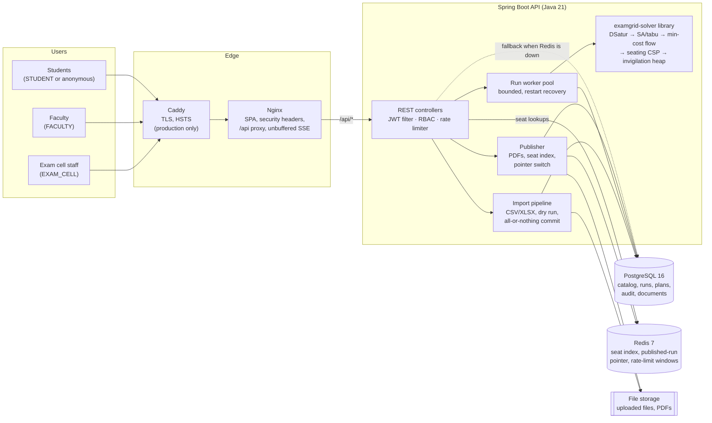
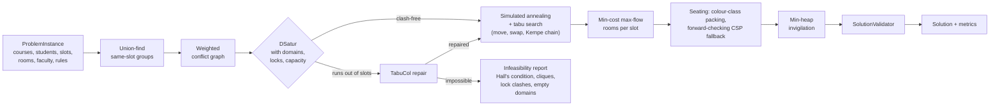
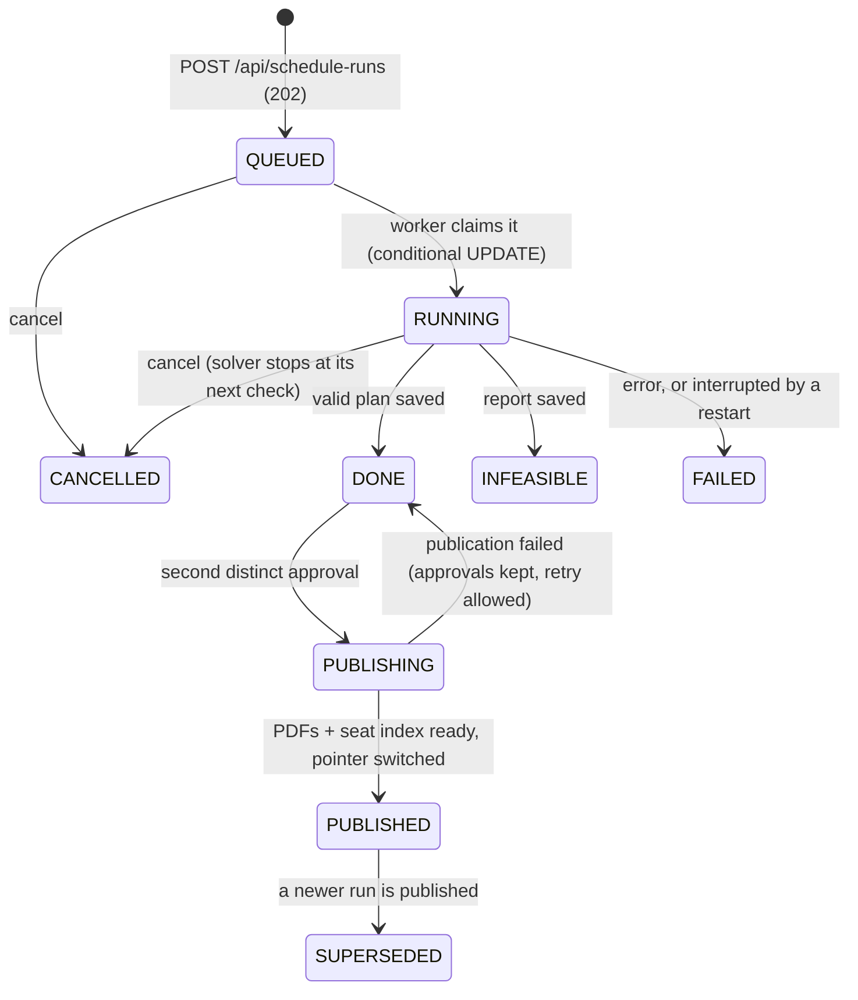
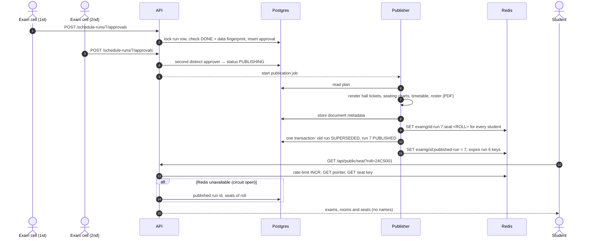
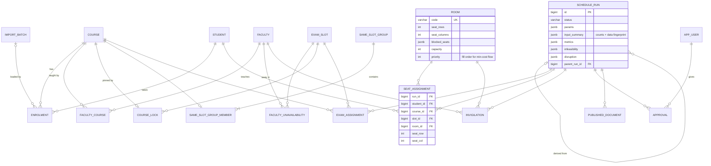

# Architecture

ExamGrid is a modular monolith. A pure-Java solver library sits inside a Spring Boot API.
A React single-page app is served by Nginx on the same origin. Postgres is the source of
truth and Redis is a disposable cache. The reasons behind each choice are recorded as
decision records in [`docs/adr/`](adr).

## System context and containers

| Container | Responsibility | Scales by |
|---|---|---|
| Nginx (`frontend/`) | Serves the built SPA with a strict CSP and long-lived caching for hashed assets. Proxies `/api`, `/v3/api-docs` and `/swagger-ui` to the API, with buffering off for SSE. | Static; any number |
| API (`backend/`) | All business logic. Stateless apart from in-flight solver jobs: JWT auth, data in Postgres and Redis. | Instances behind the proxy. Solver concurrency is a bounded pool per instance. |
| Solver (`solver/`) | Pure algorithms with no Spring and no I/O. It is also usable as a CLI and is benchmarked on its own (`benchmarks/`). | CPU per run |
| Postgres | Source of truth: master data, runs, plans, approvals, audit log, document metadata. | Vertical; read replicas if needed |
| Redis | Result-day cache. Losing it costs speed, not correctness (see [load test](benchmarks/load-test.md)). | Vertical |

### Inside the API

The API is organised by feature. Each package owns its controller, service, persistence
and DTOs:

| Package | Owns |
|---|---|
| `auth`, `user`, `security` | login, JWT issue and verify, users, role rules, two filter chains (API and docs) |
| `catalog`, `search` | courses, students, rooms with seat grids, faculty, slots, locks, same-slot groups; trigram search |
| `imports`, `storage` | CSV/XLSX parsing, row validation, advisory-locked commit, raw file archive with SHA-256 |
| `scheduling` | run lifecycle, worker pool, SSE broadcaster, plan persistence and queries, comparison |
| `publishing` | approvals, PDF rendering, seat index, disruption re-seating |
| `portal` | student and faculty self-service; public seat finder |
| `ratelimit`, `common` | Redis fixed-window limiter, Redis circuit breaker, problem responses, request ids |
| `audit` | append-only audit log written in the same transaction as the change |

## Solver pipeline

The details and trade-offs are in ADRs [0002](adr/0002-colouring-strategy.md),
[0003](adr/0003-penalty-model-and-optimisers.md) and
[0004](adr/0004-rooms-seating-invigilation.md).

## Run lifecycle

A disruption ("room 204 is flooded") never edits a plan in place. It re-seats only the
affected students into a **new** `DONE` run whose `parent_run_id` is the original, and that
run goes through the same two-person approval.

A queued run survives a restart and is picked up again. A run that was mid-solve when the
server stopped is marked `FAILED` with an explanation, because a half-finished optimisation
cannot be resumed. See [ADR-0007](adr/0007-async-runs-and-sse.md).

## Publishing and result day

Two people must approve, and the same person cannot approve twice. An approval is refused
if the catalog has changed since the run was solved, because the plan would describe
students who no longer match the data. See [ADR-0008](adr/0008-publishing-and-result-day.md).

## Data model

`audit_log` and `app_user` stand apart from the diagram. Every plan table hangs off
`schedule_run` with `on delete cascade`. Catalog rows referenced by a saved plan are
protected with `on delete restrict`, so an old plan is never silently changed. The schema is
in [`backend/src/main/resources/db/migration/`](../backend/src/main/resources/db/migration/).

## Cross-cutting concerns

| Concern | How |
|---|---|
| Security | Stateless JWT (HS256), method-level RBAC, portal identity taken only from the token, CSP and security headers at Nginx, rate limiting, audit log. See [`security.md`](security.md). |
| Errors | RFC 9457 problem documents with a stable `code` and a `requestId` |
| Observability | `X-Request-Id` correlation in MDC and responses; structured JSON logs (ECS) in `prod`; Actuator health, liveness and readiness (database included) and metrics |
| Consistency | Imports serialised by a Postgres advisory lock; runs claimed by conditional updates; approvals under a row lock; publication switched in one transaction |
| Resilience | Restart recovery for runs and publications; `RedisCircuit` fails fast to Postgres; rate limiter fails open |
| Delivery | GitHub Actions → tests, coverage, images to GHCR; Render blueprint or single-VM Compose with Caddy. See [`deployment.md`](deployment.md). |
