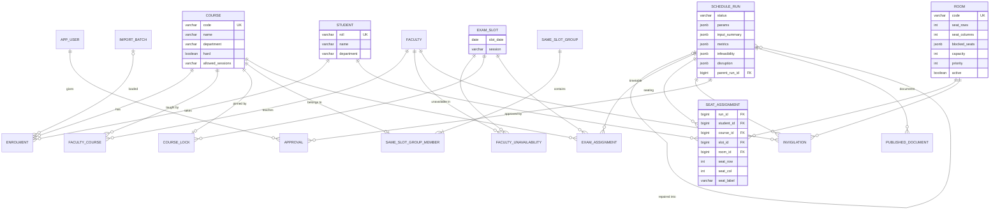

# Data model

ExamGrid keeps all of its state in three stores, each with a single job:

| Store | Holds | If it is lost |
|---|---|---|
| **PostgreSQL 16** | Everything that matters: master data, runs and their plans, approvals, audit log, document metadata | Restore from backup (`deploy/backup.sh`) |
| **Redis 7** | Derived data only: the result-day seat index and rate-limit counters | Nothing. Lookups fall back to Postgres and refill the cache |
| **File storage** | Uploaded import files and generated PDFs, addressed by key | Re-publish to regenerate PDFs. Uploaded originals are needed only for audit |

The schema is created and evolved by Flyway
([`backend/src/main/resources/db/migration`](../backend/src/main/resources/db/migration)), and
Hibernate validates it on start-up (`ddl-auto: validate`), so code and schema cannot drift
apart unnoticed.

## Design principles

1. **Master data is mutable; a run is an immutable snapshot.** Courses, students, rooms,
   faculty and slots are edited freely. Everything a solve produces hangs off
   `schedule_run`, and the catalog rows it references are protected with
   `on delete restrict`. A published plan can therefore never be silently changed by a later
   edit, and deleting a run removes its whole plan with `on delete cascade`.
2. **Business rules the database can enforce, it does.** Uniqueness of seats, one live plan,
   distinct approvers and role consistency are constraints, not just application checks. A
   bug or a race in the service layer fails loudly instead of corrupting a plan.
3. **Change detection by fingerprint.** `schedule_run.input_summary` stores a hash of the
   catalog the run was solved against. Approval and disruption repair refuse to act if the
   current catalog no longer matches.

## Entity-relationship diagram

`audit_log` stands alone. It references entities by type and id rather than by foreign key,
so audit entries outlive the rows they describe.

## Tables

### Identity and audit

| Table | Purpose | Notable constraints |
|---|---|---|
| `app_user` | Accounts with role `EXAM_CELL`, `FACULTY` or `STUDENT`; portal users link to a roll number or faculty code | A `STUDENT` must have `student_roll`; a `FACULTY` must have `faculty_code`. Partial unique indexes stop two accounts claiming the same student or teacher |
| `audit_log` | Append-only record of logins, failed logins, imports, runs, approvals, publications and edits, with JSON `details` and the `request_id` that ties it to the logs | No foreign keys, by design |

### Master data

| Table | Purpose | Notable constraints |
|---|---|---|
| `course` | A paper: `hard` drives the spacing penalty; `allowed_sessions` restricts it to e.g. mornings | Unique `code` |
| `student` | A candidate, identified by roll number | Unique `roll` |
| `enrolment` | Student × course: the solver's main input | Unique `(student_id, course_id)`; keeps the `import_batch` that loaded it |
| `room` | A hall as a seat grid with blocked seats; `priority` orders rooms for min-cost flow; inactive rooms are kept but unused | Grid between 1×1 and 100×100; `capacity > 0` |
| `faculty`, `faculty_course` | Teachers and the papers they teach, so nobody invigilates their own paper | Composite primary key on the link table |
| `faculty_unavailability` | Slots a teacher cannot invigilate | Composite primary key |
| `exam_slot` | A date and session (`MORNING`, `AFTERNOON`, `EVENING`) | Unique `(slot_date, session)` |
| `course_lock` | Pins a paper to a slot | One lock per course (the course id is the primary key) |
| `same_slot_group`, `same_slot_group_member` | Papers that must sit in the same slot, merged by union-find before colouring | A course belongs to at most one group (unique `course_id`) |
| `import_batch` | Every upload, dry run or committed, with SHA-256, the storage key of the original and the full JSON report | `status` is `VALIDATED`, `REJECTED` or `COMMITTED` |

### Runs and plans

| Table | Purpose | Notable constraints |
|---|---|---|
| `schedule_run` | One solve: parameters, input summary with fingerprint, metrics, infeasibility report, disruption summary, lifecycle status and timestamps. `parent_run_id` links a repaired plan to its original | `status` limited to the nine lifecycle states. A **partial unique index on `(true) where status = 'PUBLISHED'`** allows at most one live plan |
| `exam_assignment` | Course → slot (the timetable) | Primary key `(run_id, course_id)`: one slot per paper |
| `seat_assignment` | Student × course → slot, room, row, column and label | Unique `(run_id, slot_id, room_id, seat_row, seat_col)`: no seat is used twice. Unique `(run_id, student_id, course_id)`: exactly one seat per enrolment |
| `invigilation` | Faculty → room in a slot | Unique `(run_id, faculty_id, slot_id)`: nobody is in two rooms at once |
| `approval` | Who approved a run, when, with an optional comment | Primary key `(run_id, user_id)`: the same person cannot approve twice |
| `published_document` | Metadata of each generated PDF (hall ticket per student, seating chart per slot, timetable, roster); the bytes live in file storage | Unique `(run_id, kind, ref)` |

## Indexing strategy

Indexes follow the queries the application actually runs, nothing speculative:

| Index | Serves |
|---|---|
| Unique keys on `course.code`, `student.roll`, `room.code`, `faculty.code` | Imports upsert by natural key (`insert … on conflict`), and look-ups by code |
| `enrolment (course_id)` | Candidates of a course and catalog statistics. The unique `(student_id, course_id)` already covers per-student access |
| `seat_assignment (run_id, slot_id, room_id)` | Seating charts: one room in one slot, the most common plan view |
| `seat_assignment (run_id, student_id)` | A student's exams: the portal, hall tickets and the Postgres fallback of the seat finder |
| `schedule_run (status)` | Finding the live plan, the worker queue (`QUEUED`) and restart recovery (`RUNNING`, `PUBLISHING`) |
| `audit_log (occurred_at desc)`, `audit_log (entity_type, entity_id)` | The newest-first audit view and an entity's history |
| GIN trigram indexes on roll, names and codes (`pg_trgm`) | The admin search box: substring and fuzzy matches stay fast as tables grow |

## Concurrency control

| Situation | Mechanism |
|---|---|
| Two imports at once | A transaction-scoped Postgres advisory lock serialises commits, so imports never interleave |
| Several workers picking up runs | A conditional `update … set status = 'RUNNING' where id = ? and status = 'QUEUED'`: exactly one worker wins |
| Two approvals racing to publish | The run row is locked (`select … for update`) while approvals are counted, so publication starts once |
| Switching the live plan | One transaction marks the old run `SUPERSEDED` and the new one `PUBLISHED`; the partial unique index backs it up |

## Redis keyspace

| Key | Value | Lifetime |
|---|---|---|
| `examgrid:published-run` | Id of the live run | Replaced atomically on each publication |
| `examgrid:run:<id>:seat:<ROLL>` | JSON list of a student's exams, rooms and seats | Written at publication. A superseded run's keys expire one hour after the switch (found with `SCAN`, never `KEYS`) |
| `examgrid:rl:<bucket>:<client-ip>:<window>` | Request counter for the fixed-window rate limiter | Window length plus one second |

## File storage

`FileStorage` is an interface with a local-disk implementation (`EXAMGRID_STORAGE_ROOT`,
default `./data/storage`, `/data/storage` in the container). Keys are validated and resolved
strictly inside the root:

| Key | Contents |
|---|---|
| `imports/<yyyy>/<mm>/<sha256-prefix>-<sanitised-name>` | Each uploaded file, exactly as received |
| `runs/<run-id>/<document>.pdf` | Hall tickets, seating charts, timetable and invigilation roster of a published run |
