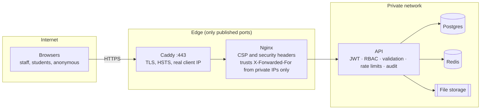

# Security model

ExamGrid holds student identities, exam timetables and seat plans. Its main risks are:
- one student reading another's data;
- an unauthorised or mistaken change to a plan that thousands of people will act on;
- abuse of the public seat finder on result day.

This document describes the controls in the code and maps them to the OWASP Top 10.

## Trust boundaries

Everything to the right of Nginx is reachable only from inside the Compose network. Postgres
and Redis publish no ports in the production Compose file.

## Authentication

- **Passwords** are hashed with Spring Security's delegating encoder (bcrypt by default) and
  must be 8–128 characters.
- **Login** gives the same `401 invalid_credentials` for an unknown user, a wrong password and
  a disabled account. Unknown users still pay for a hash comparison against a dummy hash, so
  response timing does not reveal which usernames exist. Every success and failure is audited.
- **Brute force** is limited to 10 login attempts per IP per minute, enforced in Redis with a
  fixed window.
- **Tokens** are HS256 JWTs. They carry the subject, user id, role, and roll number or faculty
  code, and are valid for 8 hours (`EXAMGRID_TOKEN_TTL`). The signature, issuer and expiry are
  verified on every request. The API refuses to start without a secret of at least 32
  characters, which comes only from the environment.
- **In the browser**, the token is kept in `sessionStorage` and sent only as an
  `Authorization` header. There are no cookies, so there is no CSRF surface. The UI signs out
  at expiry and on any `401`.

## Authorisation

| Role | Can reach |
|---|---|
| `EXAM_CELL` | All administrative endpoints and `/actuator/metrics` |
| `STUDENT` | `/api/students/me/**`: own exams and own hall ticket |
| `FACULTY` | `/api/faculty/me/**`: own invigilation duties |
| anonymous | `/api/auth/login`, `/api/public/**` (rate-limited, no names returned), health probes |

- Every administrative controller carries `@PreAuthorize("hasRole('EXAM_CELL')")`. Requests
  are denied by default (`anyRequest().authenticated()`).
- **IDOR is ruled out by construction.** Portal endpoints take no identifying parameter. The
  student or faculty identity is read from the signed token. An integration test
  (`portalsServeOnlyTheCallersOwnData`) checks it.
- **Two-person rule.** Publishing needs approvals from two different exam-cell members. The
  primary key on `approval (run_id, user_id)` makes a second approval by the same person
  impossible even under a race. The run row is locked while approvals are counted.
- **Lockout guards.** Administrators cannot disable or demote themselves, and the last active
  exam-cell account cannot be removed.

## Input validation and sanitisation

- **Request bodies** are records with Bean Validation (`@NotBlank`, `@Size`, `@Pattern`, …).
  Failures return `400 validation_failed` with a per-field list. Unknown or mistyped JSON
  returns `400 malformed_request`, naming the field.
- **Codes and roll numbers** are normalised and checked against an allow-list pattern
  (letters, digits, `.`, `_`, `-`, up to 32 characters). Codes cannot be renamed once created.
- **SQL injection.** All SQL uses bind parameters through JPA or `JdbcTemplate`. The few
  dynamically built SQL strings combine constants with typed numeric ids, never user-supplied
  text.
- **Output encoding.** React escapes all rendered text, and the strict CSP forbids inline
  scripts. PDFs are generated server-side from typed data, not from HTML templates.

## File uploads

| Risk | Control |
|---|---|
| Oversized uploads | 20 MB per file (`spring.servlet.multipart`), at most 200,000 rows and 50 columns |
| Format confusion | The format is detected from the content. Legacy OLE2 `.xls` files are refused with a clear message |
| Malicious workbooks | Apache POI reads `.xlsx` with its zip-bomb guard (minimum inflate ratio). Cells are read as values: formulas are never evaluated |
| Path traversal | Uploaded names are sanitised. Storage keys are generated by the server (`imports/<yyyy>/<mm>/<sha256-prefix>-<name>`) and resolved strictly inside the storage root |
| Tampering and repudiation | Every upload, including rejected dry runs, is archived with its SHA-256 and linked to its import batch and audit entry |

## Transport and browser hardening

- **TLS** is handled by Caddy with automatic certificates, plus HSTS
  (`max-age=31536000; includeSubDomains`). The `Server` header is removed.
- **SPA headers** (Nginx):
  - `Content-Security-Policy: default-src 'self'; script-src 'self'; object-src 'none'; frame-ancestors 'none'; …`
  - `X-Content-Type-Options: nosniff`
  - `X-Frame-Options: DENY`
  - `Referrer-Policy: no-referrer`
  - a restrictive `Permissions-Policy`
- **API headers** (Spring Security): `Content-Security-Policy: default-src 'none';
  frame-ancestors 'none'` and `Referrer-Policy: no-referrer`. Swagger UI has its own filter
  chain with a policy that allows its same-origin assets.
- **Single origin.** The browser talks to one origin, so no cross-origin access is needed.
  Allowed origins (`EXAMGRID_CORS_ORIGINS`) only matter for split-origin setups such as local
  development.
- **Client IPs.** Caddy replaces any client-supplied `X-Forwarded-For`. Nginx trusts that
  header only from private addresses and overwrites it upstream, so per-IP rate limits cannot
  be bypassed by spoofing the header.

## Secrets and configuration

- The JWT secret, database password and bootstrap admin password come only from environment
  variables. The production Compose file refuses to start if any is missing
  (`${VAR:?…}`), and `render.yaml` generates the JWT secret.
- Nothing secret is committed. `.env` files are git-ignored; only `.env.example` templates are
  tracked.
- Containers run as non-root users. The API image is a JRE on Alpine with no build tools.

## Logging, audit and error handling

- Each request gets an `X-Request-Id`. It is returned to the client, attached to every log
  line (MDC) and stored on audit entries, so a user-reported error can be traced end to end.
- The audit log is append-only and is written in the same transaction as the change it
  records. Failed logins are written in their own transaction, so they are kept even though
  the request fails.
- Errors are RFC 9457 problem documents. Stack traces are never included
  (`include-stacktrace: never`), and SQL and internal exception messages never reach clients.
- In the `prod` profile, logs are structured JSON (ECS), ready for aggregation.

## Availability

- Public and login endpoints are rate-limited per IP. The limiter fails open if Redis is down,
  favouring availability on result day.
- `RedisCircuit` routes around a Redis outage within one request, and seat lookups fall back
  to Postgres ([measured](benchmarks/load-test.md#losing-redis)).
- Solver work is bounded: a fixed worker pool, a cap on active runs (`429 too_many_runs`) and
  a cap of 20 million moves and 600 seconds per run.

## OWASP Top 10 (2021) mapping

| Risk | How ExamGrid addresses it |
|---|---|
| A01 Broken access control | Deny by default; role checks on every controller; portal identity from the token only (IDOR test); two-person publishing; self-lockout guards |
| A02 Cryptographic failures | TLS with HSTS; bcrypt password hashes; signed tokens with a 32+ character secret from the environment; no secrets in the repository |
| A03 Injection | Bind parameters everywhere; validated, allow-listed identifiers; React output encoding and a strict CSP |
| A04 Insecure design | Dry-run imports, all-or-nothing commits, stale-data guard on approval, immutable published plans, an independent plan validator |
| A05 Security misconfiguration | Hardened headers on both origins; actuator limited to health, info and metrics (metrics needs `EXAM_CELL`); no stack traces; non-root containers |
| A06 Vulnerable components | Pinned versions; Dependabot for Maven, npm, Docker base images and Actions; CI on every change |
| A07 Identification and authentication failures | Uniform login failures with timing equalisation; login rate limit; token expiry; minimum password length |
| A08 Software and data integrity failures | Uploaded files archived with SHA-256; plans tied to a data fingerprint; images built only by CI from the repository |
| A09 Security logging and monitoring failures | Append-only audit log with request ids; failed logins recorded; JSON logs; health and readiness probes |
| A10 Server-side request forgery | The API makes no outbound HTTP requests, so there is nothing to forge |

## Threats and controls

| Threat | Control | Where |
|---|---|---|
| Unauthenticated access | Stateless JWT (HS256) on every `/api/**` route except login, health and `/api/public/**` | `SecurityConfig` |
| Privilege escalation | Roles `EXAM_CELL`, `FACULTY`, `STUDENT`; `@PreAuthorize` on every controller | controllers |
| IDOR (one student reading another's data) | Student and faculty identity comes **only** from JWT claims; `/api/students/me/**` and `/api/faculty/me/**` take no identifying parameter | `PortalController`, `CurrentUser` |
| Rogue or mistaken publish | Two distinct exam-cell approvals; row lock against races; refusal when data changed since solving | `PublicationService` |
| Repudiation | Append-only audit log of logins, failed logins, imports, runs, approvals, publications and edits, each with request id | `AuditService` |
| Credential stuffing / brute force | Per-IP login rate limit in Redis; uniform failure response and constant-work password check | `RateLimitFilter`, `AuthService` |
| Scraping the seat finder | Per-IP rate limit; responses contain no names | `PublicController` |
| User enumeration | Same 401 body for unknown user, wrong password and disabled account | `AuthService` |
| Path traversal via uploads | Sanitised file names; storage keys validated and resolved strictly inside the root | `ImportService`, `LocalFileStorage` |
| Malicious spreadsheets | Size and row limits, legacy `.xls` refused, content-sniffed format | `TabularFileReader` |
| SQL injection | Parameterised queries everywhere; the few dynamic identifiers are constants | repositories, `SearchController` |
| Information leakage | RFC 9457 problems without stack traces or SQL; `server.error.include-stacktrace: never` | `ApiExceptionHandler` |
| XSS / clickjacking on API responses | `Content-Security-Policy: default-src 'none'; frame-ancestors 'none'`, `X-Frame-Options: DENY`, `nosniff`, `no-referrer` | `SecurityConfig` |
| Lockout of administrators | Cannot disable or demote yourself or the last exam-cell account | `UserService` |
| Secrets in code | JWT secret and passwords only from environment; the app refuses to start without a 32+ character secret | `SecurityProperties` |

## Known limitations

These are deliberate trade-offs for a single-institution deployment, listed so nobody has to
discover them:

- **No early token revocation.** Disabling an account blocks new logins, but an issued token
  stays valid until it expires (8 h by default). Shorten `EXAMGRID_TOKEN_TTL` if that matters.
- **No multi-factor authentication or SSO.** Integrating the institution's identity provider
  (OIDC) is the natural next step, and Spring Security's resource-server setup already
  accepts external JWTs.
- **Rate limiting fails open.** While Redis is down, public endpoints are unthrottled, a
  choice that favours result-day availability.
- **Files at rest are not encrypted by ExamGrid.** Rely on disk or volume encryption from the
  host or cloud provider.
