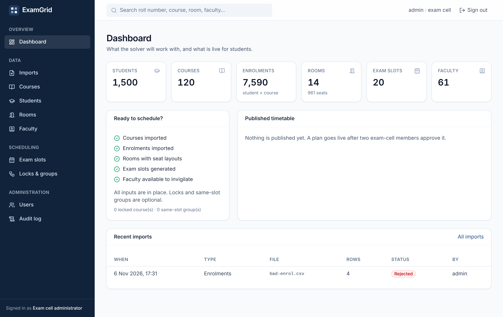
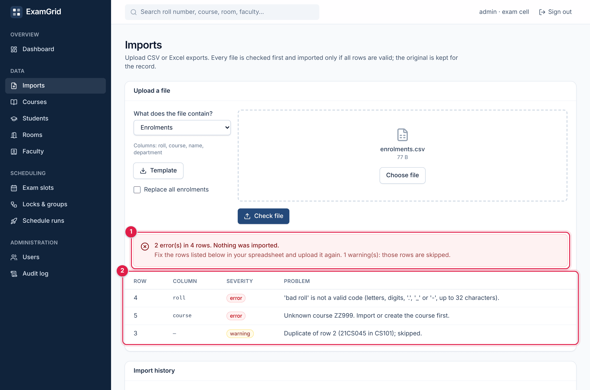
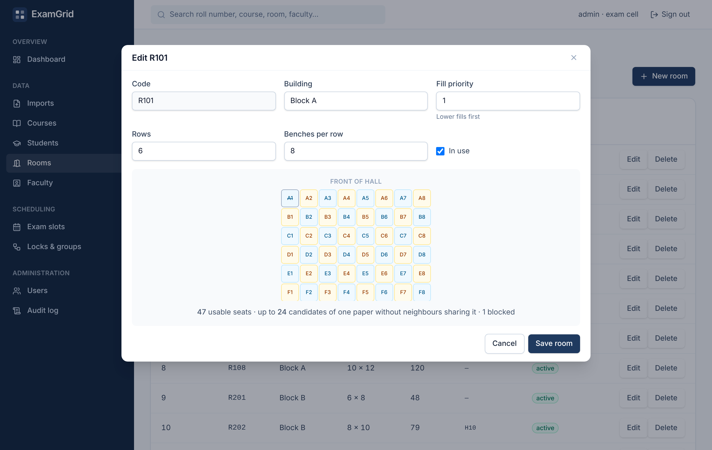

# ExamGrid frontend

React 19 + TypeScript single-page app for the exam cell, faculty and students.

| | |
|---|---|
| Build | Vite 7, TypeScript 5.9 (strict) |
| Data | TanStack Query 5 over a typed `fetch` client |
| Routing | React Router 7 with role guards |
| Styling | Tailwind CSS 4, lucide icons |
| Tests | Vitest 3 + Testing Library (jsdom) |

## Run

```bash
npm ci
npm run dev        # http://localhost:5173, proxies /api to the backend on :8080
npm test           # unit and component tests
npm run lint && npm run typecheck && npm run build
```

Start the backend first (`SPRING_PROFILES_ACTIVE=dev`), then sign in as `admin / admin12345`.
The dev profile also creates `examcell2`, a student and a faculty account (`demo12345`).

## Structure

```
src/
├── api/          typed client (problem-details aware), DTO types, endpoint modules
├── auth/         session provider, useAuth, role guard
├── components/   layout shell and UI primitives (Button, Card, Table, Modal, ErrorBanner…)
├── features/     one folder per screen: dashboard, imports, courses, students, rooms,
│                 faculty, slots, rules, runs (list, live detail, compare), users, audit,
│                 portal (student / faculty / public seat finder)
├── lib/          formatting, seat-label maths, query client, URL-state hook
└── test/         render helpers and fetch stubs
```

## Design choices

- **Errors are first-class.** The API returns RFC 9457 problems; `ApiError` keeps the
  `code`, field errors and request id, and `ErrorBanner` shows them, including the reference
  a user can quote to support.
- **Server state lives in TanStack Query**, never in component state; mutations invalidate
  the queries they affect (a committed import refreshes the dashboard counts).
- **Token in `sessionStorage`**, sent only as a bearer header: survives reloads, dies with the
  tab, no cookies and therefore no CSRF surface. A 401 anywhere signs the user out.
- **Role-aware routing.** `RequireRole` sends anonymous users to `/login` and users of another
  role to their own home; the backend enforces the same rules independently.
- **Imports are two-step.** "Check file" runs a dry run and renders the row-level report;
  only a clean report offers "Import N rows", and replace mode is styled as destructive and
  states how many enrolments it removes.
- **Live runs over SSE without EventSource.** `EventSource` cannot send an Authorization
  header, so `lib/sse.ts` parses the stream from `fetch`; `useRunEvents` reconnects with
  backoff (the server replays the latest event), stops at the terminal `status` event and then
  refreshes the run's queries.
- **Plan views are read straight from the stored run:** a day × session timetable grid with
  highlighting, per-slot seating charts tinted by paper, the invigilation roster, run
  comparison with the best value per metric highlighted, and the approval and "room lost"
  workflows.
- **Seat-grid editor** mirrors the solver's checkerboard maths (`lib/seats.ts`) to show live
  how many candidates of one paper a room can hold.

## Container

`Dockerfile` builds the bundle with Node and serves it from `nginx:1.27-alpine`; `nginx/` holds the
server config (SPA fallback, `/api` proxy with SSE-safe settings, CSP and cache headers). See
[ADR-0009](../docs/adr/0009-containers-and-single-origin.md).

## Screens

| Dashboard | Import report | Room editor |
|---|---|---|
|  |  |  |
